# Distributed Systems & AI System Design Patterns

**AI Engineering Playbook – Design Patterns**

## 1. Overview

When designing enterprise AI applications, we need more than LLMs, RAG, and agentic frameworks.

We also need distributed systems patterns to ensure:

- Reliable communication between microservices.
- Consistent data across multiple databases.
- Fault tolerance when downstream services fail.
- Reliable asynchronous processing.
- Prevention of duplicate requests and events.
- Recovery from partially completed workflows.
- Scalability and high availability.

This document covers important distributed systems patterns and their applications in enterprise AI platforms.

## 2. Transactional Outbox Pattern

### Problem Statement

Consider an AI document processing platform.

When a user uploads a financial document, the Document Service must:

1. Save document metadata in PostgreSQL.
2. Publish a `DocumentUploaded` event to Kafka.
3. Trigger an asynchronous document processing pipeline.

A common implementation is:

```text
Save document in PostgreSQL
Publish event to Kafka
```

But what happens if the database transaction succeeds and Kafka publishing fails?

The document is saved, but the downstream processing pipeline never receives the event.

This creates an inconsistent state.

### Solution: Transactional Outbox

The Outbox Pattern ensures that the business data and the event record are saved in the same database transaction.

Instead of directly publishing the event to Kafka:

1. Save document metadata.
2. Save the event in an outbox table.
3. Commit both records in one database transaction.
4. An outbox publisher reads pending events.
5. Publish events to Kafka.
6. Mark successfully published events as processed.

### Architecture

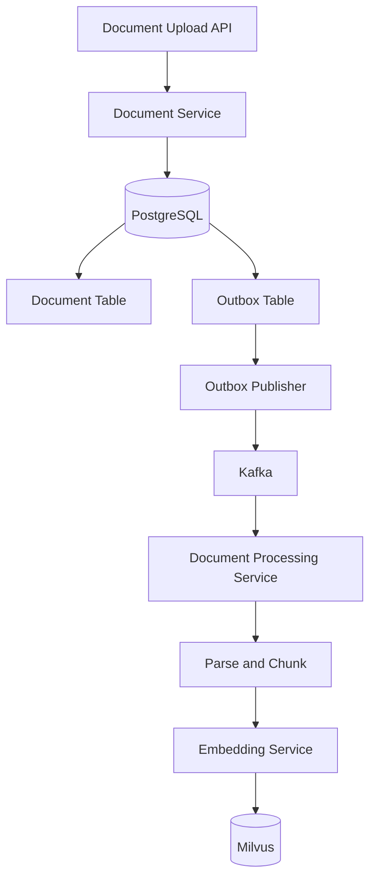

### Database Design

Documents table:

```sql
CREATE TABLE documents (
    document_id UUID PRIMARY KEY,
    file_name VARCHAR(255),
    status VARCHAR(50),
    created_at TIMESTAMP
);
```

Outbox table:

```sql
CREATE TABLE outbox_events (
    event_id UUID PRIMARY KEY,
    aggregate_id UUID,
    event_type VARCHAR(100),
    payload JSONB,
    status VARCHAR(30),
    created_at TIMESTAMP,
    published_at TIMESTAMP
);
```

### Example Transaction

```sql
BEGIN;

INSERT INTO documents (
    document_id,
    file_name,
    status,
    created_at
)
VALUES (
    '11111111-1111-1111-1111-111111111111',
    'annual-report.pdf',
    'UPLOADED',
    NOW()
);

INSERT INTO outbox_events (
    event_id,
    aggregate_id,
    event_type,
    payload,
    status,
    created_at
)
VALUES (
    gen_random_uuid(),
    '11111111-1111-1111-1111-111111111111',
    'DocumentUploaded',
    '{"fileName":"annual-report.pdf"}',
    'PENDING',
    NOW()
);

COMMIT;
```

### Important Considerations

- The outbox publisher can use polling or CDC (Change Data Capture).
- Debezium is a popular CDC option.
- Kafka publishing can happen more than once.
- Consumers must be idempotent.
- Use event IDs to identify duplicate events.
- Monitor pending event count and publishing delays.

### When to Use

- AI document ingestion pipelines.
- Order processing.
- Payment processing.
- Financial transaction workflows.
- Any microservice that must update a database and publish an event reliably.

**Interview Answer:**

"I use the transactional outbox pattern when a service needs to update its database and publish an event to Kafka. Both the business record and event record are saved in one database transaction. A separate publisher delivers the event asynchronously. This prevents the dual-write problem, where the database commits successfully but event publishing fails."

---

## 3. Saga Pattern

### Problem Statement

Consider an AI-powered banking loan processing workflow.

A loan application requires multiple services:

1. Customer verification.
2. KYC validation.
3. Document verification.
4. Credit assessment.
5. Risk assessment.
6. Loan decision workflow.

These services have independent databases and transactions.

A single distributed database transaction across all services is generally impractical.

What happens if the first four steps succeed but risk assessment fails?

We need a way to recover or compensate for completed steps.

### Solution: Saga Pattern

Saga is a distributed transaction pattern that breaks a long-running business process into smaller local transactions.

Each service performs its own transaction.

If a later step fails, the system executes compensating actions for earlier steps where appropriate.

### Example

| Step | Service | Action | Compensation |
|---|---|---|---|
| 1 | Customer Service | Verify customer | Mark verification as cancelled |
| 2 | KYC Service | Validate KYC | Revoke temporary validation state |
| 3 | Document Service | Verify documents | Mark verification as cancelled |
| 4 | Credit Service | Run credit assessment | Mark assessment as superseded |
| 5 | Risk Service | Run risk assessment | Re-evaluate or cancel pending assessment |
| 6 | Loan Workflow | Complete application | Mark application as failed or pending review |

Compensation does not necessarily mean deleting historical records. In financial systems, audit records should normally remain intact.

### Architecture

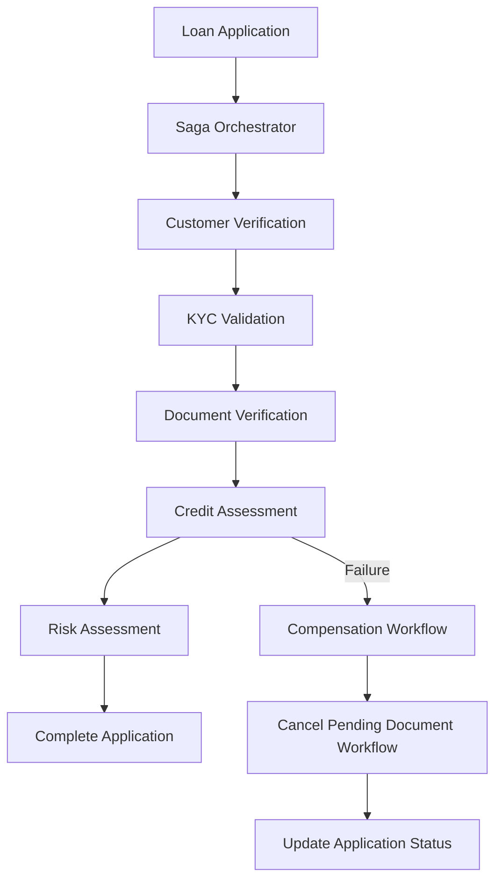

### Saga Implementation Approaches

**1. Choreography**

Each service publishes events, and other services subscribe to those events.

Example:

```text
LoanCreated
    ↓
CustomerVerified
    ↓
KYCCompleted
    ↓
DocumentsVerified
    ↓
CreditAssessmentCompleted
    ↓
RiskAssessmentCompleted
    ↓
LoanWorkflowCompleted
```

Advantages:
- Loosely coupled services.
- No central orchestrator.

Disadvantages:
- Difficult to understand complex workflows.
- Harder to track the entire transaction.
- Event dependencies can become difficult to manage.

**2. Orchestration**

A central orchestrator controls the workflow.

Example:

```text
Loan Saga Orchestrator
    ↓
Call Customer Service
    ↓
Call KYC Service
    ↓
Call Document Service
    ↓
Call Credit Service
    ↓
Call Risk Service
    ↓
Complete Workflow
```

Advantages:
- Centralized workflow management.
- Easier visibility and monitoring.
- Better control of retries and compensations.

Disadvantages:
- Orchestrator becomes an important dependency.
- Requires durable workflow state and recovery.

### When to Use

- Banking loan processing.
- Payment workflows.
- Customer onboarding.
- Multi-step AI agent workflows.
- Document approval workflows.
- Investment research approval workflows.

**Interview Answer:**

"I use the Saga pattern when a business transaction spans multiple independent microservices. Each service executes a local transaction, and if a later step fails, the workflow executes compensating actions. For a banking loan workflow, customer verification, KYC, document validation, and credit assessment can each be independent steps managed by a saga orchestrator."

---

## 4. Idempotency Pattern

### Problem Statement

Suppose a user asks an AI assistant to generate an investment research report.

The API request reaches the server, but the client times out before receiving the response.

The client retries the request.

Without protection, the system might:
- Create two research jobs.
- Generate duplicate reports.
- Trigger duplicate downstream events.
- Charge twice for an external operation.

### Solution

Use an idempotency key.

The client sends a unique key with each logical request.

Example:

```http
POST /api/v1/research/reports
Idempotency-Key: research-12345
```

The backend checks whether this key has already been processed.

If yes, return the previous result or current job status instead of creating another job.

### Database Model

```sql
CREATE TABLE idempotency_records (
    idempotency_key VARCHAR(255) PRIMARY KEY,
    request_hash VARCHAR(255),
    response_payload JSONB,
    status VARCHAR(50),
    created_at TIMESTAMP
);
```

### Flow

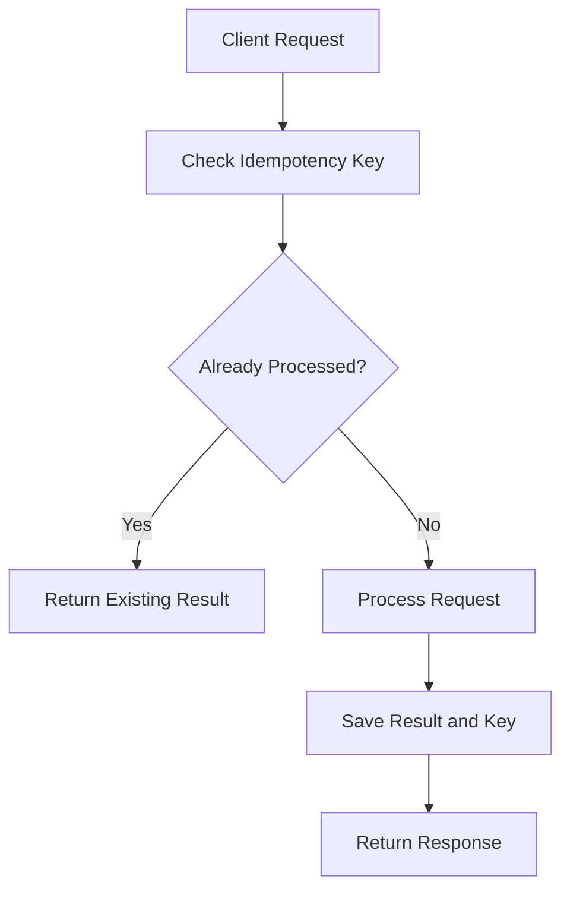

### When to Use

- Payment APIs.
- AI report generation.
- Document ingestion.
- Kafka consumers.
- Agent tool execution.
- External financial system integrations.

**Interview Answer:**

"Idempotency ensures that processing the same logical request multiple times does not create duplicate business effects. I use a unique idempotency key and persist the processing state so retries can return the existing result rather than repeating the operation."

---

## 5. Retry Pattern with Exponential Backoff

### Problem Statement

An AI service calls an external market data API.

The external service temporarily returns HTTP 503.

Immediately retrying multiple times can overload the external system.

### Solution

Retry transient failures with exponential backoff and jitter.

Example retry schedule:

| Attempt | Approximate Delay |
|---|---:|
| 1 | 1 second |
| 2 | 2 seconds |
| 3 | 4 seconds |
| 4 | 8 seconds |

Jitter adds randomness to prevent many clients retrying at exactly the same time.

### Example Python

```python
import random
import time

def call_market_api():
    max_retries = 4

    for attempt in range(max_retries):
        try:
            return fetch_market_data()

        except TemporaryServiceError:
            if attempt == max_retries - 1:
                raise

            delay = min(2 ** attempt, 30)
            delay += random.uniform(0, 1)

            time.sleep(delay)
```

In production, use bounded retries, request timeouts, and appropriate exception classification. Do not blindly retry non-retryable errors.

### When to Use

- LLM API calls.
- Embedding APIs.
- Market data providers.
- Kafka consumers.
- Temporary network failures.

---

## 6. Circuit Breaker Pattern

### Problem Statement

An AI application depends on an external LLM provider.

The provider becomes unavailable or extremely slow.

If every request continues calling the provider, application threads become exhausted and failures spread to other services.

### Solution

Circuit Breaker temporarily stops calls to an unhealthy dependency.

### Three States

**Closed**
- Requests are allowed.
- Failures are monitored.

**Open**
- Requests are rejected or routed to a fallback.
- The unhealthy dependency is not called.

**Half-Open**
- A limited number of test requests are allowed.
- If successful, circuit returns to Closed.
- If unsuccessful, it returns to Open.

### Diagram

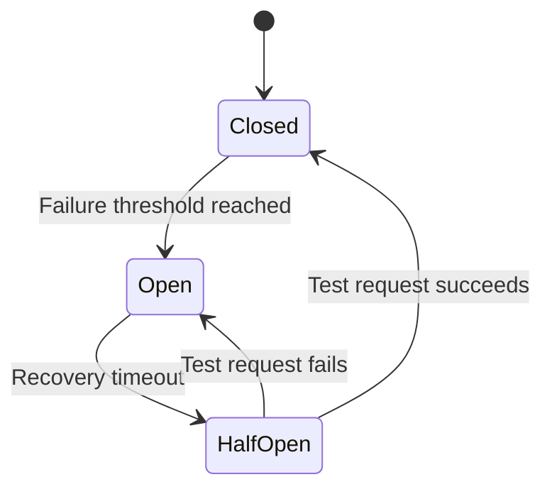

### When to Use

- LLM providers.
- External market data services.
- Third-party financial APIs.
- Vector databases.
- Downstream microservices.

**Interview Answer:**

"I use circuit breakers to prevent cascading failures. If an external service starts failing, the circuit opens and temporarily blocks requests. After a recovery period, the circuit moves to half-open and allows limited test requests."

---

## 7. Dead Letter Queue (DLQ) Pattern

### Problem Statement

Kafka receives a document ingestion event.

The consumer attempts to process the document, but the PDF is corrupted.

Repeated retries fail.

If the message remains in the normal processing path indefinitely, it can block progress or repeatedly consume resources.

### Solution

Move messages that exceed the retry policy to a Dead Letter Queue.

### Flow

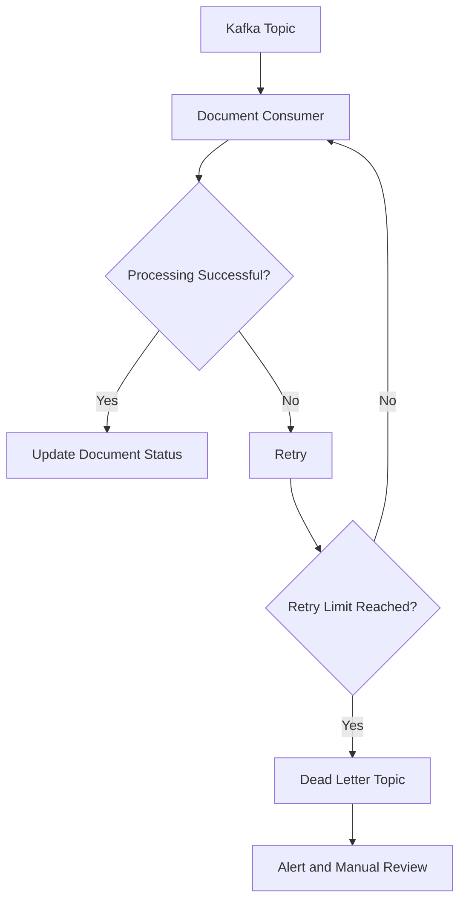

### When to Use

- Document parsing.
- Embedding generation.
- AI batch processing.
- Failed agent tool calls.
- Financial data ingestion.

Important: DLQ messages should retain the original event ID, failure reason, retry count, and relevant correlation metadata. Reprocessing should be controlled and idempotent.

---

## 8. CQRS Pattern

CQRS stands for Command Query Responsibility Segregation.

### Problem Statement

A banking AI application has two different workloads:

1. Updating customer onboarding and document workflow states.
2. Reading dashboards and generating reports.

Using the same data model and database workload for both can create performance bottlenecks.

### Solution

Separate write operations (commands) from read operations (queries).

**Command side:**
- Create document.
- Update document status.
- Approve workflow.
- Start research job.

**Query side:**
- Get document status.
- Search research reports.
- View portfolio dashboard.
- Retrieve workflow history.

### Architecture

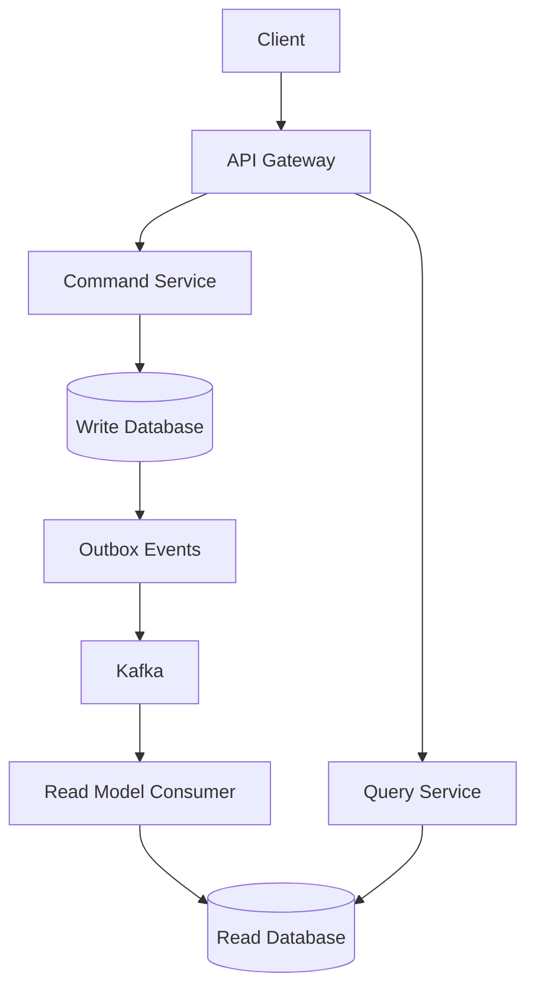

### When to Use

- High-volume enterprise platforms.
- Portfolio dashboards.
- Audit and reporting systems.
- AI research platforms.
- Applications with different read/write scaling needs.

Important: CQRS often introduces eventual consistency between write and read models. The application must account for that delay.

---

## 9. Event-Driven Architecture

### Problem Statement

A document service needs to notify multiple downstream services when a financial document is uploaded.

Direct synchronous calls create tight coupling.

### Solution

Use event-driven architecture with Kafka.

The document service publishes an event, and independent consumers process it.

### Example

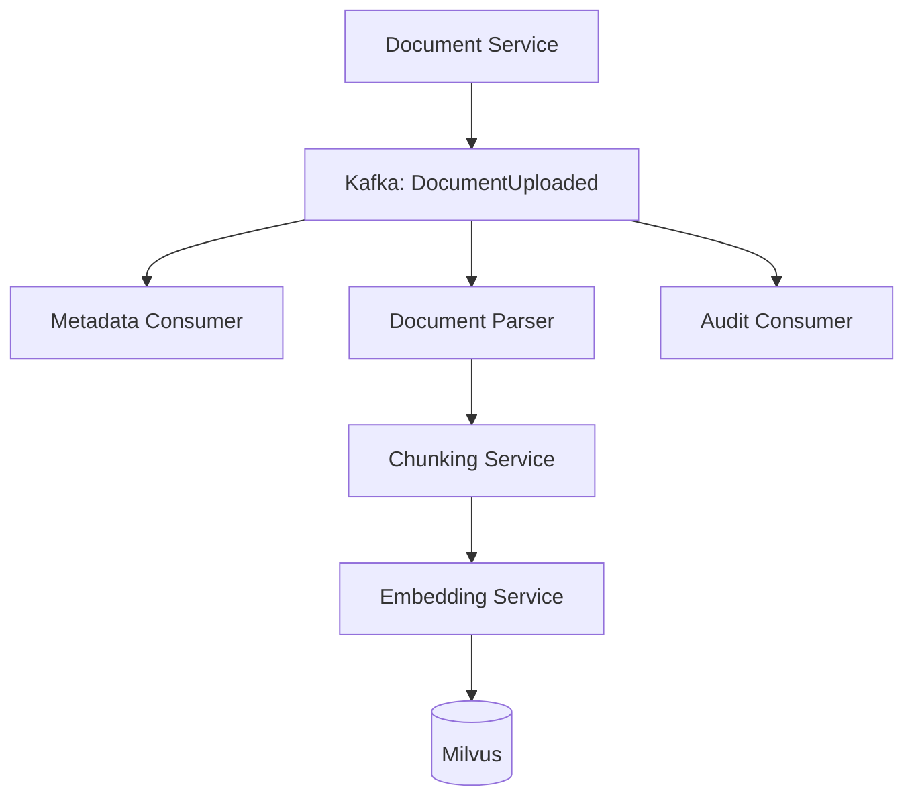

### Benefits

- Loose coupling.
- Independent scaling.
- Asynchronous processing.
- Better resilience.
- Easier integration with new services.

### When to Use

- AI document ingestion.
- Financial transaction events.
- Portfolio updates.
- Notification workflows.
- Data pipeline processing.

---

## 10. Bulkhead Pattern

### Problem Statement

An enterprise AI platform supports three capabilities:

- Document search.
- Portfolio analytics.
- Report generation.

If report generation consumes all available threads, document search and portfolio analytics may also become unavailable.

### Solution

Separate resource pools for independent workloads.

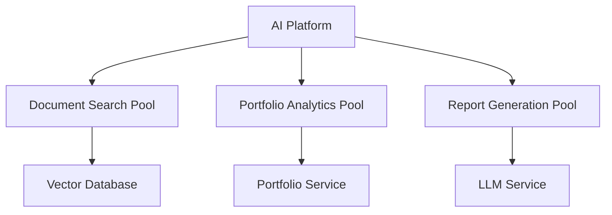

Each workload has independent:
- Thread pools.
- Connection pools.
- Concurrency limits.
- Timeouts.

### When to Use

- Multiple AI workloads.
- Expensive LLM calls.
- Document ingestion and query processing.
- High-volume microservices.

---

## 11. Cache-Aside Pattern

### Problem Statement

Users repeatedly ask for the same company profile or financial document metadata.

Repeated database calls increase latency and database load.

### Solution

Use Redis with the cache-aside pattern.

1. Application checks Redis.
2. If data exists, return cached data.
3. If not, query the database.
4. Store the result in Redis.
5. Return the result.

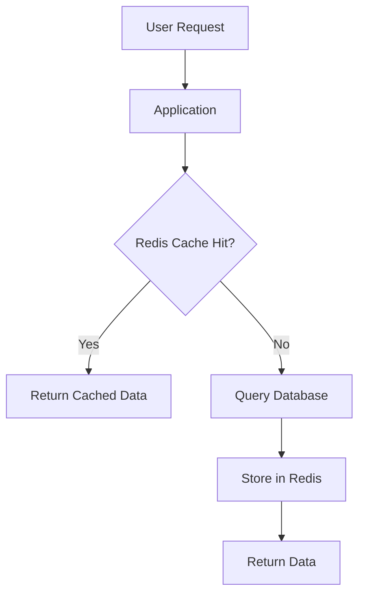

### When to Use

- Company profiles.
- Document metadata.
- User permissions, with careful invalidation.
- Frequently accessed reference data.
- Stable financial research summaries.

Do not blindly cache rapidly changing market prices or permission-sensitive information. Define freshness and invalidation rules.

---

## 12. Rate Limiting Pattern

### Problem Statement

An AI platform has limited LLM capacity.

A single user or client sends thousands of requests, affecting other users and increasing costs.

### Solution

Implement rate limiting at the API Gateway.

Common algorithms:

1. Fixed Window Counter.
2. Sliding Window Log.
3. Sliding Window Counter.
4. Token Bucket.
5. Leaky Bucket.

### Token Bucket Example

- Bucket capacity: 100 tokens.
- Each API request consumes one token.
- Tokens refill at a configured rate.
- Requests are rejected or delayed when no tokens remain.

### When to Use

- LLM APIs.
- Embedding APIs.
- Public APIs.
- Expensive agent workflows.
- Tenant-level usage controls.

---

## 13. Distributed Lock Pattern

### Problem Statement

Two workers process the same scheduled financial document at the same time.

This can create duplicate reports or conflicting updates.

### Solution

Use a distributed lock to coordinate access to a shared resource.

Example:

```text
Acquire lock: document-123
    ↓
Process document
    ↓
Update processing status
    ↓
Release lock
```

Redis can provide distributed lock primitives.

Important considerations:
- Use lock expiration.
- Use unique lock ownership tokens.
- Renew leases when needed.
- Protect writes with fencing tokens or database-level concurrency controls where correctness requires it.

A distributed lock alone is not a replacement for idempotency.

### When to Use

- Scheduled document ingestion.
- Batch report generation.
- Duplicate job prevention.
- Coordinating distributed workers.

---

## 14. Strangler Fig Pattern

### Problem Statement

A financial institution has a legacy application that handles document processing.

Replacing the entire application at once is risky.

### Solution

Gradually migrate functionality to new microservices while the old system continues running.

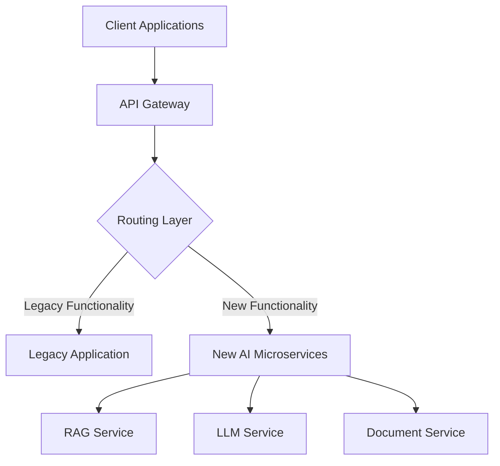

Over time, more functionality moves to the new platform until the legacy application can be retired.

### When to Use

- Legacy modernization.
- Introducing AI into existing banking systems.
- Migrating monoliths to microservices.
- Replacing legacy document search.

---

## 15. Workflow Orchestration Pattern

### Problem Statement

An enterprise AI agent needs to perform a multi-step process:

1. Understand a question.
2. Retrieve financial documents.
3. Call market data APIs.
4. Analyze results.
5. Generate a response.
6. Validate citations.
7. Request human approval if necessary.

A simple sequence of LLM calls is difficult to manage reliably.

### Solution

Use a durable workflow orchestrator such as LangGraph or a dedicated workflow engine.

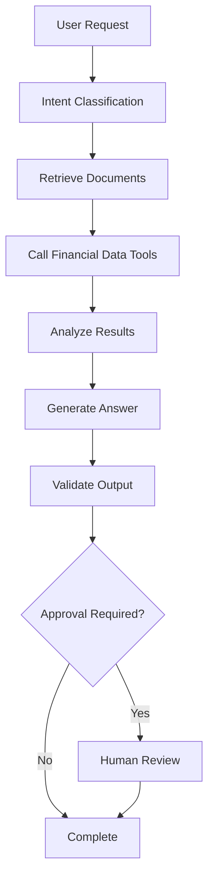

Persist workflow state so that the process can resume after failures.

For example:

```json
{
  "workflow_id": "workflow-123",
  "status": "IN_PROGRESS",
  "current_step": "FINANCIAL_ANALYSIS",
  "completed_steps": [
    "INTENT_CLASSIFICATION",
    "DOCUMENT_RETRIEVAL"
  ],
  "retry_count": 1
}
```

### When to Use

- Multi-step AI agents.
- Banking onboarding.
- Investment research.
- Compliance review.
- Document approval workflows.

---

## 16. How These Patterns Work Together

A real enterprise AI document processing platform may combine multiple patterns.

### Example: Banking Document Intelligence Platform

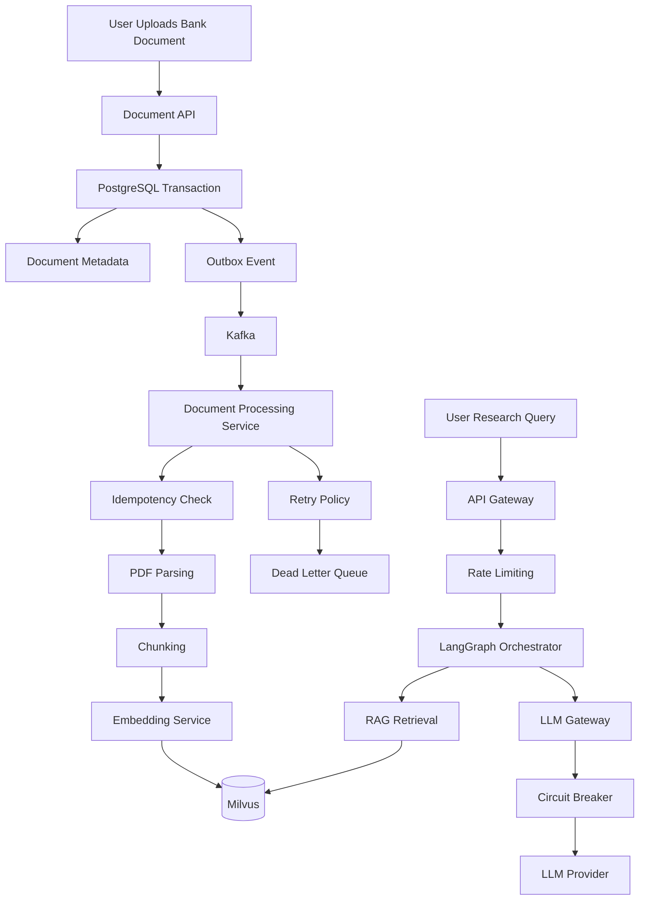

### Pattern Selection

| Problem | Design Pattern |
|---|---|
| Database update and event publishing consistency | Transactional Outbox |
| Multi-service business transaction | Saga |
| Duplicate API requests | Idempotency |
| Temporary service failures | Retry with Backoff |
| Downstream service unavailable | Circuit Breaker |
| Permanently failing messages | Dead Letter Queue |
| Independent read/write workloads | CQRS |
| Asynchronous service communication | Event-Driven Architecture |
| Resource isolation | Bulkhead |
| Repeated data access | Cache-Aside |
| Excessive API requests | Rate Limiting |
| Concurrent job execution | Distributed Lock |
| Legacy modernization | Strangler Fig |
| Multi-step AI workflows | Workflow Orchestration |

## 17. Important Interview Questions and Answers

**Q1. What is the difference between Outbox and Saga?**

Outbox solves reliable event publishing when a database update and event publication must happen together. Saga manages a distributed business transaction across multiple services using local transactions and compensating actions.

**Q2. Can we use Outbox and Saga together?**

Yes. Each participating service can use the Outbox Pattern to reliably publish saga events. The Saga orchestrator coordinates the overall workflow.

**Q3. Why do we need idempotency if Kafka provides message delivery guarantees?**

Kafka delivery guarantees do not automatically make external database writes or API calls exactly once. Consumers should use event IDs and idempotent processing to prevent duplicate business effects.

**Q4. What is the difference between Retry and Circuit Breaker?**

Retry attempts the failed operation again. Circuit Breaker temporarily stops calls to an unhealthy dependency to prevent cascading failures.

**Q5. What is the difference between Saga and a traditional database transaction?**

A traditional ACID transaction provides atomicity within its transactional boundary. Saga coordinates multiple independent local transactions and uses compensating actions when a later step fails.

**Q6. Why use Kafka instead of synchronous REST calls?**

Kafka supports asynchronous communication, buffering, independent consumers, replay, and decoupling. REST is still useful for synchronous request-response interactions.

**Q7. What happens if an Outbox event is published but the publisher crashes before marking it as published?**

The publisher may publish the same event again after restarting. Consumers must deduplicate using the event ID and process the business operation idempotently.

**Q8. When would you use LangGraph versus Saga?**

LangGraph manages AI workflow state, conditional agent execution, and tool calls. Saga manages distributed business transactions and compensations. They can work together: LangGraph may coordinate an AI workflow while a Saga manages the underlying business transaction.

**Q9. How do you ensure reliability in an AI document ingestion pipeline?**

I would combine the transactional outbox pattern, Kafka, idempotent consumers, bounded retries, DLQs, workflow state persistence, and monitoring. This ensures events are not silently lost and failed documents can be recovered.

**Q10. How do you prevent cascading failures when an LLM provider is unavailable?**

I would use request timeouts, circuit breakers, bounded retries, bulkheads, concurrency limits, and an approved fallback model where appropriate. If no provider is available, I would return a controlled error rather than pretending the AI operation succeeded.

## 18. Principal Architect Interview Answer

"When designing enterprise AI applications, I focus on both the AI architecture and distributed systems reliability.

For example, in a document intelligence platform, I would use the transactional outbox pattern to ensure document metadata and ingestion events are committed consistently. Kafka would distribute those events to parsing and embedding services, and idempotent consumers would prevent duplicate processing.

For multi-step workflows such as banking onboarding or compliance review, I would use the Saga pattern to coordinate independent services and manage compensating actions when a step fails.

I would also implement circuit breakers, retries with exponential backoff, dead-letter queues, rate limiting, and observability to handle failures gracefully.

For AI workflows, I would use LangGraph for stateful agent orchestration, while keeping business transactions and financial calculations in deterministic backend services.

The overall goal is to build an AI platform that is scalable, reliable, secure, observable, and recoverable."

## 19. Recommended Study Order

1. Transactional Outbox Pattern
2. Saga Pattern
3. Idempotency
4. Retry and Exponential Backoff
5. Circuit Breaker
6. Dead Letter Queue
7. Event-Driven Architecture
8. CQRS
9. Bulkhead
10. Cache-Aside
11. Rate Limiting
12. Distributed Lock
13. Strangler Fig
14. Workflow Orchestration

