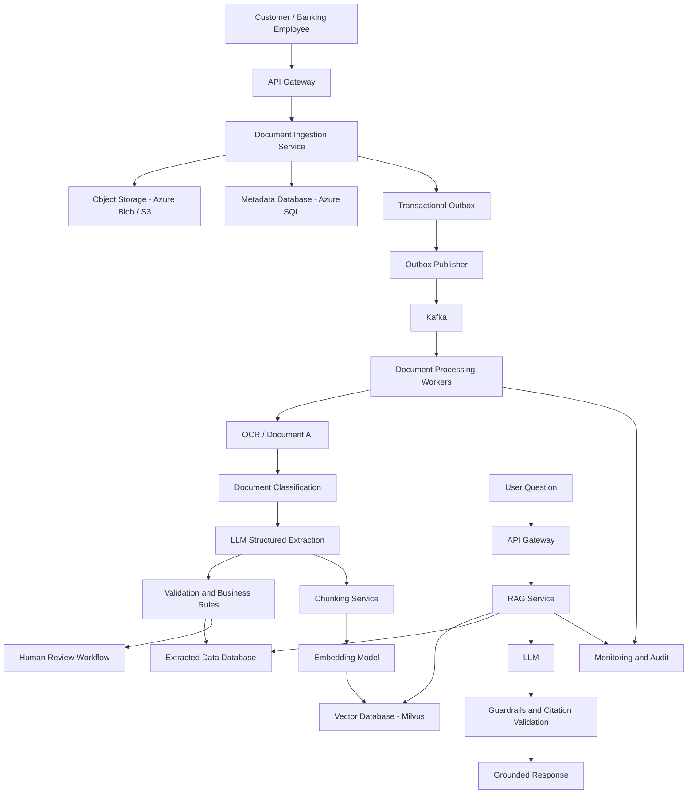
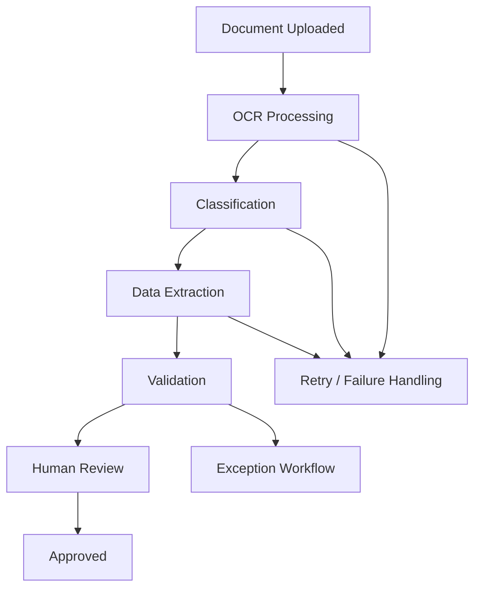

# Day 06 – Banking Document Intelligence Platform
## Enterprise AI System Design

## 1. Problem Statement

Banks process thousands or millions of documents every day across lending, mortgage processing, KYC, AML, compliance, legal, investment banking, and risk management.

Most document-driven processes involve manual document review, data extraction, validation, and approval.

This creates several challenges:

- High operational costs.
- Slow document processing.
- Manual errors during data extraction.
- Difficulty searching large document repositories.
- Inconsistent compliance reviews.
- Limited visibility into document processing status.

### Objective

Design a scalable, secure, and reliable AI-powered Document Intelligence Platform that can:

1. Ingest documents from multiple banking systems.
2. Extract text and structured information.
3. Classify documents automatically.
4. Validate extracted information against business rules.
5. Identify missing information and inconsistencies.
6. Support semantic search and conversational Q&A using RAG.
7. Provide human-in-the-loop approval.
8. Maintain document versioning and a complete audit trail.

---

## 2. Practical Banking Use Cases

| Use Case | Documents | AI Capabilities |
|---|---|---|
| Loan Processing | Loan applications, bank statements, pay slips | Extract income, liabilities, balances |
| Mortgage Processing | Property documents, tax returns, employment letters | Validate customer financial information |
| KYC / AML | Passports, proof of address, ownership documents | Extract identity and ownership information |
| Financial Analysis | Balance sheets, income statements, cash flow statements | Extract revenue, EBITDA, assets, liabilities |
| Contract Intelligence | Credit agreements, loan contracts | Extract covenants, rates, maturity dates |
| Compliance Intelligence | Policies, regulations, internal procedures | Identify policy inconsistencies |
| Investment Banking | Annual reports, SEC filings, pitch books | Summarize companies and support due diligence |
| Hedge Fund Research | Earnings transcripts, analyst reports, financial filings | Retrieve investment research insights |

---

## 3. Functional Requirements

### FR1 – Document Ingestion
- Accept PDF, DOCX, XLSX, and scanned documents.
- Support document uploads through REST APIs.
- Support bulk document ingestion.
- Store original documents in object storage.
- Generate a unique document ID.
- Maintain document metadata.

### FR2 – Document Classification
- Identify document types automatically.
- Classify documents as bank statements, tax returns, loan agreements, passports, financial statements, etc.
- Support manual correction when classification confidence is low.

### FR3 – Information Extraction
- Extract structured information from documents.
- Support fields such as customer name, income, account number, revenue, EBITDA, interest rate, and maturity date.
- Store extracted information in a relational database.
- Maintain source page references and extraction confidence.

### FR4 – Document Validation
- Validate extracted information against business rules.
- Identify missing fields.
- Compare information across multiple documents.
- Identify conflicting information.
- Flag exceptions for human review.

### FR5 – Semantic Search and RAG
- Generate embeddings from document chunks.
- Store embeddings in a vector database.
- Support semantic and hybrid search.
- Retrieve relevant document sections.
- Generate grounded responses using an LLM.
- Provide citations and page references.

### FR6 – Human-in-the-Loop
- Route exceptions to authorized reviewers.
- Allow reviewers to approve, reject, or correct extracted data.
- Maintain reviewer comments and approval history.
- Require human approval for high-impact decisions.

### FR7 – Document Version Management
- Maintain document versions.
- Detect updated documents.
- Identify changed pages or sections.
- Reprocess only changed content when feasible.
- Preserve historical versions for auditing.

### FR8 – Audit and Reporting
- Maintain document processing history.
- Track extraction results and validation outcomes.
- Track user access and approvals.
- Provide operational dashboards.

---

## 4. Non-Functional Requirements

| Category | Requirement |
|---|---|
| Scalability | Support increasing document volumes through horizontal scaling |
| Availability | Design for high availability and graceful degradation |
| Performance | Process documents asynchronously; optimize interactive search latency |
| Reliability | Retry transient failures and prevent duplicate processing |
| Security | Encryption at rest and in transit |
| Authorization | RBAC and document-level access control |
| Compliance | Audit trails, data retention, and regulatory controls |
| Observability | Metrics, logs, traces, and AI quality monitoring |
| Maintainability | Independently deployable services |
| Disaster Recovery | Backup, replication, and tested recovery procedures |

Example targets should be agreed with business stakeholders. They are not universal banking requirements.

---

## 5. High-Level Architecture



### Main Components

| Component | Technology | Responsibility |
|---|---|---|
| API Gateway | Azure APIM / Kong | Authentication, authorization, rate limiting |
| Ingestion Service | Java Spring Boot | Document upload and metadata management |
| Object Storage | Azure Blob / AWS S3 | Store original documents |
| Metadata Database | Azure SQL | Store document metadata and processing state |
| Event Streaming | Kafka / Azure Service Bus | Asynchronous processing |
| OCR | Azure Document Intelligence / AWS Textract | Extract text from scanned documents |
| Document Classification | ML / Document AI | Identify document type |
| Extraction Service | Python / FastAPI / LLM | Extract structured information |
| Validation Service | Java / Python | Apply business rules |
| Embedding Model | Text Embedding Model | Generate vector representations |
| Vector Database | Milvus | Semantic search |
| RAG Service | Python / LangChain / LangGraph | Retrieval and answer generation |
| Workflow Engine | Temporal / Camunda | Manage processing and approvals |
| Monitoring | Prometheus / Grafana | Application and AI monitoring |

---

## 6. End-to-End Document Processing Flow

### Step 1 – Document Upload

A customer uploads a bank statement through the banking application.

The application calls:

```http
POST /api/v1/documents
Content-Type: multipart/form-data
Authorization: Bearer <token>
```

The ingestion service:

1. Validates the user's authorization.
2. Validates the file type and size.
3. Generates a unique document ID.
4. Uploads the original file to object storage.
5. Saves document metadata in Azure SQL.
6. Creates an outbox event in the same database transaction.

Example metadata:

```json
{
  "document_id": "DOC-1001",
  "customer_id": "CUST-10025",
  "document_type": "BANK_STATEMENT",
  "document_version": 1,
  "storage_uri": "documents/DOC-1001/original.pdf",
  "status": "UPLOADED"
}
```

### Step 2 – Event Publishing

The outbox publisher reads pending events and publishes them to Kafka.

Example event:

```json
{
  "event_id": "EVT-1001",
  "event_type": "DOCUMENT_UPLOADED",
  "document_id": "DOC-1001",
  "document_version": 1
}
```

Kafka distributes the event to document processing workers.

### Step 3 – OCR and Document Classification

The processing worker retrieves the original document from object storage.

OCR extracts text from the PDF or scanned image.

The classification model identifies whether the document is:

- Bank statement.
- Tax return.
- Pay slip.
- Loan agreement.
- Identity document.
- Financial statement.

### Step 4 – Structured Data Extraction

An extraction service identifies relevant fields.

Example:

```json
{
  "document_id": "DOC-1001",
  "document_type": "BANK_STATEMENT",
  "extracted_fields": {
    "account_holder": "John Smith",
    "average_monthly_income": 8500,
    "average_monthly_expenses": 4200,
    "ending_balance": 12000
  },
  "source_pages": [1, 2, 3],
  "confidence": 0.96
}
```

These values are illustrative.

Important: Extraction confidence is not proof that the extracted value is correct. Critical fields should be validated against source documents and business rules.

### Step 5 – Business Validation

The validation service checks:

- Required fields are present.
- Income information is consistent across documents.
- Dates are valid.
- Account information is consistent.
- Financial calculations follow approved business rules.

Example:

Pay slip monthly income = $8,500.

Bank statement recurring deposits = $6,000.

The system identifies a discrepancy and routes it to a human reviewer.

The AI should flag the discrepancy, not automatically conclude fraud.

### Step 6 – Chunking and Embedding Generation

For semantic search, extracted document content is divided into meaningful chunks.

Example:

```text
Document: Annual Report
Page: 25

Revenue increased by 12% compared with the previous
financial year. Operating expenses increased by 5%.
```

The embedding model converts the chunk into a numerical vector.

The vector and associated metadata are stored in Milvus.

Example metadata:

```json
{
  "chunk_id": "DOC-1001-V1-P25-C1",
  "document_id": "DOC-1001",
  "document_version": 1,
  "page_number": 25,
  "document_type": "ANNUAL_REPORT",
  "tenant_id": "BANK-A"
}
```

### Step 7 – RAG and Conversational Search

An authorized banking employee asks:

"What was the revenue growth in the latest annual report?"

The RAG service:

1. Validates the user's identity and access permissions.
2. Converts the question into an embedding.
3. Searches Milvus for relevant chunks.
4. Applies metadata and authorization filters.
5. Retrieves relevant content.
6. Passes the context to the LLM.
7. Generates a grounded response.
8. Returns source citations and page references.

Example response:

"Revenue increased by 12% compared with the previous financial year."

Source: Annual Report, Page 25.

The response must be supported by retrieved source content.

---

## 7. Document Versioning and Incremental Updates

### Problem

A 100-page credit agreement is uploaded.

Later, only pages 20 and 21 are updated.

Reprocessing the entire document unnecessarily increases processing time and cost.

### Solution

Implement document versioning and page-level change detection.

Processing steps:

1. Assign a document ID and version number.
2. Store the new document version.
3. Calculate page-level hashes.
4. Compare the new page hashes with the previous version.
5. Identify changed pages.
6. Deactivate or delete obsolete chunks for changed pages.
7. Reprocess only changed pages.
8. Generate new embeddings.
9. Store updated chunks and metadata.
10. Activate the new document version after successful processing.
11. Preserve previous versions for audit and historical access.

Example:

| Page | Previous Hash | New Hash | Action |
|---|---|---|---|
| 1 | ABC123 | ABC123 | No change |
| 2 | DEF456 | DEF456 | No change |
| 20 | GHI789 | XYZ789 | Reprocess |
| 21 | JKL123 | LMN456 | Reprocess |
| 22 | PQR456 | PQR456 | No change |

Important considerations:

- A changed page may affect neighboring chunks or section-level context.
- If a table spans multiple pages, reprocess the complete logical table.
- If document layout changes significantly, page-level comparison may not be sufficient.
- Do not expose a partially processed version as the active version.
- Keep historical versions available according to retention policies.

---

## 8. Database Design

### Documents Table

```sql
CREATE TABLE Documents (
    document_id VARCHAR(100) PRIMARY KEY,
    customer_id VARCHAR(100),
    tenant_id VARCHAR(100),
    document_type VARCHAR(100),
    document_version INT,
    storage_uri VARCHAR(500),
    document_status VARCHAR(50),
    created_at TIMESTAMP,
    updated_at TIMESTAMP
);
```

### Extracted_Data Table

```sql
CREATE TABLE Extracted_Data (
    extraction_id VARCHAR(100) PRIMARY KEY,
    document_id VARCHAR(100),
    field_name VARCHAR(100),
    field_value TEXT,
    confidence_score DECIMAL(5,4),
    source_page INT,
    validation_status VARCHAR(50),
    created_at TIMESTAMP
);
```

### Document_Chunks Table

```sql
CREATE TABLE Document_Chunks (
    chunk_id VARCHAR(100) PRIMARY KEY,
    document_id VARCHAR(100),
    document_version INT,
    page_number INT,
    chunk_text TEXT,
    vector_id VARCHAR(100),
    chunk_status VARCHAR(50),
    created_at TIMESTAMP
);
```

### Document_Review Table

```sql
CREATE TABLE Document_Review (
    review_id VARCHAR(100) PRIMARY KEY,
    document_id VARCHAR(100),
    reviewer_id VARCHAR(100),
    review_status VARCHAR(50),
    comments TEXT,
    reviewed_at TIMESTAMP
);
```

Production implementation should additionally define foreign keys, indexes, tenant isolation, retention policies, and database-specific timestamp types.

### Vector Database – Milvus

Store:

- Chunk ID.
- Document ID.
- Document version.
- Page number.
- Embedding vector.
- Document type.
- Tenant ID.
- Access-control metadata.
- Active version status.

Use vector search with metadata filtering to retrieve only authorized and relevant content.

---

## 9. API Design

### Upload Document

```http
POST /api/v1/documents
```

### Get Document Status

```http
GET /api/v1/documents/{documentId}/status
```

### Get Extracted Information

```http
GET /api/v1/documents/{documentId}/extractions
```

### Search Documents

```http
POST /api/v1/documents/search
```

Request:

```json
{
  "query": "Find the latest credit agreement",
  "document_type": "CREDIT_AGREEMENT"
}
```

### Ask a Document Question

```http
POST /api/v1/assistant/query
```

Request:

```json
{
  "question": "What is the maturity date of this loan?",
  "document_id": "DOC-1001"
}
```

### Approve Document

```http
POST /api/v1/documents/{documentId}/approve
```

All endpoints must enforce authentication and document-level authorization.

---

## 10. Design Patterns

| Pattern | Application |
|---|---|
| Transactional Outbox | Reliably publish document-upload events |
| Event-Driven Architecture | Process documents asynchronously |
| Idempotency | Prevent duplicate document processing |
| Saga / Workflow Orchestration | Manage multi-step document workflows |
| Retry with Exponential Backoff | Recover from temporary service failures |
| Circuit Breaker | Protect against unavailable OCR or LLM services |
| Dead Letter Queue | Isolate repeatedly failed documents |
| CQRS | Separate document processing commands from search/read operations |
| Bulkhead | Prevent one processing workload from exhausting all resources |
| Human-in-the-Loop | Handle exceptions and sensitive approvals |
| Cache-Aside | Cache frequently requested document summaries where appropriate |

### Transactional Outbox Example

Problem:

The document metadata is saved successfully, but publishing the Kafka event fails.

The document is uploaded, but processing never starts.

Solution:

Save document metadata and the outbox event in the same database transaction.

```text
BEGIN TRANSACTION

INSERT INTO Documents (...);

INSERT INTO Outbox_Events (...);

COMMIT;
```

A separate publisher reads the outbox table and publishes events to Kafka.

Consumers must still be idempotent because events can be delivered more than once.

### Saga / Workflow Example

Document processing involves multiple steps:



Each stage maintains its own processing state.

If a stage fails, the workflow retries or moves to an exception state. Compensating actions may include marking an extraction invalid, releasing temporary resources, or preventing an incomplete document version from becoming active.

Do not blindly delete the original document when a downstream processing stage fails.

---

## 11. Security and Governance

Banking documents contain sensitive customer and financial information.

Security requirements:

1. Authentication using OAuth2 / OIDC.
2. Authorization using RBAC and document-level ACLs.
3. Tenant isolation.
4. Encryption at rest and in transit.
5. Sensitive data masking where appropriate.
6. Secure secrets and key management.
7. Audit logging for document access.
8. Prompt-injection protection.
9. Data retention and deletion policies.
10. Human approval for high-impact decisions.

### RAG Security

Never rely only on vector similarity to enforce access control.

The retrieval service must validate the user's permissions and apply document-level access filters before returning content to the LLM.

Documents must be treated as untrusted input. A document containing instructions such as "ignore previous instructions" must not override the application's system instructions or authorization policies.

---

## 12. Monitoring and Evaluation

### Application Monitoring

- API latency.
- Document processing throughput.
- Kafka consumer lag.
- OCR failures.
- LLM timeouts.
- Database performance.
- Queue depth.
- Retry count.
- Dead Letter Queue volume.

### AI Quality Monitoring

| Area | Metrics |
|---|---|
| OCR | Character error rate, word error rate |
| Classification | Accuracy, precision, recall, F1 |
| Extraction | Exact match, field-level precision and recall |
| Retrieval | Precision@K, Recall@K, MRR |
| LLM | Faithfulness, groundedness, relevance |
| Security | Unauthorized access attempts, guardrail violations |
| Business | Manual review time, exception rate, processing cost |

Tools:

- Prometheus.
- Grafana.
- OpenTelemetry.
- MLflow.
- LLM evaluation frameworks.

---

## 13. Scalability and Reliability

### Scalability

- Use Kafka to decouple ingestion from document processing.
- Scale processing workers horizontally.
- Use Kubernetes for container orchestration.
- Partition workloads by document type or tenant when appropriate.
- Use batch processing for large document collections.
- Use asynchronous APIs for long-running processing.
- Optimize vector search using indexes and metadata filtering.

### Reliability

- Use idempotency keys for document processing.
- Implement retries with exponential backoff and jitter.
- Use circuit breakers for external dependencies.
- Configure DLQs for failed events.
- Maintain processing state in a durable database.
- Implement document versioning.
- Support recovery from failed workflow stages.
- Monitor and alert on stuck processing jobs.

### Disaster Recovery

- Back up metadata databases.
- Replicate object storage according to recovery requirements.
- Back up or rebuild vector indexes from source documents.
- Test recovery procedures.
- Define RTO and RPO with business stakeholders.

---

## 14. Technology Stack

| Layer | Suggested Technologies |
|---|---|
| Backend | Java, Spring Boot |
| AI Services | Python, FastAPI |
| OCR | Azure Document Intelligence, AWS Textract |
| LLM | GPT or enterprise-approved LLM |
| Embeddings | Text embedding models |
| Vector Database | Milvus |
| Relational Database | Azure SQL, PostgreSQL |
| Object Storage | Azure Blob, AWS S3 |
| Messaging | Kafka, Azure Service Bus |
| Workflow | Temporal, Camunda, LangGraph |
| Containers | Docker, Kubernetes |
| CI/CD | Azure DevOps, GitHub Actions |
| Monitoring | Prometheus, Grafana, OpenTelemetry |
| Model Tracking | MLflow |

---

## 15. Important Interview Questions and Answers

### Q1. How would you design a banking document intelligence platform?

I would start with a shared document ingestion platform. Documents would be uploaded through REST APIs and stored in object storage, with metadata maintained in a relational database.

I would use Kafka for asynchronous document processing. OCR and document classification services would extract text and identify document types. An extraction service would identify structured information, which would be stored in SQL and validated using business rules.

For semantic search, I would chunk document content, generate embeddings, and store them in Milvus. A RAG service would retrieve relevant content and use an LLM to generate grounded answers with citations.

I would also implement RBAC, tenant isolation, audit logging, document versioning, retries, idempotency, and human review.

### Q2. Why do we need both SQL and a vector database?

SQL is useful for structured information such as customer IDs, document status, financial values, extracted fields, and approval history.

A vector database is useful for semantic search across unstructured document content.

I would use SQL for transactional and structured information and Milvus for semantic retrieval.

### Q3. Would you use an LLM for every document-processing task?

No. I would choose the appropriate technology for each task.

- OCR for text extraction.
- Document AI or ML for classification.
- LLMs for complex extraction and summarization.
- Business rules for deterministic validation.
- Vector databases for semantic retrieval.
- RAG for grounded question answering.

This approach improves reliability and cost efficiency.

### Q4. How do you prevent hallucinations?

I would use trusted document sources, hybrid retrieval, metadata filters, context grounding, source citations, and output validation.

If the retrieved information is insufficient, the application should say that it cannot find sufficient evidence rather than inventing an answer.

### Q5. How do you handle duplicate document uploads?

I would use an idempotency key and document metadata to identify duplicate processing requests.

A file hash can help detect identical file content, but identical files may legitimately belong to different customers or business cases. Therefore, deduplication must also consider tenant, customer, business context, and document version.

### Q6. How do you handle document updates?

I would maintain document versions and use page-level hashes or section-level comparison to detect changes.

I would reprocess the changed sections, regenerate embeddings, update the corresponding chunks, and activate the new version only after successful processing. Historical versions would remain available for auditing and permitted historical searches.

### Q7. How do you secure the RAG application?

I would validate user identity and permissions before retrieval, enforce tenant and document-level filters, encrypt sensitive data, mask PII where appropriate, and audit document access.

The LLM must receive only context that the requesting user is authorized to access.

### Q8. How do you measure business success?

I would track:

- Average document processing time.
- Manual review effort.
- Extraction accuracy.
- Exception rates.
- Processing cost per document.
- User adoption.
- Reduction in operational effort.

Technical quality and business outcomes should both be measured.

---

## 16. Architecture Decisions and Trade-offs

| Decision | Choice | Reason |
|---|---|---|
| Synchronous vs asynchronous processing | Asynchronous | Documents can take seconds or minutes to process |
| SQL vs vector DB | Both | Structured queries and semantic search serve different needs |
| LLM vs traditional ML | Task-dependent | Use deterministic or specialized models where appropriate |
| Full vs incremental reprocessing | Incremental when safe | Reduces processing cost for small changes |
| Automatic approval vs human approval | Human approval for high-impact cases | Maintains accountability and oversight |
| One shared platform vs separate pipelines | Shared platform with configurable workflows | Reuse ingestion, security, monitoring, and retrieval capabilities |

---

## 17. Final Architecture Summary

The document intelligence platform should provide a reusable enterprise capability rather than a standalone chatbot.

The architecture combines:

1. Document ingestion and object storage.
2. Event-driven processing using Kafka.
3. OCR and document classification.
4. LLM-based structured extraction.
5. SQL-based metadata and extracted data storage.
6. Milvus-based semantic retrieval.
7. RAG-based question answering.
8. Human-in-the-loop approval.
9. Enterprise security and governance.
10. Monitoring, evaluation, and continuous improvement.

**Principal Architect takeaway:**

The key architectural decision is to separate document ingestion, extraction, validation, semantic retrieval, and business decision-making into independently scalable capabilities.

The LLM should assist with understanding and summarizing documents, while deterministic business rules and authorized human reviewers remain responsible for critical banking decisions.

---

## 18. Practice Exercise

Design a document intelligence platform for a bank processing 100,000 documents per day.

Explain:

1. How would you design document ingestion?
2. How would you process documents asynchronously?
3. How would you prevent duplicate processing?
4. How would you extract structured financial information?
5. How would you design the SQL and Milvus data models?
6. How would you update embeddings when only two pages change?
7. How would you enforce document-level authorization?
8. How would you recover from OCR or LLM failures?
9. How would you evaluate extraction accuracy and RAG quality?
10. How would you monitor the system in production?

**Recommended interview approach:** Start with the business problem, clarify functional requirements, define non-functional requirements, estimate capacity, draw the high-level architecture, explain the data flow, and finish with failure handling, security, and trade-offs.
