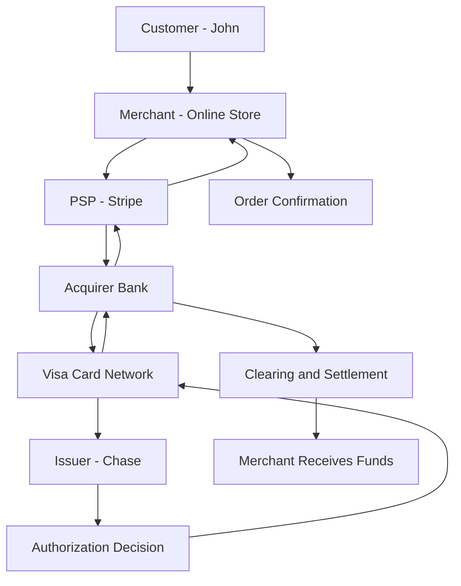

# Banking and Finance – Core Terminology

## 1. Banking

**Banking** refers to financial services that help individuals and businesses deposit, withdraw, transfer, borrow, and manage money.

### Main banking services

- Savings accounts
- Checking accounts
- Credit cards
- Debit cards
- Personal loans
- Mortgages
- Business loans
- Domestic and international money transfers

**Example:**

A customer deposits $5,000 into a savings account. The bank holds the deposit and provides services to manage the customer's money.

---

## 2. Financial Institution

A **financial institution** is an organization that provides financial products and services.

Examples:

- Commercial banks
- Investment banks
- Credit unions
- Insurance companies
- Brokerage firms
- Asset management companies
- Payment service providers

**Example:**

JPMorgan Chase is a financial institution that provides consumer banking, commercial banking, investment banking, payments, and other financial services.

---

## 3. Consumer Banking

**Consumer banking**, also called retail banking, provides financial services directly to individual customers.

### Products and services

- Checking accounts
- Savings accounts
- Debit cards
- Credit cards
- Personal loans
- Auto loans
- Mortgages
- Online and mobile banking

**Example:**

A customer opens a Chase checking account, receives a debit card, deposits their salary, and uses the card to purchase groceries.

This is consumer banking.

---

## 4. Commercial Banking

**Commercial banking** provides financial products and services to businesses, corporations, and other organizations.

### Products and services

- Business checking accounts
- Commercial loans
- Working capital financing
- Commercial real estate loans
- Treasury management
- Cash management
- Business payment processing

**Example:**

A manufacturing company needs $2 million to purchase equipment. It approaches a commercial bank for financing.

The bank evaluates the company's financial statements, cash flow, credit history, and repayment capacity before approving the loan.

This is commercial banking.

### Consumer Banking vs Commercial Banking

| Consumer Banking | Commercial Banking |
|---|---|
| Serves individuals | Serves businesses |
| Personal checking accounts | Business checking accounts |
| Credit cards | Corporate credit facilities |
| Auto loans | Equipment financing |
| Home mortgages | Commercial real estate loans |

---

## 5. Customer

A **customer** is an individual or organization that uses a bank's financial products or services.

### Types of customers

1. Individual customers
2. Small businesses
3. Large corporations
4. Government organizations
5. Institutional investors

**Example:**

John opens a checking account at Chase.

John is the bank's customer.

A company that maintains a business account with JPMorgan Chase is also a customer.

---

## 6. Account Holder

An **account holder** is the person or organization that legally owns or is authorized to operate a bank account.

**Example:**

John opens a checking account with account number 123456.

John is the account holder.

Important distinction:

- Customer = Person or organization using banking services.
- Account holder = Person or organization associated with ownership of a specific account.

---

## 7. Issuer

An **issuer** is a financial institution that issues a payment card or other financial instrument to a customer.

In card payments, the issuer is generally the bank that provides the customer's credit card or debit card.

### Issuer responsibilities

- Issue credit and debit cards.
- Maintain customer card accounts.
- Evaluate creditworthiness for credit cards.
- Authorize or decline card transactions.
- Monitor suspicious transactions.
- Manage cardholder billing and payments.
- Handle disputes and chargebacks.

**Example:**

John has a Chase credit card.

Chase is the card issuer.

When John uses his Chase credit card to purchase a laptop, Chase receives an authorization request and decides whether to approve or decline it.

### Issuer vs Customer

| Issuer | Customer |
|---|---|
| Financial institution | Individual or business |
| Provides the card | Uses the card |
| Authorizes transactions | Initiates transactions |
| Manages card account | Owns or uses the account |

---

## 8. Acquirer

An **acquirer**, also called an acquiring bank, is a financial institution that provides merchant payment acceptance services.

It enables businesses to accept debit and credit card payments.

### Acquirer responsibilities

- Onboard merchants.
- Provide payment acceptance services.
- Process card payment transactions.
- Submit authorization requests through payment networks.
- Receive settlement funds.
- Pay merchants according to settlement arrangements.
- Manage merchant-related disputes and chargebacks.

**Example:**

A grocery store accepts Visa and Mastercard payments.

The store has a merchant account through an acquiring bank.

The acquiring bank helps the grocery store accept and process card payments.

---

## 9. Merchant

A **merchant** is a business that sells products or services and accepts payments from customers.

Examples:

- Amazon
- Walmart
- Grocery stores
- Restaurants
- Online retailers
- Gas stations

**Example:**

John purchases a $100 laptop accessory from an online retailer.

The online retailer is the merchant.

---

## 10. PSP – Payment Service Provider

A **Payment Service Provider (PSP)** is a company that helps businesses accept and process electronic payments.

PSPs provide payment infrastructure so merchants do not have to build the entire payment processing system themselves.

### PSP services

- Payment gateway
- Card payment processing
- Digital wallet integration
- Fraud detection
- Payment routing
- Recurring payments
- Payment reconciliation
- Merchant reporting

Examples:

- Stripe
- Adyen
- PayPal
- Worldpay
- Square

**Example:**

An online shopping website integrates Stripe.

When a customer enters card details and clicks Pay, Stripe helps securely process the payment and communicate with the relevant payment networks and financial institutions.

### PSP vs Issuer vs Acquirer

| Term | Responsibility |
|---|---|
| PSP | Provides payment processing infrastructure to merchants |
| Issuer | Issues the customer's payment card |
| Acquirer | Supports the merchant's card acceptance and acquiring relationship |
| Merchant | Sells products or services |
| Customer | Purchases products or services |

A PSP may operate acquiring services itself or partner with acquiring banks. The exact responsibilities depend on its business model.

---

## 11. ACH – Automated Clearing House

**ACH** stands for Automated Clearing House.

ACH is a US electronic payment network used to transfer money between bank accounts.

It is commonly used for direct deposits, bill payments, and account-to-account transfers.

### ACH use cases

- Employee salary direct deposit
- Mortgage payments
- Utility bill payments
- Insurance premium payments
- Recurring subscriptions
- Business-to-business payments

### Example: Salary Direct Deposit

An employee receives a salary of $5,000.

The process:

1. The employer initiates payroll.
2. The employer's bank submits an ACH payment instruction.
3. The ACH operator processes and sorts the payment instructions.
4. The employee's bank receives the instruction.
5. The employee's bank credits the employee's account.

### ACH Participants

| Participant | Responsibility |
|---|---|
| Originator | Initiates the payment |
| ODFI | Originating Depository Financial Institution; submits the ACH entry |
| ACH Operator | Processes and distributes ACH entries |
| RDFI | Receiving Depository Financial Institution; receives the ACH entry |
| Receiver | Person or organization receiving the payment |

### ACH vs Wire Transfer

| ACH | Wire Transfer |
|---|---|
| Often processed in batches | Generally processed individually |
| Commonly used for payroll and recurring payments | Commonly used for time-sensitive transfers |
| Usually lower cost | Often higher cost |
| May take one or more banking days | Often completed the same business day for domestic wires, depending on cutoffs |
| Can be returned under ACH rules | Generally harder to reverse once completed |

---

## 12. Payment Gateway

A **payment gateway** securely captures and transmits payment information from a merchant's website or application to payment processing systems.

### Example

A customer purchases a product from an online store.

1. Customer enters credit card information.
2. Payment gateway securely captures the payment details.
3. Payment information is transmitted to the payment processor or acquirer.
4. Authorization is requested through the card network.
5. Issuer approves or declines the transaction.
6. The result is returned to the merchant.

Examples:

- Stripe payment gateway
- Adyen payment gateway
- PayPal payment services

---

## 13. Payment Processor

A **payment processor** handles the technical processing and communication required to complete electronic payments.

Its responsibilities can include:

- Transmitting authorization requests.
- Communicating with card networks and banks.
- Handling transaction responses.
- Supporting clearing and settlement.
- Providing transaction reporting.

A PSP may also provide payment processing services.

---

## 14. Card Network

A **card network** connects issuers and acquirers and provides rules and infrastructure for card transactions.

Examples:

- Visa
- Mastercard
- American Express
- Discover

### Responsibilities

- Route authorization messages.
- Define network operating rules.
- Support clearing and settlement.
- Facilitate communication between financial institutions.

**Example:**

John uses a Chase Visa credit card at Walmart.

Visa is the card network connecting the acquiring side of the transaction with Chase, the issuing bank.

Note: American Express can operate a more integrated network and issuing/acquiring model than the traditional four-party card model.

---

## 15. Authorization

**Authorization** is the process of checking whether a payment transaction can be approved.

For a card transaction, the issuer typically evaluates:

- Available credit or funds.
- Card status.
- Transaction amount.
- Fraud risk.
- Customer account restrictions.
- Transaction rules.

**Example:**

John purchases a laptop for $2,000.

The issuer receives the authorization request and checks whether the transaction can be approved.

It returns an approval or decline response.

Authorization does not necessarily mean the final funds transfer or settlement has occurred.

---

## 16. Clearing

**Clearing** is the process of exchanging transaction details between financial institutions and calculating the amounts owed.

For card payments, clearing follows authorization and prepares transactions for settlement.

**Example:**

A merchant processes 1,000 card transactions during a business day.

Transaction details are submitted through the acquiring side and card network for clearing.

The financial institutions calculate the amounts due.

---

## 17. Settlement

**Settlement** is the process of transferring funds between financial institutions to complete payment obligations.

**Example:**

A customer purchases groceries for $100.

After clearing, the relevant institutions settle the payment obligations, and the merchant receives the proceeds according to its settlement arrangement, less applicable fees.

### Authorization vs Clearing vs Settlement

| Stage | Meaning |
|---|---|
| Authorization | Can this payment be approved? |
| Clearing | What amounts do the institutions owe? |
| Settlement | Transfer the funds to satisfy those obligations |

---

## 18. ACH vs Card Payment

| ACH Payment | Card Payment |
|---|---|
| Uses bank account and routing information | Uses card credentials or token |
| Uses the ACH network | Uses a card network |
| Common for salary and recurring bills | Common for retail purchases |
| Can be initiated by businesses or consumers | Usually initiated through a merchant |
| Governed by ACH operating rules | Governed by card network rules |

---

## 19. Credit Card vs Debit Card

### Credit Card

A credit card allows a customer to borrow money from the card issuer up to an approved credit limit.

Example:

John has a $10,000 credit limit.

He purchases a laptop for $2,000 using his credit card and repays the issuer according to his billing terms.

### Debit Card

A debit card generally allows a customer to spend money from their linked deposit account.

Example:

John has $5,000 in his checking account.

He purchases groceries for $100 using his debit card.

The transaction draws on his available account balance, subject to applicable authorization and account rules.

---

## 20. Fraud Detection in Banking

**Fraud detection** is the process of identifying suspicious or unauthorized financial activity.

### Common fraud scenarios

1. Stolen credit card usage.
2. Account takeover.
3. Unauthorized ACH transfers.
4. Identity theft.
5. Suspicious wire transfers.
6. Synthetic identity fraud.
7. Unusual merchant transactions.

### AI/ML Fraud Detection

A machine learning model analyzes transaction features and generates a fraud risk score.

Example features:

- Transaction amount.
- Customer spending behavior.
- Transaction frequency.
- Merchant category.
- Device information.
- IP address and location.
- Failed login attempts.
- Historical fraud patterns.

Example flow:

```text
Customer Transaction
        |
        v
Payment Processing System
        |
        v
Fraud Detection Service
        |
        v
Feature Engineering
        |
        v
ML Model
        |
        v
Fraud Risk Score
        |
        v
Decision Engine
        |
        +----------------+
        |        |       |
        v        v       v
      Approve  Decline  Verify
```

---

## 21. Real-World Card Payment Example

John purchases a laptop for $1,000 from an online merchant.

Participants:

- Customer: John
- Merchant: Online laptop store
- PSP: Stripe
- Acquirer: Merchant's acquiring bank
- Card Network: Visa
- Issuer: Chase

### End-to-End Process

1. John enters his Chase Visa card details on the merchant website.
2. The PSP securely captures and processes the payment request.
3. The acquirer submits the authorization request through Visa.
4. Visa routes the request to Chase.
5. Chase validates the card, available credit and fraud risk.
6. Chase approves or declines the transaction.
7. The response travels back through Visa and the acquiring side to the PSP.
8. The merchant receives the payment result.
9. The merchant fulfills the order if approved.
10. Clearing and settlement take place according to the applicable processing arrangements.

### Payment Flow Diagram



---

## 22. Important Banking Terminology – Quick Revision

| Term | Simple Definition |
|---|---|
| Banking | Managing money and providing financial services |
| Financial Institution | Organization providing financial services |
| Consumer Banking | Banking services for individuals |
| Commercial Banking | Banking services for businesses |
| Customer | Person or organization using financial services |
| Account Holder | Person or organization associated with a bank account |
| Issuer | Institution issuing a payment card |
| Acquirer | Institution supporting merchant card acceptance |
| PSP | Payment Service Provider |
| ACH | US bank-to-bank electronic payment network |
| Merchant | Business selling products or services |
| Payment Gateway | Securely captures and transmits payment details |
| Payment Processor | Processes payment messages and transactions |
| Card Network | Connects card issuers and acquirers |
| Authorization | Approval or decline of a payment request |
| Clearing | Exchange and calculation of payment obligations |
| Settlement | Transfer of funds between financial institutions |
| Fraud Detection | Identifying suspicious financial activity |
| Credit Risk | Risk that a borrower will not repay |
| Liquidity | Ability to meet financial obligations when due |
| Reconciliation | Comparing records to identify mismatches |

---

## 23. Interview Questions and Answers

### Q1. What is consumer banking?

Consumer banking provides banking services to individual customers, including checking accounts, savings accounts, debit cards, credit cards, personal loans and mortgages.

### Q2. What is commercial banking?

Commercial banking provides financial services to businesses, including business accounts, corporate loans, working capital financing and treasury management.

### Q3. What is an issuer?

An issuer is the bank or financial institution that provides a credit or debit card to a customer and handles card authorization.

### Q4. What is an acquirer?

An acquirer is the financial institution that supports a merchant in accepting card payments and receiving settlement funds.

### Q5. What is a PSP?

A Payment Service Provider helps merchants accept electronic payments by providing payment processing, gateway, fraud prevention and related services.

### Q6. What is ACH?

ACH is an electronic payment network in the United States that transfers funds between bank accounts. It is commonly used for payroll, bill payments and recurring transfers.

### Q7. What is the difference between ACH and wire transfer?

ACH commonly processes domestic electronic payments through batches or supported faster ACH services. Wire transfers are generally used for individual, time-sensitive transfers and have different processing and reversal rules.

### Q8. What is the difference between issuer and PSP?

The issuer provides the customer's payment card and manages the cardholder's account. The PSP provides payment acceptance and processing services to the merchant.

### Q9. What is the difference between authorization and settlement?

Authorization determines whether a transaction can be approved. Settlement transfers funds to satisfy the payment obligations between the participating financial institutions.

### Q10. How does AI help banking?

AI and machine learning help banks detect fraudulent transactions, assess credit risk, predict customer behavior, automate document processing, improve customer support and monitor financial risks.

---

## 24. Final Memory Tips

Remember these simple definitions:

- **Customer:** Who uses the bank's services?
- **Issuer:** Who provides the customer's card?
- **Acquirer:** Who supports the merchant's card acceptance?
- **PSP:** Who provides payment processing services?
- **Merchant:** Who sells the product?
- **ACH:** How money moves between bank accounts through the ACH network.
- **Card Network:** Who connects the issuing and acquiring sides?
- **Authorization:** Can the payment be approved?
- **Clearing:** What does each institution owe?
- **Settlement:** When are the payment obligations funded?
- **Consumer Banking:** Banking for individuals.
- **Commercial Banking:** Banking for businesses.

**Key interview takeaway:** Understand the difference between the customer, merchant, issuer, acquirer, PSP and payment network. These participants work together to process payments securely and reliably.
