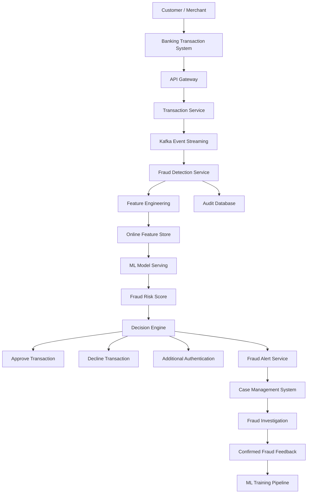
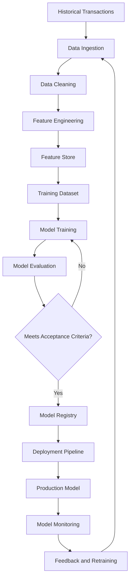

# Banking Fraud Detection System – End-to-End Architecture

## 1. Business Problem

Banks process millions of financial transactions every day through credit cards, debit cards, wire transfers, ACH payments, and online banking.

Fraudsters may attempt to:
- Use stolen credit card information.
- Perform unauthorized transactions.
- Take over customer accounts.
- Transfer money to fraudulent accounts.
- Perform unusual transactions using compromised credentials.
- Create synthetic identities to obtain financial services.

The business objective is to identify fraudulent transactions in real time while minimizing false positives and avoiding unnecessary disruption to legitimate customers.

### Business Goals

1. Detect fraudulent transactions before money is lost.
2. Reduce financial losses.
3. Minimize false-positive transaction declines.
4. Improve customer experience.
5. Support real-time fraud decisions.
6. Maintain regulatory compliance and auditability.

---

## 2. Functional Requirements

| ID | Requirement | Description |
|---|---|---|
| FR1 | Transaction ingestion | Receive transaction events from banking systems |
| FR2 | Data validation | Validate transaction amount, account, merchant and timestamp |
| FR3 | Customer profiling | Retrieve customer transaction history |
| FR4 | Feature engineering | Generate transaction and behavioral features |
| FR5 | Fraud scoring | Calculate fraud probability using an ML model |
| FR6 | Risk classification | Categorize transactions as low, medium or high risk |
| FR7 | Decision engine | Approve, decline or request additional verification |
| FR8 | Alert generation | Send suspicious transactions to fraud investigation teams |
| FR9 | Case management | Create and track fraud investigation cases |
| FR10 | Audit logging | Store decisions, model versions and explanations |
| FR11 | Feedback processing | Capture confirmed fraud and legitimate transactions |

---

## 3. Non-Functional Requirements

| Category | Requirement |
|---|---|
| Scalability | Handle millions of transactions per day |
| Availability | Highly available fraud detection services |
| Latency | Return transaction risk decisions within the banking system's latency target |
| Reliability | Avoid duplicate transaction processing |
| Security | Encrypt data in transit and at rest |
| Privacy | Protect customer PII and sensitive financial data |
| Consistency | Maintain reliable transaction and decision records |
| Observability | Monitor latency, errors, model performance and throughput |
| Fault tolerance | Handle downstream service and model failures |
| Explainability | Provide reasons supporting suspicious transaction decisions |

---

## 4. High-Level Architecture



### Component Responsibilities

| Component | Responsibility |
|---|---|
| API Gateway | Authentication, authorization, rate limiting |
| Transaction Service | Validate and process transaction requests |
| Kafka | Publish transaction events |
| Fraud Detection Service | Orchestrate fraud detection |
| Feature Engineering | Calculate customer and transaction features |
| Feature Store | Store reusable ML features |
| ML Model Serving | Generate fraud probability |
| Decision Engine | Apply risk thresholds and business rules |
| Case Management | Manage fraud investigation workflows |
| Audit Database | Maintain decision history |
| ML Training Pipeline | Train and evaluate updated models |

---

## 5. End-to-End Transaction Processing

### Step 1: Customer Initiates Transaction

Example:

A customer uses a credit card to purchase a laptop for $2,500.

Transaction details:

```json
{
  "transactionId": "TXN10001",
  "customerId": "CUST1001",
  "accountId": "ACC1001",
  "amount": 2500,
  "currency": "USD",
  "merchantId": "MERCHANT500",
  "merchantCategory": "Electronics",
  "location": "New York",
  "channel": "ONLINE",
  "timestamp": "2026-11-20T10:30:00"
}
```

The banking system receives the transaction request.

### Step 2: API Gateway

The API Gateway performs:

- Authentication.
- Authorization.
- JWT validation.
- Rate limiting.
- Request routing.
- Request validation.

The request is forwarded to the transaction service.

### Step 3: Transaction Validation

The transaction service validates:

- Customer account status.
- Transaction amount.
- Available balance or credit.
- Merchant information.
- Transaction identifier.
- Required transaction fields.

Invalid requests are rejected or handled according to banking rules.

### Step 4: Publish Transaction Event

The transaction service publishes a transaction event to Kafka.

Example topic:

```text
banking.transactions
```

Kafka allows downstream fraud detection services to consume transaction events asynchronously.

For a synchronous payment authorization flow, the transaction service must still wait for the fraud decision within the authorization deadline. Kafka can also support event distribution, analytics and downstream processing.

### Step 5: Feature Engineering

The fraud detection service retrieves historical customer behavior and calculates features.

Examples:

| Feature | Description |
|---|---|
| transaction_amount | Current transaction amount |
| avg_transaction_amount | Average customer transaction amount |
| transaction_frequency | Number of recent transactions |
| location_change | Difference from normal customer location |
| failed_attempts | Recent failed transaction attempts |
| merchant_risk | Historical merchant risk |
| device_change | Whether the device is new |
| account_age | Age of customer account |
| velocity_5min | Number of transactions in the last five minutes |
| amount_deviation | Difference from customer's normal spending |

Example:

```python
features = {
    "transaction_amount": 2500,
    "avg_transaction_amount": 100,
    "transaction_frequency": 8,
    "failed_attempts": 3,
    "new_device": 1,
    "location_change": 1
}
```

These features represent customer transaction behavior.

### Step 6: Feature Store

A feature store provides consistent features for model training and real-time inference.

Two important types:

**Offline Feature Store**
- Stores historical features.
- Supports model training.
- Used for batch processing and analysis.

**Online Feature Store**
- Stores recent customer features.
- Supports low-latency inference.
- Used during real-time transaction processing.

Examples of technology choices:
- Redis for low-latency online feature retrieval.
- Feast for feature management.
- Data lake or warehouse for historical features.

### Step 7: ML Model Training

Historical transaction data is used to train a fraud detection model.

Training dataset example:

| Transaction | Amount | New Device | Failed Attempts | Fraud |
|---|---:|---:|---:|---:|
| T1 | 50 | 0 | 0 | 0 |
| T2 | 5000 | 1 | 4 | 1 |
| T3 | 100 | 0 | 0 | 0 |
| T4 | 3500 | 1 | 3 | 1 |
| T5 | 75 | 0 | 0 | 0 |

Here:
- 0 = Legitimate transaction.
- 1 = Fraudulent transaction.

This is a supervised machine learning classification problem.

### Step 8: Model Selection

Possible ML algorithms:

| Algorithm | Use |
|---|---|
| Logistic Regression | Baseline fraud classification |
| Decision Tree | Rule-like classification |
| Random Forest | Nonlinear fraud patterns |
| XGBoost | High-performance classification on tabular data |
| Neural Networks | Complex patterns with sufficient data |

For structured banking transaction data, gradient-boosted tree models such as XGBoost are common candidates.

The final model should be selected through validation, performance, explainability, latency and operational requirements.

### Step 9: Model Evaluation

Fraud detection datasets are usually imbalanced because legitimate transactions greatly outnumber fraudulent transactions.

Accuracy alone is not sufficient.

Important metrics:

**Precision**

Out of all transactions predicted as fraud, how many were actually fraud?

```text
Precision = TP / (TP + FP)
```

**Recall**

Out of all actual fraudulent transactions, how many did the model detect?

```text
Recall = TP / (TP + FN)
```

**F1 Score**

Harmonic mean of precision and recall.

```text
F1 = 2 * (Precision * Recall) / (Precision + Recall)
```

Other important measurements:
- False-positive rate.
- PR-AUC.
- ROC-AUC.
- Fraud dollars prevented.
- Customer transaction decline rate.
- Inference latency.

### Step 10: Model Registry

Once the model is trained and approved, register it in a model registry.

Example:

```text
Fraud Detection Model

Model Name: fraud-detection-xgboost
Version: 1.0
Algorithm: XGBoost
Status: Production
Training Date: 2026-11-20
Evaluation: Approved
```

Tools:
- MLflow Model Registry.
- Cloud-based model registries.

The registry tracks model versions, artifacts, evaluation results and deployment status.

### Step 11: Model Deployment

Deploy the approved model as a REST API.

Possible technologies:
- Python.
- FastAPI.
- Docker.
- Kubernetes.
- AWS SageMaker.
- Azure Machine Learning.

Example API:

```python
from fastapi import FastAPI
import joblib

app = FastAPI()

model = joblib.load("fraud_model.pkl")

@app.post("/predict")
def predict(features: dict):

    values = [[
        features["transaction_amount"],
        features["avg_transaction_amount"],
        features["transaction_frequency"],
        features["failed_attempts"],
        features["new_device"],
        features["location_change"]
    ]]

    probability = model.predict_proba(values)[0][1]

    return {
        "fraud_probability": float(probability)
    }
```

The API receives features and returns the probability of fraud.

### Step 12: Real-Time Fraud Scoring

The model returns a fraud probability between 0 and 1.

Example:

```json
{
  "transactionId": "TXN10001",
  "fraudProbability": 0.94
}
```

The model predicts a 94% fraud probability.

Important: This is a model score, not necessarily a calibrated probability. Calibration should be evaluated before interpreting it literally.

### Step 13: Decision Engine

The decision engine combines model scores with business rules.

Example thresholds (illustrative only):

| Risk Score | Risk Level | Decision |
|---|---|---|
| 0.00–0.30 | Low | Approve |
| 0.31–0.70 | Medium | Additional authentication |
| 0.71–1.00 | High | Decline or hold for review |

Example:

```python
def fraud_decision(score):

    if score < 0.30:
        return "APPROVE"

    elif score < 0.70:
        return "ADDITIONAL_AUTHENTICATION"

    else:
        return "DECLINE"
```

Actual thresholds must be selected using business costs, validation data, fraud loss, customer impact and risk policies.

### Step 14: Fraud Alert and Case Management

For suspicious transactions:

1. Generate fraud alert.
2. Create investigation case.
3. Store transaction details.
4. Attach model score and risk factors.
5. Assign case to fraud analyst.
6. Investigate transaction.
7. Record final outcome.

Example case:

```json
{
  "caseId": "CASE10001",
  "transactionId": "TXN10001",
  "riskLevel": "HIGH",
  "fraudProbability": 0.94,
  "status": "OPEN",
  "reason": [
    "Unusual transaction amount",
    "New device",
    "Unusual location"
  ]
}
```

A fraud analyst can review and mark the transaction as confirmed fraud or legitimate.

### Step 15: Feedback Loop

Fraud investigation results become labeled data.

```text
Transaction
    |
    v
Fraud Model Prediction
    |
    v
Fraud Investigation
    |
    v
Confirmed Fraud / Legitimate
    |
    v
Historical Training Dataset
    |
    v
Model Retraining
    |
    v
Model Evaluation
    |
    v
Model Registry
    |
    v
Production Deployment
```

This continuously improves fraud detection.

---

## 6. Machine Learning Pipeline Architecture



### ML Lifecycle

1. Data ingestion.
2. Data preprocessing.
3. Feature engineering.
4. Model training.
5. Model evaluation.
6. Model registration.
7. Model deployment.
8. Model inference.
9. Model monitoring.
10. Model retraining.

---

## 7. Fraud Detection Monitoring

Monitoring is required at both application and ML levels.

### Application Monitoring

| Metric | Purpose |
|---|---|
| API latency | Measure response time |
| Error rate | Identify service failures |
| Kafka lag | Identify delayed event processing |
| Throughput | Transactions processed per second |
| CPU and memory | Infrastructure health |
| Availability | Service uptime |

Tools:
- Prometheus.
- Grafana.
- Cloud monitoring.
- OpenTelemetry.

### ML Model Monitoring

| Metric | Purpose |
|---|---|
| Data drift | Detect changes in input data |
| Concept drift | Detect changes in fraud patterns |
| Precision | Measure quality of fraud alerts |
| Recall | Measure fraud detection coverage |
| False-positive rate | Monitor legitimate customer impact |
| Prediction distribution | Identify changes in model outputs |
| Model latency | Monitor inference performance |

---

## 8. Security and Governance

Financial systems require strong security and governance.

- OAuth2 and JWT authentication.
- Role-based access control (RBAC).
- Encryption at rest and in transit.
- Customer PII protection.
- Secrets management.
- API rate limiting.
- Network isolation.
- Audit logging.
- Model versioning.
- Explainability and decision traceability.
- Human review for appropriate high-risk cases.
- Data retention and regulatory controls.

Never expose customer financial information in application logs.

---

## 9. Fault Tolerance and Reliability

Consider these scenarios:

| Failure | Solution |
|---|---|
| ML model unavailable | Use approved fallback decision policy |
| Feature store unavailable | Use cached or fallback features where safe |
| Kafka unavailable | Durable event handling and retry |
| Duplicate transaction event | Idempotency key |
| Slow model response | Timeout and controlled fallback |
| Downstream service failure | Circuit breaker and retry policy |
| Service instance failure | Kubernetes restart and horizontal scaling |

Important: A fallback must not automatically approve suspicious transactions. The bank's authorization and risk policies determine whether to decline, hold, or request additional authentication.

---

## 10. Technology Stack

| Layer | Example Technologies |
|---|---|
| Programming | Python, Java |
| API | FastAPI, Spring Boot, REST |
| Streaming | Apache Kafka |
| Data processing | Apache Spark, Pandas |
| Database | PostgreSQL, Oracle, Azure SQL |
| Online feature store | Redis, Feast |
| ML algorithms | Scikit-learn, XGBoost, PyTorch |
| Model registry | MLflow |
| Model serving | FastAPI, SageMaker, Azure ML |
| Containerization | Docker |
| Orchestration | Kubernetes |
| Workflow orchestration | Airflow |
| CI/CD | Jenkins, GitHub Actions, Azure DevOps |
| Monitoring | Prometheus, Grafana, OpenTelemetry |
| Cloud | AWS, Azure, GCP |

These are possible technology choices, not a claim that every bank uses all of them.

---

## 11. System Design Interview Questions

### Q1. How would you design a real-time fraud detection system?

I would start with the transaction ingestion layer. The banking transaction service receives the transaction and validates the request. The transaction event is then made available to the fraud detection service.

The fraud service retrieves customer behavioral features from the online feature store and sends them to the deployed ML model.

The model generates a fraud risk score. The decision engine combines the score with business rules and decides whether to approve, decline, or request additional authentication.

For suspicious transactions, the system generates alerts and creates investigation cases. All decisions are audited, and investigation outcomes are fed back into the ML training pipeline.

I would also design for high availability, low latency, idempotency, security, observability and model monitoring.

### Q2. Why use Kafka?

Kafka provides distributed event streaming.

It helps:
- Process transaction events asynchronously.
- Scale consumers independently.
- Distribute events to multiple downstream services.
- Retain events for replay within configured retention.
- Support fraud analytics and monitoring.

For synchronous authorization, Kafka alone does not replace the need for a timely fraud decision.

### Q3. Why use a feature store?

A feature store provides reusable, consistent features for both training and inference.

It reduces duplicate feature engineering and helps avoid training-serving skew.

### Q4. How do you handle class imbalance?

Fraudulent transactions are relatively rare.

Possible approaches:
- Class weights.
- Oversampling.
- Undersampling.
- SMOTE, where appropriate.
- Threshold tuning.
- Precision-recall evaluation.

The goal is to detect fraud without creating too many false positives.

### Q5. What is data drift?

Data drift happens when the distribution of incoming features changes over time.

For example, customer transaction behavior or payment channel usage changes.

We monitor feature distributions and investigate significant changes.

### Q6. What is concept drift?

Concept drift happens when the relationship between input features and fraud labels changes.

For example, fraudsters develop new techniques that make previously reliable patterns less effective.

We monitor model performance using confirmed outcomes and retrain when appropriate.

### Q7. How do you reduce false positives?

- Improve feature engineering.
- Use customer behavioral history.
- Tune classification thresholds.
- Evaluate precision and recall.
- Use additional authentication for medium-risk transactions.
- Analyze false-positive feedback.
- Retrain with newly labeled data.

### Q8. What is the difference between model training and inference?

**Training:** The model learns patterns from historical labeled transactions.

**Inference:** The trained model evaluates a new transaction and generates a fraud score.

---

## 12. Summary

Remember this end-to-end flow:

```text
Customer Transaction
        |
        v
API Gateway
        |
        v
Transaction Service
        |
        v
Kafka
        |
        v
Fraud Detection Service
        |
        v
Feature Engineering
        |
        v
Online Feature Store
        |
        v
ML Model Serving
        |
        v
Fraud Risk Score
        |
        v
Decision Engine
        |
        +------------------+
        |         |        |
        v         v        v
      Approve   Decline  Additional
                         Authentication
        |
        v
Fraud Alerts and Case Management
        |
        v
Investigation Feedback
        |
        v
Model Retraining and Monitoring
```


A fraud detection platform is not just an ML model. It is an end-to-end distributed system involving transaction ingestion, streaming, feature engineering, model training, real-time inference, decision orchestration, case management, monitoring, security and continuous model improvement.
