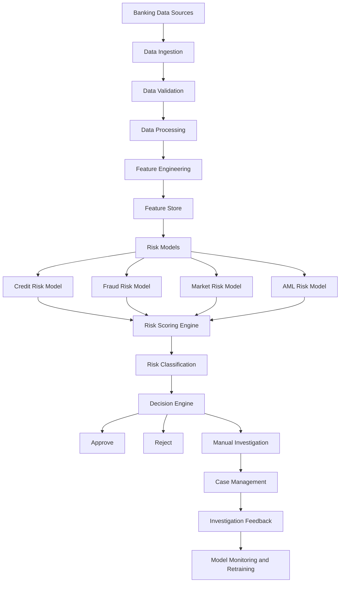

# Banking and Finance – Risk Analysis

## 1. What Is Risk Analysis in Banking?

Risk analysis is the process of identifying, measuring, monitoring, and managing potential financial risks that could cause losses to a bank.

Banks analyze risk before approving loans, processing transactions, investing money, and providing financial services.

### Business Objectives

- Minimize financial losses.
- Identify suspicious transactions.
- Evaluate customer creditworthiness.
- Prevent fraud.
- Monitor market volatility.
- Maintain regulatory compliance.
- Protect customer and institutional assets.
- Improve financial decision-making.

---

## 2. Types of Risk in Banking

There are several major categories of banking risk.

| Risk Type | Definition | Example |
|---|---|---|
| Credit Risk | Risk that a borrower will not repay a loan | Customer defaults on mortgage |
| Market Risk | Risk of losses due to market price movements | Stock or bond prices decline |
| Operational Risk | Risk caused by failed processes, people, systems or external events | Payment processing system failure |
| Liquidity Risk | Risk of not having sufficient funds to meet obligations | Bank cannot meet withdrawal demands |
| Fraud Risk | Risk of financial loss due to fraudulent activity | Stolen credit card usage |
| Interest Rate Risk | Risk from changes in interest rates | Rising interest rates reduce bond values |
| Cybersecurity Risk | Risk from cyberattacks or unauthorized access | Account takeover |
| Compliance Risk | Risk of violating laws and regulations | Failure to comply with AML requirements |
| Model Risk | Risk of incorrect decisions caused by flawed models or assumptions | Incorrect credit risk prediction |
| Counterparty Risk | Risk that another party fails to meet contractual obligations | Trading counterparty defaults |

---

## 3. Credit Risk Analysis

### What Is Credit Risk?

Credit risk is the possibility that a borrower will fail to repay borrowed money according to the agreed terms.

Banks evaluate credit risk before approving:

- Credit cards.
- Personal loans.
- Mortgages.
- Auto loans.
- Business loans.
- Corporate credit facilities.

### Example

A customer applies for a $50,000 personal loan.

The bank evaluates:

- Annual income.
- Employment history.
- Credit score.
- Existing debt.
- Payment history.
- Debt-to-income ratio.
- Loan amount.
- Loan duration.

The bank uses these factors to estimate the probability that the customer will default.

### Important Credit Risk Metrics

#### 1. Probability of Default (PD)

PD estimates the probability that a borrower will default within a specified time horizon.

Example:

```text
Probability of Default = 5%
```

This means the model estimates a 5% probability of default over the defined period.

#### 2. Loss Given Default (LGD)

LGD measures the percentage of exposure the bank expects to lose if the borrower defaults.

Formula:

```text
LGD = (Exposure at Default - Recovery Amount)
      / Exposure at Default
```

Example:

```text
Loan Exposure = $100,000
Recovery Amount = $40,000

LGD = ($100,000 - $40,000) / $100,000

LGD = 60%
```

#### 3. Exposure at Default (EAD)

EAD estimates the amount the borrower owes when default occurs.

Example:

```text
Outstanding Loan Balance = $80,000
Additional Expected Exposure = $5,000

EAD = $85,000
```

#### 4. Expected Loss (EL)

Expected Loss estimates the average loss the bank expects from credit exposure.

Formula:

```text
Expected Loss = PD × LGD × EAD
```

Example:

```text
PD  = 5%  = 0.05
LGD = 60% = 0.60
EAD = $100,000

Expected Loss = 0.05 × 0.60 × 100,000

Expected Loss = $3,000
```

The bank estimates an expected loss of $3,000 for this exposure over the defined risk horizon.

---

## 4. Credit Scoring Using Machine Learning

Credit scoring uses customer and financial information to estimate credit risk.

### Input Features

| Feature | Description |
|---|---|
| Annual Income | Customer's yearly income |
| Credit Score | Historical creditworthiness indicator |
| Debt-to-Income Ratio | Monthly debt relative to gross monthly income |
| Payment History | History of timely or missed payments |
| Loan Amount | Requested loan amount |
| Employment Duration | Length of employment |
| Credit Utilization | Used credit relative to available credit |
| Existing Loans | Current outstanding loans |

### Machine Learning Algorithms

| Algorithm | Use |
|---|---|
| Logistic Regression | Predict probability of default |
| Decision Tree | Identify decision patterns |
| Random Forest | Combine multiple decision trees |
| XGBoost | Model complex relationships in structured data |
| Neural Networks | Learn complex patterns from larger datasets |

### Example Model Output

```json
{
  "customerId": "CUST1001",
  "defaultProbability": 0.08,
  "riskCategory": "LOW"
}
```

The model estimates an 8% probability of default.

The bank combines model output with lending policies and other eligibility criteria before making a final decision.

---

## 5. Fraud Risk Analysis

### What Is Fraud Risk?

Fraud risk is the possibility of financial loss caused by unauthorized or deceptive activities.

### Common Fraud Scenarios

1. Credit card fraud.
2. Debit card fraud.
3. Account takeover.
4. Identity theft.
5. ACH payment fraud.
6. Wire transfer fraud.
7. Synthetic identity fraud.
8. Merchant fraud.

### Fraud Detection Features

| Feature | Description |
|---|---|
| Transaction Amount | Amount being transferred or spent |
| Transaction Frequency | Number of recent transactions |
| Location | Transaction location |
| Device ID | Device used for transaction |
| IP Address | Network address associated with request |
| Merchant Category | Type of merchant |
| Failed Login Attempts | Number of failed authentication attempts |
| Customer Spending Pattern | Historical transaction behavior |
| Account Age | How long the account has existed |

### Fraud Risk Scoring

A machine learning model generates a fraud score.

Example:

```json
{
  "transactionId": "TXN10001",
  "fraudProbability": 0.94,
  "riskCategory": "HIGH"
}
```

Illustrative decision thresholds:

| Risk Score | Risk Category | Possible Action |
|---|---|---|
| 0.00–0.30 | Low | Approve |
| 0.31–0.70 | Medium | Additional authentication |
| 0.71–1.00 | High | Decline or investigate |

Actual thresholds depend on bank policies, validation results and customer impact.

---

## 6. Market Risk Analysis

### What Is Market Risk?

Market risk is the possibility of financial loss caused by changes in financial market prices.

It affects banks, investment banks, asset managers, hedge funds and institutional investors.

### Types of Market Risk

#### 1. Equity Risk

Risk caused by changes in stock prices.

Example:

A bank holds $10 million worth of company shares. The stock price decreases by 10%.

Potential loss:

```text
$10,000,000 × 10% = $1,000,000
```

#### 2. Interest Rate Risk

Risk caused by changes in interest rates.

Example:

A bank owns long-term bonds. Market interest rates increase, causing the market value of existing fixed-rate bonds to decline.

#### 3. Foreign Exchange Risk

Risk caused by changes in currency exchange rates.

Example:

A US company receives revenue in euros. The euro weakens against the US dollar, reducing the dollar value of that revenue.

#### 4. Commodity Risk

Risk caused by changes in commodity prices.

Examples:

- Oil.
- Gold.
- Natural gas.
- Agricultural products.

### Market Risk Measurement

Important metrics:

- Value at Risk (VaR).
- Expected Shortfall (ES).
- Stress testing.
- Scenario analysis.
- Sensitivity analysis.

#### Value at Risk (VaR)

VaR estimates a potential loss threshold over a specified time horizon and confidence level, under a chosen model.

Example:

```text
1-Day 99% VaR = $5 million
```

Interpretation:

Under the model assumptions, the portfolio has a 99% confidence that its loss over one day will not exceed $5 million.

VaR does not measure the maximum possible loss.

#### Expected Shortfall (ES)

Expected Shortfall estimates the average loss in the tail beyond the VaR threshold, under the specified assumptions.

It helps assess losses in more severe scenarios.

---

## 7. Operational Risk Analysis

### What Is Operational Risk?

Operational risk is the possibility of financial loss resulting from failed internal processes, people, systems or external events.

### Examples

- Payment processing outage.
- Incorrect financial calculations.
- Failed database transactions.
- Employee errors.
- Cyberattacks.
- Incomplete transaction processing.
- Third-party service failures.

### Risk Mitigation

- Retry mechanisms.
- Circuit breakers.
- Disaster recovery.
- Data validation.
- Access controls.
- Audit logging.
- Monitoring and alerting.
- Business continuity planning.

### Example: Payment Processing Failure

A banking payment service calls an external payment provider.

The external provider becomes unavailable.

The banking system should:

1. Apply request timeouts.
2. Retry transient failures with controlled backoff.
3. Use a circuit breaker to protect the downstream system.
4. Preserve transaction state.
5. Avoid duplicate payments through idempotency.
6. Raise alerts for prolonged failures.
7. Reconcile transactions after recovery.

---

## 8. Liquidity Risk Analysis

### What Is Liquidity Risk?

Liquidity risk is the possibility that a bank cannot meet its financial obligations when they become due without incurring unacceptable losses.

### Example

Customers withdraw large amounts of money at the same time.

The bank must maintain sufficient liquid assets to meet withdrawal and payment obligations.

### Important Liquidity Metrics

#### Liquidity Coverage Ratio (LCR)

```text
LCR = High Quality Liquid Assets (HQLA)
      / Total Net Cash Outflows over 30 Days
```

A regulatory minimum of 100% generally applies to covered institutions, subject to applicable regulatory rules.

#### Net Stable Funding Ratio (NSFR)

```text
NSFR = Available Stable Funding
       / Required Stable Funding
```

The regulatory minimum is generally 100% for covered institutions.

These ratios are designed to support short-term liquidity resilience and more stable longer-term funding.

---

## 9. Compliance and AML Risk

### What Is Compliance Risk?

Compliance risk is the risk of legal, regulatory or financial consequences from failing to comply with applicable laws, regulations and policies.

### What Is AML?

AML stands for Anti-Money Laundering.

Banks use AML controls to detect and prevent money laundering and suspicious financial activity.

### Common AML Activities

- Customer identity verification (KYC).
- Customer due diligence (CDD).
- Transaction monitoring.
- Suspicious activity detection.
- Sanctions screening.
- Investigation and reporting where required.

### Example

A customer normally transfers $1,000 per month.

Suddenly, the account receives multiple large transfers from unrelated parties and quickly sends the money to other accounts.

An AML monitoring system may flag this behavior for investigation.

Important: An alert is not proof of money laundering. Investigators assess the activity and relevant context.

---

## 10. Model Risk Analysis

### What Is Model Risk?

Model risk occurs when a model produces incorrect or unreliable results because of flawed assumptions, incorrect data, implementation issues or inappropriate use.

### Examples

- Incorrect credit risk predictions.
- Fraud models missing new fraud patterns.
- Biased training data.
- Incorrect feature calculations.
- Data leakage during training.
- Poor model calibration.
- Model drift.

### Model Risk Management

1. Validate training data.
2. Review feature engineering.
3. Evaluate model performance.
4. Perform independent model validation.
5. Document assumptions and limitations.
6. Monitor production performance.
7. Track model versions.
8. Establish approval and governance processes.

---

## 11. Risk Analysis Using Machine Learning

Machine learning can help financial institutions identify patterns and predict potential risks.

### Supervised Learning

Uses historical labeled data.

Examples:

- Credit default prediction.
- Fraud classification.
- Loan delinquency prediction.

Algorithms:

- Logistic Regression.
- Random Forest.
- XGBoost.
- Neural Networks.

### Unsupervised Learning

Finds unusual patterns without requiring labeled outcomes.

Examples:

- Unusual transaction detection.
- Customer behavior anomalies.
- Suspicious transaction clustering.

Algorithms:

- K-Means.
- DBSCAN.
- Isolation Forest.
- Autoencoders.

### Model Evaluation Metrics

| Metric | Purpose |
|---|---|
| Accuracy | Overall correct predictions |
| Precision | How many predicted positive cases are truly positive |
| Recall | How many actual positive cases are detected |
| F1 Score | Balance between precision and recall |
| ROC-AUC | Ability to rank positive cases above negative cases |
| PR-AUC | Useful for evaluating rare positive cases |
| Confusion Matrix | Shows TP, FP, TN and FN |

---

## 12. End-to-End Banking Risk Analysis Architecture



### Architecture Components

| Component | Responsibility |
|---|---|
| Data Ingestion | Collect transaction, customer and financial data |
| Data Validation | Check data quality and completeness |
| Data Processing | Transform raw data |
| Feature Engineering | Calculate risk-related features |
| Feature Store | Reuse features for training and inference |
| ML Models | Predict different categories of risk |
| Risk Scoring Engine | Generate risk scores |
| Decision Engine | Apply business policies |
| Case Management | Manage investigations |
| Model Monitoring | Track model performance and drift |
| Audit Database | Store decisions and evidence |

---

## 13. Risk Scoring Example

A risk model may use multiple input features to estimate the probability of a negative outcome.

Example credit risk output:

```json
{
  "customerId": "CUST1001",
  "probabilityOfDefault": 0.08,
  "riskCategory": "LOW",
  "modelVersion": "credit-model-v1.2"
}
```

Example fraud risk output:

```json
{
  "transactionId": "TXN10001",
  "fraudProbability": 0.94,
  "riskCategory": "HIGH",
  "modelVersion": "fraud-model-v2.1"
}
```

Important distinction:

A probability is a model estimate. A risk category is a business classification based on policies and thresholds. They are not interchangeable.

---

## 14. Risk Analysis Interview Questions

### Q1. What are the main types of risk in banking?

The major risks include credit risk, market risk, operational risk, liquidity risk, fraud risk, compliance risk, cybersecurity risk and model risk.

### Q2. What is credit risk?

Credit risk is the possibility that a borrower will not repay a loan. Banks evaluate customer income, credit history, existing debt, and repayment capacity to estimate default risk.

### Q3. What is PD, LGD and EAD?

- PD: Probability of Default.
- LGD: Loss Given Default.
- EAD: Exposure at Default.

Expected Loss is calculated using:

```text
EL = PD × LGD × EAD
```

### Q4. What is market risk?

Market risk is the possibility of financial losses due to changes in stock prices, interest rates, foreign exchange rates or commodity prices.

### Q5. What is operational risk?

Operational risk is the possibility of losses caused by failed processes, systems, people or external events.

### Q6. What is liquidity risk?

Liquidity risk is the possibility that a bank cannot meet its financial obligations when they become due.

### Q7. How does AI help with risk analysis?

AI and machine learning help analyze large volumes of financial data, identify unusual patterns, predict defaults, detect fraud and prioritize investigations.

### Q8. How do you monitor a risk model?

I would monitor prediction quality, precision, recall, false-positive rates, data drift, model drift, latency and business outcomes. I would also track model versions and use confirmed outcomes to evaluate whether retraining is needed.

---

## 15. Quick Revision – Risk Types

| Risk | Remember |
|---|---|
| Credit Risk | Will the borrower repay? |
| Fraud Risk | Is this transaction fraudulent? |
| Market Risk | Can market movements cause losses? |
| Operational Risk | Can systems or processes fail? |
| Liquidity Risk | Can the bank meet its obligations? |
| Compliance Risk | Is the bank following regulations? |
| Model Risk | Can the model produce unreliable decisions? |
| Cyber Risk | Can attackers compromise systems? |
| Counterparty Risk | Will the other party fulfill its obligations? |
| Interest Rate Risk | How do interest rate changes affect financial value? |

## 16.

Banking risk analysis is the process of identifying, measuring and managing financial and operational risks.

Different risk models address different business problems:

- Credit risk models estimate the likelihood of loan default.
- Fraud detection models identify suspicious transactions.
- Market risk models estimate potential losses from market movements.
- AML models identify suspicious financial activity.
- Operational risk systems identify failures in business processes and technology.

From an AI/ML engineering perspective, building these solutions requires reliable data pipelines, feature engineering, model training, model serving, risk scoring, monitoring, explainability, security and governance.


Risk analysis is not just about building a machine learning model. It is about creating a complete, reliable and auditable system that helps financial institutions identify potential losses and make informed decisions.
