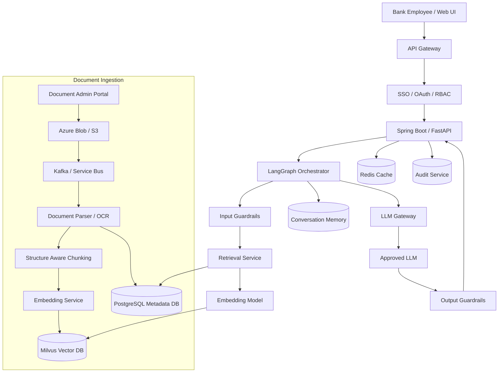
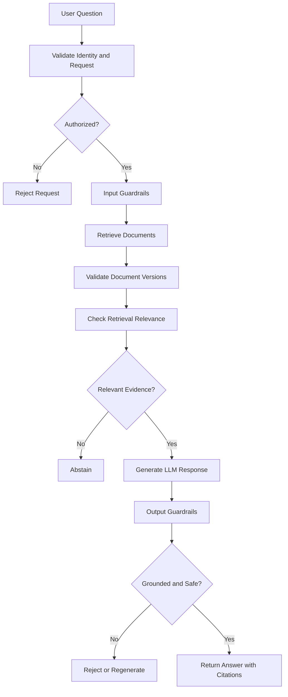
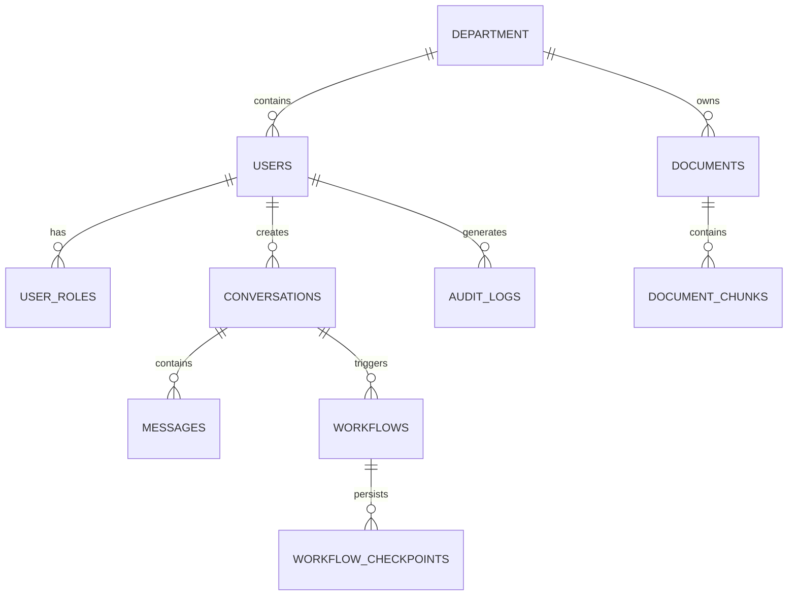

# Banking Document Intelligence & AI Assistant – System Design

**Domain:** Banking / Financial Services  
**Architecture:** Enterprise RAG + Agentic AI  
**Goal:** Design a secure, scalable, fault-tolerant AI platform that allows bank employees to search, understand, summarize, and retrieve information from internal banking documents using natural language.

---

# 1. Problem Statement

Banks maintain large volumes of documents across multiple departments, including:

- Retail Banking
- Corporate Banking
- Investment Banking
- Risk Management
- Compliance
- Legal
- Credit and Lending
- Treasury
- Operations

These documents include credit policies, loan agreements, KYC/AML guidelines, regulatory documents, customer onboarding documents, transaction procedures, risk reports, and internal operating procedures.

Currently, bank employees often spend significant time manually searching through multiple document repositories, reading lengthy PDFs, and contacting different departments to obtain information.

This results in:

- Slow information retrieval.
- Repetitive manual work.
- Inconsistent interpretation of banking policies.
- Delayed customer onboarding and loan processing.
- Increased operational costs.
- Difficulty identifying the latest approved policy or document version.

## Proposed Solution

Build an AI-powered Banking Document Intelligence Assistant that allows authorized bank employees to ask questions about internal banking documents and receive accurate, contextual, source-grounded answers.

The platform uses Retrieval-Augmented Generation (RAG), vector search, LLMs, and agentic workflows.

### Example user questions

1. What documents are required to onboard a corporate banking customer?
2. Explain the KYC verification process.
3. What is the difference between secured and unsecured lending?
4. What are the eligibility requirements for a commercial loan?
5. Summarize the credit risk policy for corporate borrowers.
6. What is the process for handling suspicious transactions?
7. What are the latest AML compliance requirements in our internal policy?
8. Summarize the key clauses in this loan agreement.
9. What is the approval workflow for a loan above $5 million?
10. What collateral documentation is required for a commercial mortgage?

The assistant must provide answers with citations, document names, version numbers, and page references.

**Important:** The system provides decision support, not autonomous credit approvals, regulatory determinations, or replacements for authorized human reviewers.

---

# 2. Functional Requirements

1. Bank employees can authenticate using enterprise SSO.
2. Employees can ask questions using natural language.
3. The system retrieves relevant banking documents.
4. The system generates answers using an approved LLM.
5. Answers include document citations and page references.
6. Users can ask follow-up questions.
7. The system maintains conversation history.
8. Administrators can upload, update, and delete documents.
9. Support PDF, Word, Excel, and PowerPoint documents.
10. Support scanned PDFs using OCR.
11. Enforce department-level and document-level access control.
12. Support multiple banking departments.
13. Identify document versions and effective dates.
14. Administrators can monitor document ingestion.
15. Maintain audit logs for all user interactions.
16. Support human approval for sensitive workflows.
17. Allow users to provide feedback on AI-generated answers.
18. Prevent retrieval of expired or superseded policies unless explicitly requested.

---

# 3. Non-Functional Requirements

| Requirement | Design consideration |
|---|---|
| Scalability | Support thousands of bank employees |
| Consistency | Maintain document versions and metadata |
| Availability | Highly available services |
| Reliability | Handle LLM and database failures |
| Fault tolerance | Retries, timeouts, circuit breakers |
| Security | RBAC, ABAC, encryption |
| Performance | Fast retrieval and response generation |
| Observability | Logs, metrics, distributed tracing |
| Cost | Optimize tokens and embedding costs |
| Auditability | Record user queries and document access |
| Compliance | Apply bank-specific retention and governance policies |
| Privacy | Prevent unauthorized disclosure of customer information |

---

# 4. Capacity Estimation

Assume the following initial planning numbers.

- 20,000 bank employees.
- 5,000 peak concurrent users.
- 500,000 banking documents.
- Average document size: 2 MB.
- Average document length: 10,000 tokens.
- Average chunk size: 500 tokens.
- Average employee: 20 questions per day.

These are architectural planning assumptions, not production measurements.

### Daily request volume

20,000 employees × 20 questions = 400,000 questions per day.

Average requests per second:

400,000 / 86,400 = approximately 4.63 requests per second.

Assume peak traffic is 10 times the average.

Peak throughput = approximately 46 requests per second.

### Document storage

500,000 documents × 2 MB = 1 TB.

### Approximate chunk count

Assume:

- 10,000 tokens per document.
- 500 tokens per chunk.
- 20 chunks per document.

500,000 × 20 = approximately 10 million chunks.

Actual chunk counts depend on document size, structure, and overlap.

### Embedding storage

Assume 1,536-dimensional Float32 embeddings.

Each vector:

1,536 × 4 bytes = 6,144 bytes.

For 10 million vectors:

Approximately 61.44 GB of raw vector storage.

This excludes metadata, replicas, and vector index overhead.

---

# 5. High-Level Architecture

## Architecture diagram



## Main components

| Component | Responsibility |
|---|---|
| Web UI | Employee conversational interface |
| API Gateway | Authentication, rate limiting, routing |
| Spring Boot | Core backend APIs and business logic |
| FastAPI | AI and document-processing services |
| LangGraph | Stateful AI workflow orchestration |
| Retrieval Service | Semantic and hybrid search |
| Milvus | Vector storage and similarity search |
| PostgreSQL | Users, permissions, documents, conversations |
| Azure Blob / S3 | Original banking documents |
| Embedding Model | Converts text chunks into vectors |
| LLM Gateway | Routes requests to approved models |
| Guardrails | Prompt injection and sensitive-data protection |
| Redis | Caching |
| Kafka | Asynchronous document processing |
| Audit Service | Security and compliance events |
| Kubernetes | Container orchestration |

---

# 6. End-to-End Workflows

## A. Document Ingestion Workflow

1. Administrator uploads a banking document.
2. Backend validates file type, size, and administrator permissions.
3. Original document is stored in Azure Blob Storage or Amazon S3.
4. Document metadata is stored in PostgreSQL.
5. An ingestion event is published to Kafka or Azure Service Bus.
6. Document-processing service extracts text.
7. OCR is applied to scanned documents.
8. Tables, headings, and sections are identified.
9. Content is divided into smaller chunks.
10. Metadata is attached to each chunk.
11. Embedding model generates vector embeddings.
12. Vectors are stored in Milvus.
13. Document processing status is updated in PostgreSQL.
14. Document becomes available for authorized retrieval after validation.

### Document metadata

- Document ID
- Department ID
- Document type
- Customer ID, when applicable
- Document version
- Effective date
- Expiration date
- Access groups
- Classification level
- Uploaded by
- Last updated timestamp
- Document status

## B. Question Answering Workflow

1. Employee submits a question.
2. API Gateway validates the request.
3. SSO authentication verifies employee identity.
4. Authorization determines permitted departments and documents.
5. Backend sends the request to LangGraph.
6. Input guardrails inspect the question.
7. Query embedding is generated.
8. Retrieval service performs hybrid search.
9. Metadata filters enforce document permissions.
10. Reranker selects the most relevant chunks.
11. LangGraph assembles the context.
12. LLM Gateway invokes the approved LLM.
13. LLM generates a grounded answer.
14. Output guardrails check the response.
15. Citations and page references are attached.
16. Answer is returned to the employee.
17. Conversation and audit records are persisted.

### RAG pipeline

Offline:

Document → Parsing → OCR → Chunking → Embedding → Milvus.

Online:

Question → Query Embedding → Hybrid Search → Reranking → Context Assembly → LLM → Grounded Answer.

---

# 7. AI Architecture Details

## 7.1 RAG Architecture

RAG stands for Retrieval-Augmented Generation.

It consists of three stages:

**Retrieval:** Find relevant banking documents.

**Augmentation:** Add retrieved document content to the LLM prompt.

**Generation:** Generate an answer using the retrieved information.

RAG reduces reliance on the LLM's internal knowledge but does not guarantee factual correctness.

## 7.2 Chunking Strategy

Use an initial chunk size of approximately 500 tokens with 50–100 tokens of overlap.

For banking documents, use structure-aware chunking.

Preserve:

- Document title.
- Section headings.
- Subsections.
- Tables.
- Page numbers.
- Policy references.
- Effective dates.

For example:

Document: Corporate Credit Policy

Section: Loan Eligibility

Subsection: Minimum Financial Requirements

Chunk should preserve the relationship between the section and subsection.

This is important because banking policies often contain tables, conditions, and exceptions.

## 7.3 Embedding Model

Use an approved text embedding model.

Example:

Input:

"Corporate borrowers must provide audited financial statements."

Output:

[0.12, 0.45, 0.78, 0.21, ...]

Store embeddings in Milvus.

The embedding dimensions must match the selected model.

Use compatible embedding models for both document chunks and user queries.

## 7.4 Retrieval Strategy

Use hybrid search.

**Dense vector search:**
- Understands semantic meaning.
- Finds related content even when wording differs.

**Sparse keyword search:**
- Finds exact policy numbers.
- Finds account terminology.
- Finds loan identifiers and regulatory references.

**Metadata filtering:**
- Department.
- User permissions.
- Document version.
- Effective date.
- Classification.
- Customer access.

**Reranking:**

Use a reranking model to improve the relevance of retrieved chunks.

For example, a query about a corporate loan's collateral requirements should prioritize the relevant collateral section rather than unrelated loan policy sections.

## 7.5 Agent Orchestration

Use LangGraph for stateful workflow management.

Example:



LangGraph provides:

- Stateful workflows.
- Conditional routing.
- Checkpointing.
- Retry and recovery.
- Human-in-the-loop approval.

## 7.6 Example Agentic Workflow

Question:

"Summarize the credit risk requirements for this corporate loan."

Possible workflow:

1. Query understanding agent identifies the intent.
2. Retrieval agent searches credit policy documents.
3. Document agent retrieves relevant financial and collateral sections.
4. Validation step checks document versions and effective dates.
5. Summarization step generates the response.
6. Compliance guardrail checks the answer.
7. Human reviewer validates sensitive conclusions where required.

Do not introduce multiple agents unnecessarily. A deterministic workflow with a few controlled LLM calls is often sufficient.

---

# 8. Data Models and Database Design

A production banking AI platform needs explicit data models and storage decisions.

## 8.1 Main Entities

| Entity | Purpose | Database |
|---|---|---|
| Department | Banking department | PostgreSQL |
| User | Employee identity | PostgreSQL |
| User Role | Access permissions | PostgreSQL |
| Customer | Customer reference | PostgreSQL |
| Document | Banking document metadata | PostgreSQL |
| Document Chunk | Extracted document content | Milvus |
| Conversation | Chat session | PostgreSQL |
| Message | Chat messages | PostgreSQL |
| Workflow | AI execution state | PostgreSQL |
| Audit Log | Security and activity records | PostgreSQL / audit store |

## 8.2 Entity Relationship Diagram



## 8.3 SQL Data Models

### Department

```sql
CREATE TABLE departments (
    department_id UUID PRIMARY KEY,
    department_name VARCHAR(150) NOT NULL,
    status VARCHAR(30),
    created_at TIMESTAMP DEFAULT CURRENT_TIMESTAMP
);
```

### Users

```sql
CREATE TABLE users (
    user_id UUID PRIMARY KEY,
    department_id UUID REFERENCES departments(department_id),
    employee_id VARCHAR(100) UNIQUE NOT NULL,
    email VARCHAR(255) UNIQUE NOT NULL,
    status VARCHAR(30),
    created_at TIMESTAMP DEFAULT CURRENT_TIMESTAMP
);
```

### Documents

```sql
CREATE TABLE documents (
    document_id UUID PRIMARY KEY,
    department_id UUID REFERENCES departments(department_id),
    document_name VARCHAR(255) NOT NULL,
    document_type VARCHAR(100),
    storage_uri TEXT,
    document_version INTEGER,
    classification VARCHAR(50),
    effective_date DATE,
    expiration_date DATE,
    processing_status VARCHAR(50),
    uploaded_by UUID REFERENCES users(user_id),
    created_at TIMESTAMP DEFAULT CURRENT_TIMESTAMP,
    updated_at TIMESTAMP
);
```

### Conversations

```sql
CREATE TABLE conversations (
    conversation_id UUID PRIMARY KEY,
    user_id UUID REFERENCES users(user_id),
    status VARCHAR(30),
    created_at TIMESTAMP DEFAULT CURRENT_TIMESTAMP,
    updated_at TIMESTAMP
);
```

### Messages

```sql
CREATE TABLE messages (
    message_id UUID PRIMARY KEY,
    conversation_id UUID REFERENCES conversations(conversation_id),
    sender VARCHAR(30),
    content TEXT,
    model_name VARCHAR(100),
    token_count INTEGER,
    created_at TIMESTAMP DEFAULT CURRENT_TIMESTAMP
);
```

### Workflow

```sql
CREATE TABLE workflows (
    workflow_id UUID PRIMARY KEY,
    conversation_id UUID REFERENCES conversations(conversation_id),
    workflow_type VARCHAR(100),
    workflow_status VARCHAR(50),
    current_step VARCHAR(100),
    retry_count INTEGER DEFAULT 0,
    created_at TIMESTAMP DEFAULT CURRENT_TIMESTAMP,
    updated_at TIMESTAMP
);
```

### Audit Logs

```sql
CREATE TABLE audit_logs (
    audit_id UUID PRIMARY KEY,
    user_id UUID,
    action VARCHAR(100),
    resource_type VARCHAR(100),
    resource_id UUID,
    status VARCHAR(50),
    created_at TIMESTAMP DEFAULT CURRENT_TIMESTAMP
);
```

## 8.4 Milvus Vector Database Schema

| Field | Type | Description |
|---|---|---|
| chunk_id | VARCHAR | Unique chunk identifier |
| document_id | VARCHAR | Parent document |
| department_id | VARCHAR | Banking department |
| customer_id | VARCHAR | Customer reference, if applicable |
| chunk_text | VARCHAR | Extracted content |
| embedding | FLOAT_VECTOR | Dense embedding |
| page_number | INT | Source page |
| document_version | INT | Document version |
| classification | VARCHAR | Document classification |
| effective_date | VARCHAR | Policy effective date |

Example:

```json
{
  "chunk_id": "chunk-1001",
  "document_id": "doc-101",
  "department_id": "corporate-banking",
  "chunk_text": "Corporate borrowers must provide audited financial statements.",
  "embedding": [0.12, 0.45, 0.78],
  "page_number": 12,
  "document_version": 2,
  "classification": "INTERNAL"
}
```

Embedding values are illustrative. Production vectors must use the configured embedding dimension.

**Important:** Authorization must be enforced using trusted identity and permission data. Metadata filters in vector search are an additional enforcement layer, not a substitute for authorization.

## 8.5 Database Selection

| Data | Recommended technology |
|---|---|
| Users and roles | PostgreSQL |
| Department metadata | PostgreSQL |
| Document metadata | PostgreSQL |
| Conversations | PostgreSQL |
| Workflow state | PostgreSQL / checkpoint store |
| Document embeddings | Milvus |
| Original documents | Azure Blob / S3 |
| Cache | Redis |
| Event messaging | Kafka / Azure Service Bus |
| Audit records | SQL / immutable audit storage |

Architecture principle:

Use relational databases for structured business data, object storage for original documents, and vector databases for semantic retrieval.

---

# 9. API Design

## Upload Banking Document

```http
POST /api/v1/documents
Authorization: Bearer <JWT>
Content-Type: multipart/form-data
```

Response:

```json
{
  "documentId": "doc-101",
  "status": "PROCESSING"
}
```

## Ask Banking Question

```http
POST /api/v1/chat
Authorization: Bearer <JWT>
Content-Type: application/json
```

Request:

```json
{
  "conversationId": "conv-101",
  "question": "What are the KYC requirements for corporate customers?"
}
```

Response:

```json
{
  "conversationId": "conv-101",
  "answer": "Corporate customers must complete the required identity and business verification procedures.",
  "citations": [
    {
      "documentId": "doc-101",
      "documentName": "Corporate KYC Policy",
      "documentVersion": 2,
      "pageNumber": 12
    }
  ],
  "status": "SUCCESS"
}
```

## Get Conversation History

```http
GET /api/v1/conversations/{conversationId}/messages
Authorization: Bearer <JWT>
```

## Get Document Status

```http
GET /api/v1/documents/{documentId}/status
Authorization: Bearer <JWT>
```

---

# 10. Security and AI Governance

Security is critical in banking because documents can contain confidential financial information and customer PII.

## Authentication

- OAuth 2.0 / OpenID Connect.
- Enterprise SSO.
- JWT validation.
- MFA through enterprise identity provider.

## Authorization

Implement RBAC and ABAC.

Example:

| Role | Access |
|---|---|
| Retail Banking Employee | Retail banking documents |
| Corporate Banking Employee | Corporate banking documents |
| Credit Risk Analyst | Authorized credit policy documents |
| Compliance Officer | Authorized compliance documents |
| Administrator | Document administration according to privileges |

For customer-specific documents, enforce customer-level permissions in addition to department-level access.

## Prompt Injection Protection

- Treat uploaded documents as untrusted input.
- Detect malicious instructions in user queries.
- Prevent retrieved content from overriding system instructions.
- Restrict access to approved tools.
- Validate tool arguments.
- Enforce permissions before document retrieval.

## Data Protection

- Encrypt data at rest and in transit.
- Mask sensitive customer information where appropriate.
- Store secrets in a secure secrets manager.
- Apply retention and deletion policies.
- Prevent cross-department and cross-customer data leakage.
- Restrict LLM access through an approved enterprise gateway.
- Avoid exposing raw customer data in logs.

## Output Guardrails

- Validate answers against retrieved context.
- Check for PII disclosure.
- Include document citations.
- Abstain when evidence is insufficient.
- Avoid generating unsupported financial or regulatory advice.
- Require human review for sensitive decisions.

---

# 11. Scalability and Reliability

## Scalability

- Horizontally scale Spring Boot and FastAPI services.
- Scale document ingestion workers independently.
- Use Kafka for asynchronous processing.
- Use Milvus vector indexes for efficient search.
- Use Redis for eligible caching.
- Use Kubernetes autoscaling.
- Partition large audit and message tables.
- Separate document ingestion from online query processing.

## Reliability

- Configure timeouts for LLM and database calls.
- Implement bounded retries with exponential backoff and jitter.
- Use circuit breakers for downstream failures.
- Apply rate limiting and backpressure.
- Use dead-letter queues for failed ingestion events.
- Use idempotency keys for document processing.
- Persist workflow checkpoints.
- Implement document-version consistency checks.

## Failure Handling

| Failure | Recovery |
|---|---|
| LLM unavailable | Retry and use approved fallback model if permitted |
| Milvus unavailable | Return controlled error; do not fabricate answers |
| Parser failure | Retry and move persistent failures to DLQ |
| Duplicate upload | Idempotent document ingestion |
| Redis unavailable | Fall back to database |
| Kafka unavailable | Persist ingestion state and retry publishing |
| Unauthorized retrieval | Deny access and audit event |
| Expired policy | Exclude from default current-policy retrieval |
| Invalid context | Abstain or request clarification |

---

# 12. Observability and AI Evaluation

Monitor both infrastructure and AI quality.

## Infrastructure Metrics

- API latency.
- Requests per second.
- Error rate.
- CPU and memory utilization.
- Database connections.
- Kafka consumer lag.
- Queue depth.
- LLM provider latency.
- Vector search latency.

## AI Quality Metrics

- Retrieval precision and recall.
- Answer relevance.
- Faithfulness / groundedness.
- Citation correctness.
- Hallucination rate.
- Context relevance.
- Token consumption.
- Cost per request.
- Guardrail rejection rate.
- Abstention accuracy.

## Evaluation Strategy

Build a representative banking question-and-answer dataset.

Example:

Question: What documents are required for corporate customer onboarding?

Expected evidence: Corporate KYC policy, onboarding checklist, and applicable supporting documentation.

Evaluate:

1. Did retrieval return the correct policy?
2. Did the LLM use the retrieved evidence?
3. Were citations correct?
4. Did the response avoid unsupported claims?
5. Did authorization prevent access to restricted documents?

Tools:

- Prometheus.
- Grafana.
- OpenTelemetry.
- LLM tracing and evaluation platforms.
- Human-reviewed test datasets.

---

# 13. Failure Scenarios and Recovery

## Scenario 1: LLM Provider Timeout

Problem: LLM does not respond within the configured timeout.

Solution:

- Configure request timeout.
- Apply bounded retries.
- Use circuit breaker.
- Use an approved fallback model when appropriate.
- Return a controlled error if all options fail.

## Scenario 2: Unauthorized Customer Document Retrieval

Problem: A retail banking employee attempts to retrieve a corporate customer's confidential document.

Solution:

- Validate employee identity.
- Check customer-level authorization.
- Apply permission filters before retrieval.
- Deny access if authorization fails.
- Record the attempt in audit logs.

## Scenario 3: Outdated Credit Policy

Problem: The vector database returns an older credit policy instead of the latest approved version.

Solution:

- Store document version and effective dates.
- Mark superseded documents.
- Filter by approved current versions by default.
- Re-index documents when updated.
- Maintain document lineage and audit history.

## Scenario 4: Duplicate Document Ingestion

Problem: Kafka delivers the same document-processing event more than once.

Solution:

- Use document ID and version as an idempotency key.
- Check existing processing status.
- Prevent duplicate vector records.
- Update document status consistently.

## Scenario 5: Prompt Injection in Uploaded Document

Problem: A document contains malicious instructions attempting to manipulate the LLM.

Solution:

- Treat document text as untrusted data.
- Separate system instructions from retrieved context.
- Apply prompt injection detection.
- Restrict tool permissions.
- Validate generated responses.
- Log suspicious activity.

---

# 14. Technology Stack

| Layer | Technology |
|---|---|
| Frontend | React / Angular |
| Backend | Java Spring Boot |
| AI Services | Python FastAPI |
| Orchestration | LangGraph |
| LLM Integration | Enterprise LLM Gateway |
| Embeddings | Approved text embedding model |
| Vector Database | Milvus |
| Relational Database | PostgreSQL |
| Object Storage | Azure Blob / Amazon S3 |
| Cache | Redis |
| Messaging | Kafka / Azure Service Bus |
| OCR | Azure Document Intelligence / approved OCR |
| Containerization | Docker |
| Orchestration | Kubernetes |
| Monitoring | Prometheus / Grafana / OpenTelemetry |

---

# 15. Future Enhancements

1. Add an MCP server to expose approved banking document search and retrieval tools.
2. Add agentic workflows for multi-document analysis.
3. Support loan agreement comparison.
4. Automate document classification.
5. Add document summarization and clause extraction.
6. Support multilingual banking documents.
7. Add advanced hybrid retrieval and reranking.
8. Add human-in-the-loop approval workflows.
9. Introduce continuous RAG evaluation.
10. Integrate with approved banking workflow systems.

---

# 16. Key System Design Decisions

| Decision | Reason |
|---|---|
| RAG instead of relying only on LLM knowledge | Answers grounded in internal banking documents |
| Milvus for vectors | Scalable semantic retrieval |
| PostgreSQL for metadata | Structured data and relational consistency |
| Kafka for ingestion | Decouple document processing from uploads |
| LangGraph for orchestration | Stateful and recoverable AI workflows |
| Hybrid search | Combines semantic and exact keyword retrieval |
| RBAC + ABAC | Enforce department and customer-level permissions |
| Human approval | Preserve accountability for sensitive decisions |
| Document versioning | Avoid outdated policy responses |
| LLM Gateway | Centralized model access and governance |

---

# 17. Interview Summary

If asked to design a Banking Document Intelligence platform, I would start by understanding the business problem and defining functional and non-functional requirements.

I would design an enterprise RAG architecture where banking documents are uploaded to object storage, parsed, chunked, converted into embeddings, and indexed in Milvus. PostgreSQL would store structured metadata, document versions, user permissions, and conversation information.

For the query path, I would use Spring Boot for core APIs, Python FastAPI for AI services, and LangGraph for workflow orchestration. The retrieval layer would combine dense vector search, sparse keyword search, metadata filtering, and reranking.

Since this is a banking environment, I would prioritize customer-level authorization, document classification, PII protection, prompt injection defense, auditability, and human approval for sensitive workflows.

Finally, I would evaluate the platform using retrieval precision, recall, groundedness, citation accuracy, latency, and cost per request.

The goal is not just to build a chatbot. It is to build a secure, reliable, and governed banking knowledge platform that helps employees make better-informed decisions and reduces manual document research.
