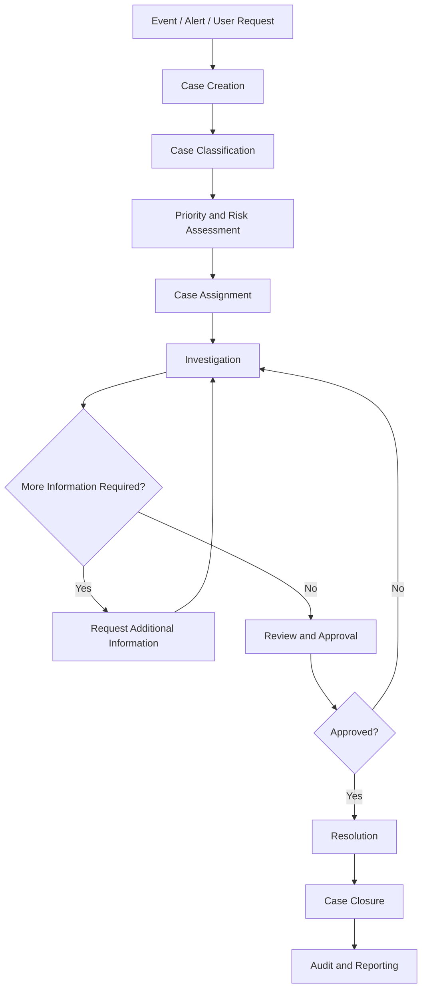
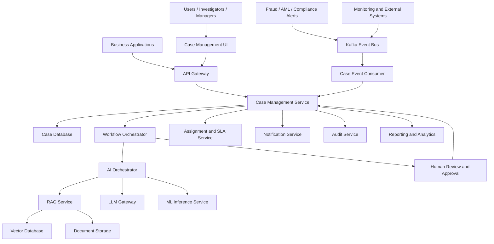
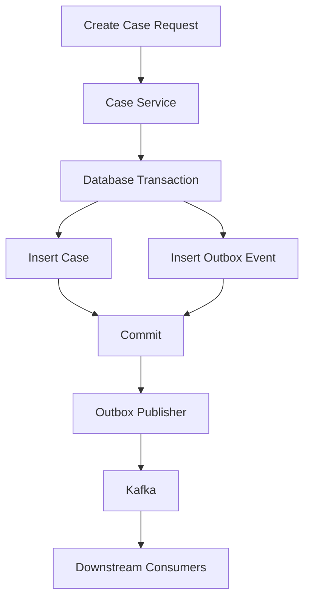
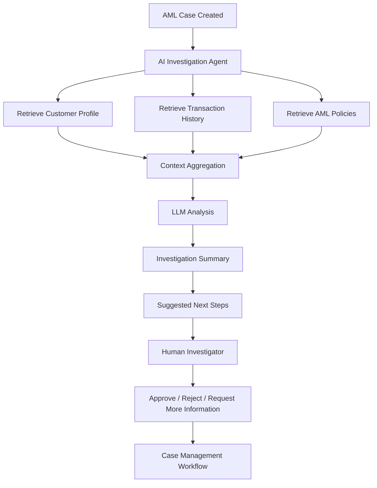

# Case Management System Design – Financial Services AI Use Cases

## 1. Introduction

Case Management is a process used by financial institutions to track, investigate, manage, and resolve business issues, incidents, alerts, and exceptions.

A case represents a specific issue that requires investigation, action, review, approval, or resolution.

Examples:
- A potentially fraudulent bank transaction.
- A suspicious activity alert generated by an AML system.
- A compliance policy violation.
- A customer complaint.
- A missing document in a loan application.
- An operational failure in a financial transaction.
- An investment due diligence issue.

An AI-powered Case Management System can automate case creation, prioritize cases, summarize information, recommend next steps, and assist investigators.

**Important:** AI can assist with investigation and recommendations, but regulated or high-impact decisions should follow approved business rules and human approval workflows.

---

# 2. Common Case Management Lifecycle

Most case management systems follow a similar lifecycle.



## Case Statuses

| Status | Description |
|---|---|
| NEW | Case has been created |
| OPEN | Case is ready for investigation |
| ASSIGNED | Assigned to an investigator |
| IN_PROGRESS | Investigation is ongoing |
| PENDING_INFORMATION | Waiting for additional information |
| PENDING_APPROVAL | Waiting for supervisor or compliance approval |
| ESCALATED | Requires higher-level review |
| RESOLVED | Investigation or required action is completed |
| CLOSED | Case is formally closed |
| REOPENED | Previously closed case requires further investigation |

## Case Priority

| Priority | Description | Example |
|---|---|---|
| P1 - Critical | Immediate attention required | Large-scale fraud incident |
| P2 - High | Significant business or regulatory impact | High-risk AML alert |
| P3 - Medium | Normal investigation | Customer transaction dispute |
| P4 - Low | Routine operational issue | Missing non-critical document |

Priority should be determined using approved business rules and risk models, not solely by an LLM.

---

# 3. Scenario 1 – Banking Fraud Detection and Investigation

## Business Problem

Banks process millions of financial transactions.

Fraud detection systems identify suspicious transactions using predefined rules and machine learning models.

However, fraud analysts must investigate alerts manually by reviewing transaction history, customer behavior, and supporting information.

This creates investigation delays and operational overhead.

## Business Use Case

Build an AI-powered fraud case management system that automatically creates investigation cases when suspicious transactions are identified.

## Example Scenario

A customer usually performs transactions between $50 and $500.

Suddenly:
- A $9,000 transaction occurs.
- Multiple transactions happen within a short period.
- Transactions originate from unusual locations.
- The transaction pattern differs from the customer's historical behavior.

A fraud detection model identifies unusual activity and generates a risk score.

The case management system creates a fraud investigation case.

## Functional Requirements

- FR-01: Consume transaction alerts from fraud detection services.
- FR-02: Create a unique case for each qualifying alert or grouped investigation.
- FR-03: Retrieve customer and transaction information.
- FR-04: Calculate case priority using approved fraud risk rules.
- FR-05: Assign cases to fraud investigators.
- FR-06: Display transaction history and suspicious patterns.
- FR-07: Generate AI-based investigation summaries.
- FR-08: Allow investigators to add notes and evidence.
- FR-09: Support supervisor review and approval.
- FR-10: Record investigation decisions and audit history.

## AI Capabilities

- Transaction anomaly detection.
- Fraud risk scoring.
- Suspicious pattern identification.
- Investigation summarization.
- Evidence retrieval using RAG.
- Suggested next investigation steps.

## Sample Case

```json
{
  "case_id": "FRD-10001",
  "case_type": "FRAUD",
  "customer_id": "CUST-9001",
  "transaction_id": "TXN-12345",
  "risk_score": 0.94,
  "priority": "P1",
  "status": "OPEN",
  "description": "Unusual high-value transaction pattern detected",
  "assigned_team": "Fraud Investigation"
}
```

The risk score above is illustrative, not a real fraud prediction.

---

# 4. Scenario 2 – AML (Anti-Money Laundering) Investigation

## Business Problem

Banks must identify and investigate potentially suspicious financial activities.

AML monitoring systems generate alerts based on transaction patterns, customer profiles, and regulatory rules.

Compliance investigators review these alerts to determine whether further action is required.

## Business Use Case

Build an AML case management platform that groups suspicious activity, retrieves supporting evidence, and assists compliance investigators.

## Example Scenario

A customer performs:
- Multiple cash deposits.
- Transfers across several accounts.
- Transactions below certain reporting thresholds.
- Transfers to unusual counterparties.

An AML monitoring system detects suspicious activity and generates an alert.

The case management system creates an investigation case and groups related alerts.

## Functional Requirements

- FR-01: Ingest AML alerts from monitoring systems.
- FR-02: Group related alerts by customer and investigation.
- FR-03: Retrieve customer profile and transaction history.
- FR-04: Identify related accounts and counterparties.
- FR-05: Generate investigation summaries.
- FR-06: Retrieve relevant AML policies and procedures.
- FR-07: Allow investigators to record findings.
- FR-08: Support escalation to compliance officers.
- FR-09: Maintain investigation evidence and audit records.
- FR-10: Support approved regulatory reporting workflows.

## AI Capabilities

- Alert summarization.
- Entity and relationship extraction.
- Transaction pattern analysis.
- RAG-based policy retrieval.
- Investigation timeline generation.
- Suggested investigation questions.

## Example AI Output

```text
AML Investigation Summary

Customer: CUST-9001

Observations:
1. Multiple deposits within a short period.
2. Transfers to several unrelated counterparties.
3. Transaction behavior differs from historical activity.

Recommended Investigation Steps:
1. Review the source of funds.
2. Verify customer profile information.
3. Review related counterparties.
4. Compare activity against approved AML procedures.

Final determination: Requires investigator review.
```

**Important:** The LLM should not independently determine that money laundering has occurred or automatically file a regulatory report without the required approved process.

---

# 5. Scenario 3 – Compliance and Regulatory Case Management

## Business Problem

Compliance teams review business activities, marketing materials, communications, and operational processes against internal policies and regulatory requirements.

Manual investigation and evidence collection can be time-consuming.

## Business Use Case

Build an AI-powered compliance case management platform that identifies potential violations, tracks findings, and supports human review.

## Example Scenario

A marketing employee uploads an investment presentation.

The compliance AI agent:
1. Extracts text from the presentation.
2. Retrieves relevant marketing and investment policies.
3. Compares presentation content against policy requirements.
4. Identifies potentially non-compliant statements.
5. Creates a compliance case.
6. Assigns the case to a compliance reviewer.

The reviewer examines the findings and decides whether the content can be approved.

## Functional Requirements

- FR-01: Accept compliance alerts and document submissions.
- FR-02: Extract content from submitted documents.
- FR-03: Retrieve relevant policy documents.
- FR-04: Identify potential policy violations.
- FR-05: Create cases with evidence references.
- FR-06: Assign cases to compliance reviewers.
- FR-07: Allow submitters to respond to findings.
- FR-08: Support approval and rejection workflows.
- FR-09: Record final compliance decisions.
- FR-10: Maintain complete audit history.

## AI Capabilities

- Document intelligence.
- Policy-based RAG.
- Potential violation identification.
- Evidence extraction.
- Compliance report summarization.
- Human-in-the-loop workflow.

## Example Case

```json
{
  "case_id": "CMP-20001",
  "case_type": "COMPLIANCE",
  "source": "MARKETING_DOCUMENT",
  "document_id": "DOC-501",
  "priority": "HIGH",
  "status": "PENDING_APPROVAL",
  "finding": "Potential unsupported investment performance statement",
  "policy_reference": "POLICY-101",
  "assigned_team": "Compliance Review"
}
```

---

# 6. Scenario 4 – Loan Application Exception Management

## Business Problem

Loan applications require multiple documents and approvals.

Examples:
- Income verification.
- Bank statements.
- Tax returns.
- Credit reports.
- Identity documents.
- Collateral information.

Applications may be delayed when documents are missing, inconsistent, or incomplete.

## Business Use Case

Build a case management platform that automatically identifies loan application exceptions and routes them to the appropriate team.

## Example Scenario

A customer applies for a mortgage.

The system identifies:
- Missing income documentation.
- Inconsistent income across submitted documents.
- Expired identification.
- Missing property valuation.

The system creates an exception case and assigns it to the mortgage operations team.

## Functional Requirements

- FR-01: Receive loan application events.
- FR-02: Validate mandatory documents.
- FR-03: Extract information using OCR and LLMs.
- FR-04: Compare information across documents.
- FR-05: Create exception cases.
- FR-06: Assign cases to the appropriate operations team.
- FR-07: Request missing information.
- FR-08: Track document submission status.
- FR-09: Escalate cases that exceed SLA.
- FR-10: Close cases when all required validations are complete.

## AI Capabilities

- Document classification.
- Data extraction.
- Cross-document comparison.
- Missing document detection.
- Exception summarization.
- Automated communication drafting.

---

# 7. Scenario 5 – Investment Banking Due Diligence Case Management

## Business Problem

During mergers and acquisitions, investment bankers and due diligence teams review large volumes of financial, legal, operational, and commercial documents.

Potential issues must be identified, assigned, investigated, and resolved.

## Business Use Case

Build a due diligence case management platform that uses AI to identify potential deal risks and track investigation activities.

## Example Scenario

An investment bank is advising a client acquiring another company.

During due diligence, the team identifies:
- Outstanding legal disputes.
- High debt exposure.
- Declining revenue.
- Customer concentration risk.
- Contractual obligations.
- Regulatory issues.

Each finding becomes a due diligence case assigned to a relevant specialist.

## Functional Requirements

- FR-01: Upload and process due diligence documents.
- FR-02: Extract financial and contractual information.
- FR-03: Identify potential deal risks.
- FR-04: Create cases for identified findings.
- FR-05: Categorize cases by financial, legal, operational, and regulatory risk.
- FR-06: Assign cases to specialists.
- FR-07: Track investigation progress.
- FR-08: Attach supporting documents and evidence.
- FR-09: Generate due diligence summaries.
- FR-10: Support final deal review and approval workflows.

## AI Capabilities

- Financial document intelligence.
- Contract analysis.
- Entity extraction.
- Risk identification.
- RAG-based document search.
- Due diligence report generation.

## Example Case

```json
{
  "case_id": "DD-30001",
  "case_type": "DUE_DILIGENCE",
  "deal_id": "DEAL-5001",
  "risk_category": "FINANCIAL",
  "priority": "HIGH",
  "finding": "Potential increase in outstanding debt obligations",
  "status": "IN_PROGRESS",
  "assigned_team": "Financial Due Diligence"
}
```

---

# 8. Scenario 6 – Hedge Fund Investment Research Case Management

## Business Problem

Hedge fund analysts monitor portfolio companies, financial reports, market events, and investment risks.

Significant developments may require investigation by research analysts, portfolio managers, or risk teams.

## Business Use Case

Build an investment research case management platform that creates cases when material company or portfolio events are detected.

## Example Scenario

A hedge fund holds a significant position in a publicly traded company.

The company releases quarterly earnings.

An AI platform detects:
- Revenue below expectations.
- Declining operating margins.
- Increased debt.
- Negative cash flow.
- Significant management changes.

The system creates an investment research case and assigns it to the relevant analyst.

## Functional Requirements

- FR-01: Ingest approved market and company information.
- FR-02: Monitor earnings reports and financial disclosures.
- FR-03: Extract key financial metrics.
- FR-04: Compare current and historical performance.
- FR-05: Identify significant changes using approved rules or ML models.
- FR-06: Create research cases.
- FR-07: Assign cases to analysts.
- FR-08: Generate research summaries with citations.
- FR-09: Track analyst findings and decisions.
- FR-10: Maintain an audit trail.

## AI Capabilities

- Earnings report summarization.
- Financial metric extraction.
- Anomaly detection.
- Sentiment and event classification.
- RAG over research documents.
- Analyst research assistance.

**Important:** AI-generated research findings are decision-support information, not automatically approved investment instructions.

---

# 9. Scenario 7 – Customer Complaint and Dispute Management

## Business Problem

Banks receive customer complaints related to:
- Unauthorized transactions.
- Duplicate payments.
- Delayed transfers.
- Credit card disputes.
- Incorrect fees.
- Loan servicing issues.

Support teams need to investigate and resolve these cases within defined service-level agreements.

## Business Use Case

Build an AI-powered customer dispute management platform.

## Example Scenario

A customer reports an unauthorized $750 credit card transaction.

The system:
1. Authenticates the customer.
2. Creates a dispute case.
3. Retrieves the relevant transaction.
4. Categorizes the dispute.
5. Assigns the case to the appropriate team.
6. Tracks the investigation.
7. Sends status updates to the customer.

## Functional Requirements

- FR-01: Accept customer complaints through multiple channels.
- FR-02: Authenticate customer identity.
- FR-03: Create dispute cases.
- FR-04: Retrieve relevant transaction information.
- FR-05: Categorize and prioritize complaints.
- FR-06: Assign cases to service representatives.
- FR-07: Track SLA deadlines.
- FR-08: Send customer notifications.
- FR-09: Support dispute resolution and approvals.
- FR-10: Maintain case history.

## AI Capabilities

- Complaint classification.
- Sentiment analysis.
- Conversation summarization.
- Knowledge retrieval.
- Suggested resolution steps.
- Automated response drafting.

---

# 10. Scenario 8 – IT Incident and Operational Case Management

## Business Problem

Financial institutions operate distributed systems involving APIs, databases, payment systems, messaging services, and external integrations.

Failures can affect critical business operations.

Operations teams need to identify incidents, investigate root causes, and coordinate resolution.

## Business Use Case

Build an AI-assisted incident management system that creates cases from monitoring alerts and helps engineers investigate failures.

## Example Scenario

A payment processing service experiences increased API failures.

Monitoring detects:
- Increased HTTP 5xx responses.
- High database latency.
- Kafka consumer lag.
- Downstream payment provider timeouts.

The incident management platform creates a P1 incident case and notifies the on-call team.

## Functional Requirements

- FR-01: Ingest alerts from monitoring systems.
- FR-02: Create incident cases automatically.
- FR-03: Correlate related alerts.
- FR-04: Assign incidents to support teams.
- FR-05: Track incident severity and SLA.
- FR-06: Capture logs, metrics, and traces.
- FR-07: Generate incident summaries.
- FR-08: Record root cause analysis.
- FR-09: Track remediation actions.
- FR-10: Maintain post-incident reports.

## AI Capabilities

- Log summarization.
- Alert correlation assistance.
- Root cause investigation assistance.
- Retrieval of historical incidents.
- Suggested troubleshooting steps.
- Post-incident report generation.

**Important:** AI-suggested remediation should not execute production changes without appropriate authorization and approval.

---

# 11. Common Functional Requirements Across Case Management Systems

| ID | Functional Requirement |
|---|---|
| FR-01 | Create a unique case |
| FR-02 | Classify cases by type and category |
| FR-03 | Assign priority and severity |
| FR-04 | Assign cases to teams and users |
| FR-05 | Support case reassignment |
| FR-06 | Track case status and lifecycle |
| FR-07 | Store comments and investigation notes |
| FR-08 | Attach evidence and documents |
| FR-09 | Maintain case history |
| FR-10 | Support approval and escalation workflows |
| FR-11 | Track SLA deadlines |
| FR-12 | Send notifications |
| FR-13 | Support case search and filtering |
| FR-14 | Generate reports and dashboards |
| FR-15 | Maintain complete audit records |
| FR-16 | Integrate with external enterprise systems |
| FR-17 | Support AI-based summarization and recommendations |
| FR-18 | Support human review and approval |

---

# 12. Common Non-Functional Requirements

## Performance

- Support fast case creation.
- Support low-latency case search.
- Support efficient retrieval of investigation evidence.
- Process asynchronous workloads without blocking user requests.

## Scalability

- Support increasing case volumes.
- Support multiple business units.
- Scale application services horizontally.
- Scale event processing independently.
- Support increasing document and evidence storage.

## Availability

- Define availability targets for critical case workflows.
- Avoid single points of failure.
- Support recovery of critical services.
- Provide graceful degradation when AI services are unavailable.

## Reliability and Fault Tolerance

- Implement bounded retries with exponential backoff and jitter.
- Implement circuit breakers for external services.
- Use idempotency to prevent duplicate case creation.
- Use Kafka DLQs for failed event processing.
- Preserve case state during recoverable failures.
- Use transactional outbox patterns where reliable event publication is required.

## Security

- Enterprise authentication.
- Role-based access control.
- Case-level and document-level authorization.
- Encryption at rest and in transit.
- PII protection.
- Secure API integration.
- Tenant isolation.
- Immutable or tamper-evident audit history where required.

## Observability

- Centralized logging.
- Metrics and dashboards.
- Distributed tracing.
- SLA monitoring.
- Case backlog monitoring.
- AI quality monitoring.
- Model latency and token cost monitoring.

## Governance

- Case decision traceability.
- AI model version tracking.
- Prompt version tracking.
- Human approval workflows.
- Data retention and deletion policies.
- Regulatory audit support.

---

# 13. High-Level Case Management Architecture



## Architecture Responsibilities

| Component | Responsibility |
|---|---|
| API Gateway | Authentication, rate limiting, routing |
| Kafka | Asynchronous alert and event delivery |
| Case Management Service | Case creation, updates, assignments |
| Case Database | Stores case details and status |
| Workflow Orchestrator | Coordinates investigation and approval steps |
| AI Orchestrator | Coordinates RAG, LLM, and ML calls |
| Vector Database | Retrieves relevant knowledge |
| Document Storage | Stores case evidence |
| ML Inference Service | Generates approved model predictions |
| LLM Gateway | Routes requests to approved LLMs |
| Notification Service | Sends email or application notifications |
| Audit Service | Records important actions |
| Reporting Service | Case metrics and business reporting |

---

# 14. Database Design

A relational database such as PostgreSQL, SQL Server, or Oracle can store case information and workflow state.

## 14.1 Cases Table

```sql
CREATE TABLE cases (
    case_id VARCHAR(50) PRIMARY KEY,
    case_type VARCHAR(50) NOT NULL,
    source_system VARCHAR(100),
    reference_id VARCHAR(100),
    customer_id VARCHAR(100),
    priority VARCHAR(20),
    status VARCHAR(30),
    title VARCHAR(255),
    description TEXT,
    assigned_team VARCHAR(100),
    assigned_user VARCHAR(100),
    created_at TIMESTAMP,
    updated_at TIMESTAMP,
    due_at TIMESTAMP,
    closed_at TIMESTAMP
);
```

## 14.2 Case Comments Table

```sql
CREATE TABLE case_comments (
    comment_id VARCHAR(50) PRIMARY KEY,
    case_id VARCHAR(50) NOT NULL,
    user_id VARCHAR(100),
    comment_text TEXT,
    created_at TIMESTAMP,
    FOREIGN KEY (case_id) REFERENCES cases(case_id)
);
```

## 14.3 Case Evidence Table

```sql
CREATE TABLE case_evidence (
    evidence_id VARCHAR(50) PRIMARY KEY,
    case_id VARCHAR(50) NOT NULL,
    document_id VARCHAR(100),
    evidence_type VARCHAR(50),
    storage_location VARCHAR(500),
    uploaded_by VARCHAR(100),
    created_at TIMESTAMP,
    FOREIGN KEY (case_id) REFERENCES cases(case_id)
);
```

## 14.4 Case History Table

```sql
CREATE TABLE case_history (
    history_id VARCHAR(50) PRIMARY KEY,
    case_id VARCHAR(50) NOT NULL,
    previous_status VARCHAR(30),
    new_status VARCHAR(30),
    changed_by VARCHAR(100),
    change_reason TEXT,
    created_at TIMESTAMP,
    FOREIGN KEY (case_id) REFERENCES cases(case_id)
);
```

## 14.5 Case Assignment Table

```sql
CREATE TABLE case_assignments (
    assignment_id VARCHAR(50) PRIMARY KEY,
    case_id VARCHAR(50) NOT NULL,
    assigned_team VARCHAR(100),
    assigned_user VARCHAR(100),
    assigned_by VARCHAR(100),
    assigned_at TIMESTAMP,
    FOREIGN KEY (case_id) REFERENCES cases(case_id)
);
```

## 14.6 Case AI Findings Table

```sql
CREATE TABLE case_ai_findings (
    finding_id VARCHAR(50) PRIMARY KEY,
    case_id VARCHAR(50) NOT NULL,
    finding_type VARCHAR(100),
    finding_description TEXT,
    model_name VARCHAR(100),
    model_version VARCHAR(100),
    prompt_version VARCHAR(100),
    confidence_score DECIMAL(8,5),
    created_at TIMESTAMP,
    FOREIGN KEY (case_id) REFERENCES cases(case_id)
);
```

**Database design considerations:**

- Keep case workflow state in a transactional database.
- Store large documents in object storage.
- Store embeddings in a vector database.
- Store model outputs and their provenance separately.
- Preserve audit history.
- Use database constraints and transactions to protect case integrity.

---

# 15. API Design

## Create Case

```http
POST /api/v1/cases
```

Request:

```json
{
  "case_type": "FRAUD",
  "reference_id": "TXN-12345",
  "priority": "HIGH",
  "title": "Suspicious transaction detected",
  "description": "Unusual transaction activity",
  "assigned_team": "Fraud Investigation"
}
```

Response:

```json
{
  "case_id": "FRD-10001",
  "status": "OPEN",
  "created": true
}
```

## Get Case

```http
GET /api/v1/cases/{caseId}
```

## Update Case Status

```http
PATCH /api/v1/cases/{caseId}/status
```

Request:

```json
{
  "status": "IN_PROGRESS",
  "reason": "Investigation started"
}
```

## Assign Case

```http
POST /api/v1/cases/{caseId}/assign
```

Request:

```json
{
  "assigned_team": "AML Investigation",
  "assigned_user": "USER-1001"
}
```

## Add Case Evidence

```http
POST /api/v1/cases/{caseId}/evidence
```

## Generate AI Summary

```http
POST /api/v1/cases/{caseId}/ai-summary
```

Response:

```json
{
  "case_id": "FRD-10001",
  "summary": "Multiple unusual transactions were identified.",
  "evidence": [
    "TXN-12345",
    "TXN-12346"
  ],
  "requires_human_review": true
}
```

---

# 16. Distributed Systems Design Patterns for Case Management

## 16.1 Transactional Outbox

Problem:

A case is saved in the database, but publishing the corresponding Kafka event fails.

This creates inconsistent state between the database and event consumers.

Solution:

Save the case and an outbox event in the same database transaction.



## 16.2 Idempotency

Problem:

An upstream fraud system retries an alert, causing duplicate case creation.

Solution:

- Assign a unique source event ID.
- Enforce a unique constraint on the source event ID.
- Store the result of processing.
- Return the existing case when the same event is received again.

## 16.3 Saga Pattern

Problem:

A case creation workflow involves multiple services:
- Case creation.
- Assignment.
- Notification.
- Document retrieval.
- Approval workflow.

One service may fail after other services have completed their work.

Solution:

Use an orchestrated Saga workflow to coordinate steps, retries, and compensating actions where appropriate.

## 16.4 Dead Letter Queue

Problem:

An invalid or unprocessable event repeatedly fails.

Solution:

After a configured retry policy, route the event to a DLQ for investigation and controlled replay.

## 16.5 Circuit Breaker

Problem:

An external customer information service is unavailable.

Solution:

Use a circuit breaker to prevent repeated calls to the failing dependency. Keep the case in a recoverable state and retry when the dependency recovers.

---

# 17. AI Agent Integration with Case Management

AI agents can assist case investigators by retrieving evidence, analyzing information, and suggesting next steps.

## Example: AML Investigation Agent



### Agent Tools

The AI agent may have access to controlled tools such as:

```text
getCustomerProfile(customerId)
getTransactionHistory(customerId, dateRange)
getRelatedAccounts(customerId)
searchCompliancePolicies(query)
getCaseEvidence(caseId)
addInvestigationNote(caseId, note)
requestSupervisorReview(caseId)
```

### MCP Integration

MCP can provide a standardized interface for the AI application to discover and invoke approved tools.

However:

- Every tool must enforce authorization.
- Tool arguments must be validated.
- Read-only tools should be preferred initially.
- Sensitive write operations should require explicit approval.
- Tool execution must be audited.

---

# 18. Monitoring and Business Metrics

## Operational Metrics

- Number of open cases.
- Number of cases created per day.
- Case assignment latency.
- Average investigation time.
- Cases exceeding SLA.
- Number of escalated cases.
- Case closure rate.
- Failed event processing.
- DLQ message count.

## AI Metrics

- Classification accuracy.
- Precision and recall.
- False-positive rate.
- Summary quality.
- Evidence relevance.
- Retrieval Recall@K.
- Hallucination and unsupported-claim rate.
- Human acceptance rate of AI suggestions.
- Model inference latency.
- Cost per case.

## Business Metrics

- Average case resolution time.
- Reduction in manual investigation effort.
- Investigator productivity.
- Compliance review turnaround time.
- Fraud losses and detection effectiveness.
- Customer satisfaction.
- Percentage of cases resolved within SLA.

---

# 19. Interview Questions and Answers

## Q1. What is a Case Management System?

A Case Management System is an application used to create, assign, track, investigate, and resolve business issues or exceptions.

In financial services, examples include fraud investigation, AML alerts, compliance findings, loan exceptions, and customer disputes.

## Q2. How would you design a scalable case management system?

I would use an API Gateway, Case Management Service, relational database, Kafka for asynchronous event processing, workflow orchestration, and notification services.

I would implement idempotency to avoid duplicate case creation, the transactional outbox pattern for reliable event publishing, and retries and DLQs for fault tolerance.

## Q3. How would you integrate AI into case management?

I would use ML models to classify and prioritize cases and RAG with LLMs to retrieve evidence and generate investigation summaries.

An AI agent could call approved enterprise tools to retrieve information and suggest next steps.

I would keep final decisions and sensitive actions under authorized human control.

## Q4. Why use Kafka?

Kafka decouples upstream alert-producing systems from case management.

For example, fraud detection can publish transaction alerts without waiting for case creation to finish.

Case management consumes the events asynchronously and creates cases.

## Q5. How do you avoid duplicate cases?

I would use idempotency keys and unique source event IDs.

Before creating a new case, the service checks whether that event has already been processed. A unique database constraint protects against concurrent duplicate requests.

## Q6. How do you handle a failed downstream service?

I would implement bounded retries with exponential backoff and jitter, circuit breakers, and DLQs for failed asynchronous events.

I would preserve the case state and resume processing when the dependency recovers.

## Q7. Why use a workflow engine?

A case may involve multiple steps, teams, approvals, and timeouts.

A workflow engine maintains execution state, coordinates transitions, manages retries, and supports human-in-the-loop tasks.

## Q8. How do you ensure case auditability?

I would maintain an immutable or tamper-evident audit history of important actions, including case creation, assignment, status changes, evidence additions, AI recommendations, human decisions, and approvals.

## Q9. Should an AI agent close an AML or fraud case automatically?

Not by default.

The agent can summarize evidence, identify patterns, and recommend next steps. Final case disposition should follow approved business policies, authorization controls, and human review where required.

## Q10. What is the difference between a case and a workflow?

A case represents the business issue being investigated.

A workflow represents the sequence of activities used to process that issue.

For example, an AML case is the investigation record. The workflow defines alert review, evidence collection, investigator assessment, supervisor approval, and closure.

---

# 20. How to Explain Case Management in a Principal AI Architect Interview

"I would design case management as a reusable enterprise platform rather than building a separate application for every business process.

For example, fraud detection, AML, compliance, and loan exception management all generate alerts or exceptions that require investigation, assignment, evidence collection, approvals, and resolution.

I would create a common case management service with a configurable case lifecycle, priority, assignment, SLA tracking, audit history, and workflow orchestration.

Upstream systems would publish events through Kafka, and the case service would consume those events using idempotent processing and a transactional outbox pattern.

For AI capabilities, I would integrate ML models for classification and risk scoring, and RAG with LLMs for evidence retrieval and investigation summaries.

I would also implement role-based access control, human approval, observability, and fault tolerance.

This approach provides reusable infrastructure, consistent governance, and extensibility across multiple financial-services use cases."

---

# 21. Key Takeaways

1. A case represents a business issue requiring investigation or resolution.
2. A workflow defines how the case progresses.
3. Kafka supports asynchronous case creation and event processing.
4. A relational database stores case and workflow state.
5. Object storage stores large documents and evidence.
6. RAG retrieves relevant policies and investigation evidence.
7. ML models classify, predict, and prioritize cases.
8. LLMs summarize findings and recommend next steps.
9. MCP can expose controlled enterprise tools to AI applications.
10. Human approval and auditability are essential for sensitive financial workflows.

## System Design Sequence

```text
Business Problem
      |
      v
Identify Case Types
      |
      v
Define Case Lifecycle
      |
      v
Define Business Requirements
      |
      v
Define Functional Requirements
      |
      v
Define NFRs
      |
      v
Design APIs and Database
      |
      v
Design Kafka Event Processing
      |
      v
Add Workflow Orchestration
      |
      v
Integrate ML / RAG / LLM / Agents
      |
      v
Security / Audit / Monitoring
      |
      v
Failure Handling and Scalability
```

**Interview principle:** Design the case management foundation first. Add AI to improve investigation and decision support, rather than making the entire case lifecycle dependent on an LLM.
