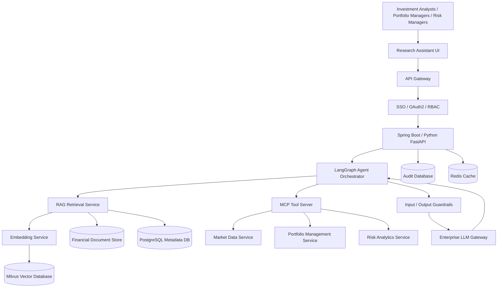
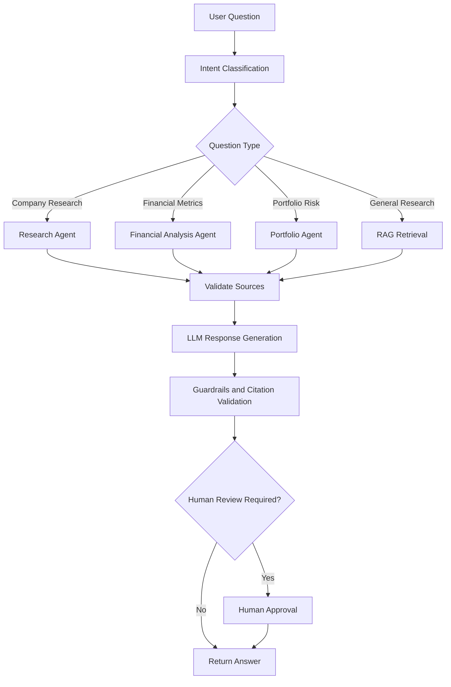

# Hedge Fund Investment Research & Portfolio Intelligence Platform – System Design

**AI System Design – Day 3**

## 1. Problem Statement

A hedge fund manages investments across multiple asset classes, including equities, fixed income, derivatives, currencies, and alternative investments.

Investment professionals such as portfolio managers, research analysts, traders, and risk managers consume large volumes of information every day:

- Company annual reports (10-K), quarterly reports (10-Q), and earnings transcripts
- SEC filings and regulatory disclosures
- Research reports from investment banks
- Market data, stock prices, and trading volumes
- Economic indicators and financial news
- Internal investment research and historical investment decisions
- Portfolio holdings, exposure, and risk reports

Today, analysts manually search through documents, spreadsheets, market data, and research systems to answer investment-related questions.

This creates several challenges:

1. Research analysts spend significant time collecting and analyzing information.
2. Portfolio managers lack a unified view of relevant investment information.
3. Comparing companies and identifying investment opportunities requires manual effort.
4. Risk managers need timely visibility into portfolio exposure and market risks.
5. Research insights may be scattered across multiple systems.
6. Investment decisions need to be traceable, explainable, and supported by reliable sources.

### Proposed Solution

Build an enterprise AI-powered Hedge Fund Investment Research and Portfolio Intelligence Platform.

The platform will allow investment professionals to ask natural-language questions, retrieve relevant financial information, compare companies, summarize earnings reports, analyze portfolio exposure, and generate research insights.

The platform will combine:

- Retrieval-Augmented Generation (RAG)
- Large Language Models (LLMs)
- Agentic AI workflows
- Financial market data integrations
- Vector databases
- Portfolio analytics services
- MCP-based tool integrations
- Human-in-the-loop approval

**Important:** The platform supports investment research and decision-making. It does not autonomously execute trades or make final investment decisions.

## 2. Example Business Use Cases

### Use Case 1: Company Research

An analyst asks:

"Analyze Apple's latest quarterly earnings and compare its revenue growth, operating margins, and debt levels with Microsoft."

The platform:
1. Retrieves the latest earnings reports.
2. Extracts financial metrics.
3. Retrieves relevant market data.
4. Compares the companies.
5. Generates a grounded research summary.
6. Provides references to the original reports.

### Use Case 2: Investment Research Assistant

A portfolio manager asks:

"What are the major risks associated with investing in semiconductor companies?"

The platform:
1. Searches internal research documents.
2. Retrieves relevant market and industry reports.
3. Analyzes financial and macroeconomic information.
4. Identifies potential risk factors.
5. Generates a summarized report with citations.

### Use Case 3: Portfolio Risk Analysis

A risk manager asks:

"Show me our portfolio's exposure to technology stocks and identify concentration risks."

The platform:
1. Calls the portfolio management service.
2. Retrieves current holdings and sector classifications.
3. Calculates sector-level exposure.
4. Identifies concentration risks based on configured thresholds.
5. Generates an explanation for the risk manager.

### Use Case 4: Earnings Analysis

An analyst asks:

"Summarize the latest earnings calls for the top five companies in our portfolio."

The platform:
1. Retrieves portfolio holdings.
2. Identifies the five largest positions.
3. Retrieves their latest earnings transcripts.
4. Summarizes revenue, profitability, guidance, and management commentary.
5. Highlights material changes and potential risks.

## 3. Functional Requirements

### Core Requirements

1. Users should authenticate through enterprise SSO.
2. Users should ask investment-related questions using natural language.
3. The platform should retrieve financial documents from internal and external sources.
4. The platform should support document ingestion, parsing, chunking, and embedding.
5. The platform should support semantic and keyword-based search.
6. The platform should generate answers grounded in retrieved documents.
7. The platform should provide citations and source references.
8. The platform should retrieve market data through authorized APIs.
9. The platform should compare companies using financial metrics.
10. The platform should retrieve portfolio holdings and calculate exposures.
11. The platform should generate research summaries and reports.
12. The platform should maintain conversation history.
13. The platform should support audit logging and human review.

### Advanced AI Requirements

1. Support multiple specialized agents.
2. Support agent-to-tool communication using MCP.
3. Support stateful workflows using LangGraph.
4. Support financial document summarization.
5. Support company comparison and financial analysis.
6. Support portfolio risk and concentration analysis.
7. Support evaluation of LLM output quality.
8. Support human approval for sensitive workflows.

## 4. Non-Functional Requirements

### Scalability
- Support thousands of investment professionals.
- Handle millions of financial documents.
- Support concurrent research queries.
- Scale ingestion and embedding pipelines independently.

### Availability
- Target 99.9% availability for research services.
- Provide graceful degradation if external market data providers are unavailable.

### Reliability
- Use retries, exponential backoff, and circuit breakers.
- Ensure idempotent document ingestion.
- Maintain durable workflow state.

### Security
- Enterprise SSO and role-based access control.
- Restrict access to sensitive portfolio and research data.
- Encrypt data at rest and in transit.
- Apply tenant, fund, and strategy-level data isolation where required.

### AI Governance
- Prevent unsupported financial claims.
- Require source citations for research answers.
- Track model versions and prompts.
- Monitor hallucination, groundedness, and retrieval quality.
- Keep final investment decisions with authorized professionals.

## 5. Capacity Estimation

The following figures are illustrative assumptions for system design.

| Metric | Assumption |
|---|---:|
| Investment professionals | 5,000 |
| Daily active users | 3,000 |
| Queries per user per day | 30 |
| Total daily queries | 90,000 |
| Average queries per second | ~1.04 |
| Peak traffic multiplier | 10x |
| Peak queries per second | ~11 |
| Financial documents | 2 million |
| Average document size | 2 MB |
| Total document storage | ~4 TB |
| Average chunks per document | 20 |
| Total vector records | 40 million |

For 40 million vectors with 1,536 dimensions using Float32:

40M × 1,536 × 4 bytes = approximately 245.8 GB of raw vector storage.

This excludes indexes, metadata, replication, and operational overhead.

## 6. High-Level Architecture

### Architecture Diagram



### Architecture Components

**1. API Gateway**
- Authentication and authorization enforcement.
- Rate limiting.
- Request routing.
- API security.

**2. Spring Boot / FastAPI**
- User and conversation management.
- Research API endpoints.
- Integration with enterprise services.
- Business validation.

**3. LangGraph Orchestrator**
- Maintains workflow state.
- Determines which research steps are required.
- Routes tasks to RAG or specialized tools.
- Supports conditional execution and human approval.

**4. RAG Retrieval Service**
- Retrieves relevant financial reports.
- Performs hybrid search.
- Applies metadata and access filters.
- Reranks retrieved documents.

**5. Milvus**
- Stores document embeddings.
- Supports approximate nearest-neighbor search.
- Supports metadata filtering.

**6. MCP Server**
Exposes authorized tools to AI agents, such as:
- get_company_profile()
- get_latest_earnings()
- get_stock_price()
- get_portfolio_holdings()
- calculate_sector_exposure()
- get_financial_metrics()

**7. Enterprise LLM Gateway**
- Routes requests to approved models.
- Enforces model access policies.
- Tracks token usage.
- Supports model monitoring and governance.

## 7. End-to-End Document Ingestion Flow

Financial documents can originate from:
- SEC filings.
- Internal research repositories.
- Investment bank research reports.
- Earnings transcripts.
- Approved external data providers.

### Ingestion Pipeline

1. Document arrives through an ingestion API or scheduled process.
2. Store the original document in S3 or Azure Blob Storage.
3. Publish a document-ingestion event to Kafka.
4. Document processing service consumes the event.
5. Extract text and tables using PDF parsers or OCR.
6. Perform document classification.
7. Split the content into meaningful chunks.
8. Generate embeddings.
9. Store embeddings in Milvus.
10. Store document metadata in PostgreSQL.
11. Record ingestion status and processing metrics.

### Example Chunking Strategy

For financial documents, use structure-aware chunking rather than blindly splitting every fixed number of tokens.

Example:
- Document: Annual Report
- Section: Management Discussion and Analysis
- Subsection: Revenue
- Chunk size: approximately 500–800 tokens
- Overlap: approximately 50–100 tokens

Preserve important metadata:
- Company ticker
- Company name
- Filing type
- Fiscal year
- Reporting period
- Document date
- Section name
- Page number
- Source
- Access permissions

## 8. RAG Architecture

### Query Flow

User asks:

"Compare revenue growth and operating margins for Apple and Microsoft."

1. Receive the user question.
2. Authenticate user and validate access.
3. Identify the companies and requested metrics.
4. Generate a query embedding.
5. Search Milvus for relevant financial documents.
6. Apply metadata filters for company, reporting period, and document type.
7. Perform keyword and semantic retrieval.
8. Rerank the retrieved chunks.
9. Retrieve additional structured financial metrics where needed.
10. Send the grounded context to the LLM.
11. Validate the response using output guardrails.
12. Return the answer with source citations.

### Hybrid Search

Use both:

- Dense vector search for semantic similarity.
- Sparse or keyword search for exact terms, financial terminology, and ticker symbols.

Combine results using a ranking strategy such as Reciprocal Rank Fusion (RRF), then rerank the strongest candidates.

## 9. Agentic AI Architecture

Use specialized agents with clearly defined responsibilities.

### 1. Research Agent
- Understands investment research questions.
- Retrieves internal and external research.
- Summarizes relevant information.

### 2. Financial Analysis Agent
- Extracts financial metrics.
- Compares companies.
- Calculates financial ratios using validated data.

### 3. Portfolio Agent
- Retrieves portfolio holdings.
- Analyzes sector and asset-class exposure.
- Identifies concentration risks.

### 4. Risk Agent
- Retrieves risk reports.
- Analyzes configured risk indicators.
- Explains potential risk factors.

### 5. Report Generation Agent
- Combines research findings.
- Produces structured investment research reports.
- Includes supporting references.

### LangGraph Workflow



LangGraph is useful here because the workflow has multiple conditional paths, state transitions, retries, and possible human approval steps.

## 10. Data Models and Database Design

Use relational storage for structured business data and vector storage for semantic document retrieval.

### PostgreSQL Tables

#### users

```sql
CREATE TABLE users (
    user_id UUID PRIMARY KEY,
    username VARCHAR(150),
    email VARCHAR(255),
    role VARCHAR(100),
    department VARCHAR(100),
    created_at TIMESTAMP
);
```

#### companies

```sql
CREATE TABLE companies (
    company_id UUID PRIMARY KEY,
    ticker VARCHAR(20),
    company_name VARCHAR(255),
    exchange VARCHAR(50),
    sector VARCHAR(100),
    industry VARCHAR(100)
);
```

#### financial_documents

```sql
CREATE TABLE financial_documents (
    document_id UUID PRIMARY KEY,
    company_id UUID,
    document_type VARCHAR(100),
    reporting_period VARCHAR(50),
    document_date DATE,
    storage_location TEXT,
    ingestion_status VARCHAR(50),
    created_at TIMESTAMP
);
```

#### portfolios

```sql
CREATE TABLE portfolios (
    portfolio_id UUID PRIMARY KEY,
    portfolio_name VARCHAR(255),
    fund_name VARCHAR(255),
    strategy VARCHAR(100),
    created_at TIMESTAMP
);
```

#### portfolio_holdings

```sql
CREATE TABLE portfolio_holdings (
    holding_id UUID PRIMARY KEY,
    portfolio_id UUID,
    company_id UUID,
    quantity NUMERIC(20, 4),
    market_value NUMERIC(20, 2),
    currency VARCHAR(10),
    as_of_date DATE
);
```

#### conversations

```sql
CREATE TABLE conversations (
    conversation_id UUID PRIMARY KEY,
    user_id UUID,
    created_at TIMESTAMP,
    updated_at TIMESTAMP
);
```

#### audit_logs

```sql
CREATE TABLE audit_logs (
    audit_id UUID PRIMARY KEY,
    user_id UUID,
    action VARCHAR(255),
    resource_id VARCHAR(255),
    timestamp TIMESTAMP,
    status VARCHAR(50)
);
```

### Milvus Vector Schema

| Field | Type | Description |
|---|---|---|
| chunk_id | VARCHAR | Unique chunk identifier |
| document_id | VARCHAR | Source document |
| company_id | VARCHAR | Company identifier |
| ticker | VARCHAR | Company ticker |
| document_type | VARCHAR | 10-K, 10-Q, transcript |
| reporting_period | VARCHAR | Fiscal reporting period |
| section_name | VARCHAR | Financial document section |
| page_number | INT | Source page |
| chunk_text | VARCHAR | Extracted text |
| embedding | FLOAT_VECTOR | Semantic representation |

Example:

```python
{
    "chunk_id": "chunk-1001",
    "document_id": "doc-101",
    "company_id": "company-apple",
    "ticker": "AAPL",
    "document_type": "10-K",
    "reporting_period": "FY2026",
    "section_name": "Revenue",
    "page_number": 42,
    "chunk_text": "The company reported...",
    "embedding": [0.12, 0.34, 0.56]
}
```

The embedding array above is illustrative; production vectors must match the configured model dimension.

## 11. API Design

### Research API

```http
POST /api/v1/research/query
```

Request:

```json
{
  "conversationId": "conv-123",
  "question": "Compare Apple and Microsoft revenue growth",
  "companies": ["AAPL", "MSFT"],
  "reportingPeriod": "FY2026"
}
```

Response:

```json
{
  "answer": "Apple and Microsoft reported...",
  "sources": [
    {
      "company": "Apple",
      "documentType": "10-K",
      "page": 42
    }
  ],
  "confidence": 0.94
}
```

The confidence value is illustrative. In production, define and calibrate confidence rather than treating an LLM's self-reported confidence as a reliable probability.

### Portfolio API

```http
GET /api/v1/portfolios/{portfolioId}/holdings
```

### Company Metrics API

```http
GET /api/v1/companies/{ticker}/financial-metrics
```

### Document Ingestion API

```http
POST /api/v1/documents/ingest
```

## 12. Security and AI Governance

Hedge funds handle confidential investment information, so access control is critical.

### Application Security
- SSO using OAuth2/OIDC.
- RBAC and attribute-based access control.
- Fund, strategy, and portfolio-level permissions.
- Encryption at rest and in transit.
- Secrets management.
- Audit trails.

### AI Security
- Prompt injection detection.
- PII and sensitive data protection.
- Retrieval access filtering before context reaches the LLM.
- Output validation.
- Source citation verification.
- Prevent unauthorized cross-fund data access.
- Treat retrieved documents and external content as untrusted input.

### Investment Governance
- No autonomous trade execution.
- No unapproved investment recommendations.
- Human review for sensitive research outputs.
- Traceability of inputs, sources, model versions, and outputs.
- Compliance and retention policies.

## 13. Scalability and Reliability

### Scalability
- Horizontally scale FastAPI and Spring Boot services.
- Use Kubernetes for deployment and autoscaling.
- Use Kafka for asynchronous document ingestion.
- Scale embedding workers independently.
- Partition vector collections or use appropriate Milvus sharding.
- Use Redis for frequently accessed metadata and query results.

### Reliability
- Retry transient failures with exponential backoff and jitter.
- Use circuit breakers for external data providers.
- Apply request timeouts.
- Use idempotency keys for ingestion.
- Use Kafka dead-letter queues.
- Persist LangGraph workflow state.
- Provide graceful fallback when external market data is unavailable.

### Example Failure Scenarios

| Failure | Mitigation |
|---|---|
| LLM unavailable | Retry, fallback to approved model |
| Milvus unavailable | Fail gracefully; use keyword search if available |
| Market data API unavailable | Return last available data with timestamp and staleness warning |
| Kafka consumer failure | Retry and DLQ |
| Document parsing failure | Retry or route for manual review |
| Unauthorized portfolio access | Deny request and audit |
| Prompt injection | Detect, isolate untrusted content, block unsafe tool actions |
| Outdated financial data | Enforce as-of timestamps and freshness checks |

## 14. Observability and AI Evaluation

### Infrastructure Metrics
- API latency.
- Request throughput.
- Error rate.
- CPU and memory utilization.
- Kafka consumer lag.
- Vector search latency.
- LLM latency.
- Token consumption.

### AI Metrics
- Retrieval precision and recall.
- Context relevance.
- Answer groundedness.
- Citation correctness.
- Hallucination rate.
- Financial metric extraction accuracy.
- Tool-call success rate.
- Human review and rejection rate.

### Tools
- Prometheus
- Grafana
- OpenTelemetry
- Centralized application logging
- LLM evaluation framework

## 15. Technology Stack

| Layer | Technology |
|---|---|
| Frontend | React / Angular |
| API | Java Spring Boot / Python FastAPI |
| Orchestration | LangGraph |
| LLM | Enterprise-approved LLM gateway |
| Embeddings | Text embedding model |
| Vector Database | Milvus |
| Relational Database | PostgreSQL |
| Object Storage | S3 / Azure Blob |
| Messaging | Kafka |
| Cache | Redis |
| Tool Integration | MCP |
| Containerization | Docker |
| Orchestration | Kubernetes |
| Monitoring | Prometheus / Grafana / OpenTelemetry |

## 16. Future Enhancements

1. Multi-agent investment research workflows.
2. Automated earnings-call summarization.
3. Financial statement comparison.
4. Scenario and sensitivity analysis.
5. Portfolio exposure monitoring.
6. Event-driven research alerts.
7. Natural-language access to approved internal analytics.
8. Research report generation with citations.
9. Integration with approved market data vendors.
10. Human-reviewed investment research workflows.

## 17.  Summary

"I would design this as an enterprise AI-powered investment research platform combining RAG, agentic workflows, structured financial data, and authorized market-data integrations.

I would use Milvus for semantic retrieval of financial documents, PostgreSQL for structured metadata and portfolio information, Kafka for asynchronous ingestion, and LangGraph for stateful orchestration of specialized research and portfolio agents.

For real-time or structured financial information, I would not rely on RAG alone. I would use authorized APIs and deterministic calculation services, then let the LLM explain the validated results with source references.

Security, fund-level data isolation, auditability, data freshness, and human oversight would be critical because investment research can influence high-value financial decisions."

## 18. Key Design Decisions to Explain in an Interview

1. Why use RAG for financial documents?
2. Why combine vector search with keyword search?
3. Why use Milvus instead of storing all vectors in PostgreSQL?
4. Why use LangGraph for agent orchestration?
5. When should an agent call an MCP tool instead of retrieving documents?
6. Why should financial calculations be performed by deterministic services?
7. How do you prevent cross-fund data leakage?
8. How do you handle stale market data?
9. How do you evaluate financial answer accuracy?
10. Why should the platform not autonomously execute trades?
