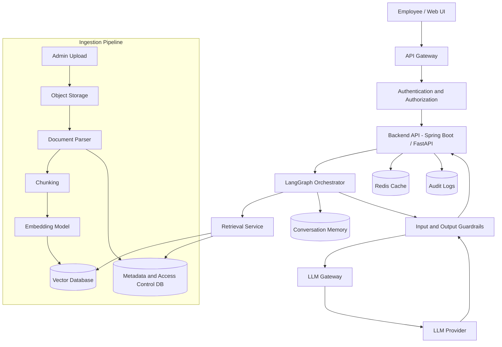
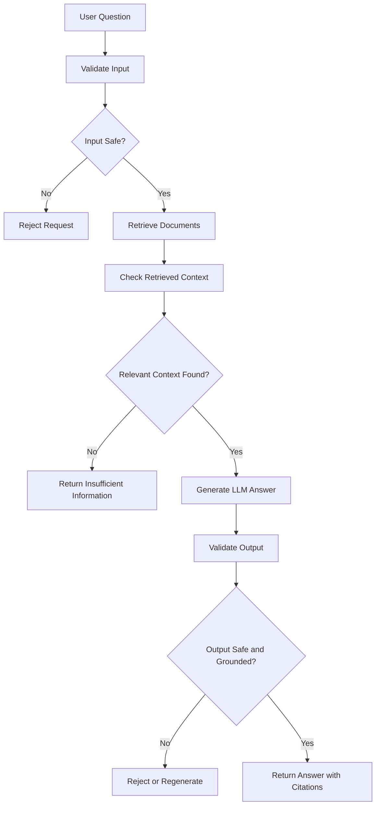
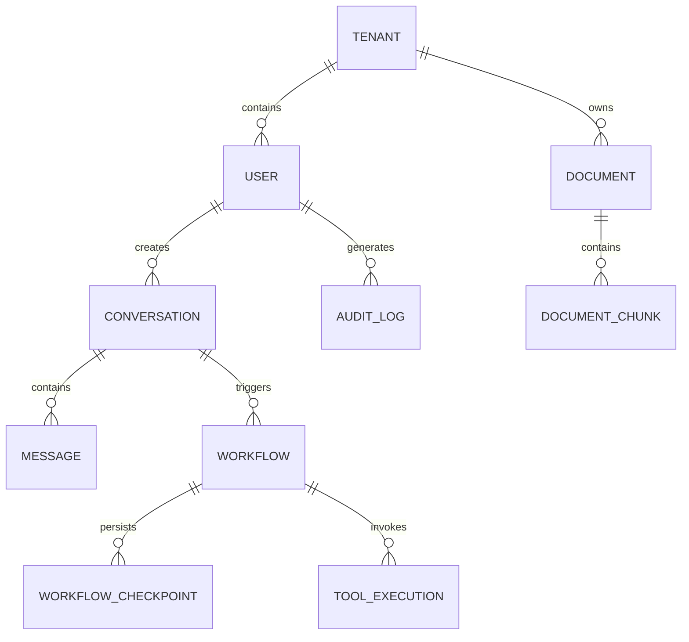

#Enterprise RAG Chatbot – System Design

**Domain:** Financial Services  
**Architecture:** Enterprise-grade RAG (Retrieval-Augmented Generation)  
**Goal:** Design a secure, scalable, reliable AI chatbot that answers employee questions using internal enterprise documents.

---

## 1. Problem Statement

Design an enterprise AI chatbot that allows employees of a financial institution to ask questions about internal documents, policies, procedures, compliance guidelines, and business knowledge.

The chatbot must retrieve relevant information from approved enterprise documents and generate accurate, contextual answers using an LLM.

Example questions:

- What is our information security policy?
- What is the employee expense reimbursement process?
- Explain the compliance approval workflow.
- What are the rules for handling confidential client information?

The chatbot must provide citations and references to the original documents.

It must prevent employees from accessing documents they are not authorized to view.

## 2. Functional Requirements

1. Employees can authenticate and access the chatbot.
2. Employees can ask questions using natural language.
3. The system retrieves relevant enterprise documents.
4. The system generates answers using an LLM.
5. Answers include document citations and page references.
6. Users can ask follow-up questions.
7. The system maintains conversation history.
8. Administrators can upload, update, and delete documents.
9. The system supports PDF, Word, and PowerPoint documents.
10. The system enforces document-level access control.
11. The system records user activity and audit information.
12. Administrators can monitor document ingestion and processing status.

## 3. Non-Functional Requirements


| Requirement | Design consideration |
|---|---|
| Scalability | Support thousands of employees and growing document volumes |
| Consistency | Ensure document versions and metadata remain consistent |
| Availability | Keep chatbot services highly available |
| Reliability | Handle model, database, and downstream failures |
| Fault tolerance | Retries, timeouts, circuit breakers, fallback |
| Security | Authentication, authorization, encryption, tenant isolation |
| Performance | Fast retrieval and acceptable response latency |
| Observability | Logs, metrics, traces, model evaluation |
| Cost | Token optimization, caching, model selection |
| Auditability | Record access, document versions, and AI interactions |

## 4. Capacity Estimation

For an initial design, assume:

- 10,000 employees.
- 2,000 concurrent users during peak periods.
- 100,000 enterprise documents.
- Average document size: 2 MB.
- Average document: 20 pages.
- Average page: 500 tokens.
- Average user: 20 questions per day.

### Daily request volume

10,000 users × 20 questions = 200,000 questions per day.

Average requests per second:

200,000 / 86,400 = approximately 2.3 requests per second.

Assume peak traffic is 10 times the average:

Approximately 23 requests per second.

These are planning assumptions, not measured production figures.

### Document storage

100,000 documents × 2 MB = 200 GB.

### Approximate chunk count

Assume 10,000 tokens per document and 500 tokens per chunk.

100,000 × 20 chunks = approximately 2 million chunks.

Actual chunk counts depend on document length, chunk size, and overlap.

## 5. High-Level Architecture

### Architecture diagram



### Main components

| Component | Responsibility |
|---|---|
| Web UI | Employee chat interface |
| API Gateway | Authentication integration, rate limiting, routing |
| Backend API | Request validation and business logic |
| LangGraph | Workflow orchestration and state management |
| Retrieval Service | Semantic and hybrid search |
| Vector DB | Stores document embeddings and chunk metadata |
| SQL Database | Stores users, documents, conversations, permissions |
| Object Storage | Stores original enterprise documents |
| Embedding Model | Converts text chunks into vectors |
| LLM Gateway | Routes requests to approved LLMs |
| Guardrails | Input validation, prompt injection detection, output validation |
| Redis | Caching and short-lived data |
| Audit Service | Records security and business events |

## 6. End-to-End Request Flow

### A. Document ingestion flow

1. Administrator uploads a PDF, Word, or PowerPoint document.
2. Backend validates the document and administrator permissions.
3. Original document is stored in Azure Blob Storage or Amazon S3.
4. An ingestion event is published to Kafka or Azure Service Bus.
5. Document processing service extracts the text.
6. Text is cleaned and divided into smaller chunks.
7. Metadata is attached to each chunk:
   - Document ID
   - Tenant ID
   - Page number
   - Document version
   - Access groups
   - Last updated timestamp
8. Embedding model converts each chunk into a vector.
9. Embeddings and metadata are stored in the vector database.
10. Document processing status is updated in SQL.

### B. Question-answering flow

1. Employee submits a question.
2. API Gateway validates the incoming request.
3. Authentication verifies the employee's identity.
4. Authorization determines which documents the employee can access.
5. Backend sends the question to the LangGraph orchestrator.
6. Input guardrails inspect the question for malicious instructions and other risks.
7. The retrieval service converts the question into an embedding.
8. Vector search retrieves relevant document chunks.
9. Metadata filters enforce tenant and document permissions during retrieval.
10. The orchestrator builds a grounded prompt using retrieved content.
11. LLM Gateway sends the request to the approved LLM.
12. LLM generates an answer based on the retrieved context.
13. Output guardrails validate the response.
14. The chatbot returns the answer with citations.
15. Conversation and audit information are persisted.

### Important RAG concept

RAG stands for Retrieval-Augmented Generation.

- Retrieval: Find relevant enterprise documents.
- Augmentation: Add the retrieved context to the LLM prompt.
- Generation: Generate an answer grounded in that context.

RAG helps reduce hallucinations, but does not guarantee factual correctness.

## 7. AI Architecture Details

### 7.1 RAG architecture

The RAG pipeline has two main stages.

**Offline stage: Indexing**

Document → Parsing → Chunking → Embedding → Vector Database.

**Online stage: Retrieval and generation**

Question → Query Embedding → Similarity Search → Context Assembly → LLM → Answer.

### 7.2 Chunking strategy

Use an initial chunk size of approximately 500 tokens with 50–100 tokens of overlap.

Benefits:

- Preserves contextual continuity.
- Avoids excessively large chunks.
- Improves retrieval relevance.

For financial and compliance documents, consider structure-aware chunking that preserves headings, sections, tables, and page references.

### 7.3 Embedding model

An embedding model converts text into numerical vectors.

Example:

```text
Input:
"Employees must protect confidential client information."

Output:
[0.12, 0.45, 0.78, 0.21, ...]
```

Store vectors in a vector database such as Milvus or Azure AI Search.

The vector dimension must match the selected embedding model.

### 7.4 Retrieval strategy

Use hybrid search:

- Vector similarity search for semantic relevance.
- Keyword search for exact terms, policy numbers, and names.
- Metadata filtering for tenant, document version, and access permissions.
- Optional reranking to improve the relevance of retrieved chunks.

### 7.5 Agent orchestration

Use LangGraph to manage the workflow.

Example workflow:



LangGraph is useful because it supports:

- Stateful workflows.
- Conditional routing.
- Checkpointing.
- Retry and recovery logic.
- Human-in-the-loop approval when required.

## 8. Data Models and Database Design

A production AI system needs explicit data models, relationships, and storage decisions.

### 8.1 Main entities

| Entity | Purpose | Database |
|---|---|---|
| Tenant | Organization or business unit | SQL |
| User | Employee identity and role | SQL |
| Conversation | Chat session | SQL |
| Message | User and AI messages | SQL |
| Document | Document metadata | SQL |
| Document Chunk | Extracted document sections | Vector DB |
| Workflow | Agent execution state | SQL |
| Workflow Checkpoint | Persisted workflow state | Checkpoint store |
| Tool Execution | Tool invocation records | SQL |
| Audit Log | Security and activity records | SQL / audit store |

### 8.2 Entity relationship diagram



### 8.3 SQL data models

**Tenant**

```sql
CREATE TABLE tenants (
    tenant_id UUID PRIMARY KEY,
    tenant_name VARCHAR(255) NOT NULL,
    status VARCHAR(50),
    created_at TIMESTAMP DEFAULT CURRENT_TIMESTAMP
);
```

**User**

```sql
CREATE TABLE users (
    user_id UUID PRIMARY KEY,
    tenant_id UUID NOT NULL REFERENCES tenants(tenant_id),
    username VARCHAR(255) NOT NULL,
    email VARCHAR(255) NOT NULL,
    role VARCHAR(100),
    created_at TIMESTAMP DEFAULT CURRENT_TIMESTAMP
);
```

**Conversation**

```sql
CREATE TABLE conversations (
    conversation_id UUID PRIMARY KEY,
    tenant_id UUID NOT NULL REFERENCES tenants(tenant_id),
    user_id UUID NOT NULL REFERENCES users(user_id),
    status VARCHAR(50),
    created_at TIMESTAMP DEFAULT CURRENT_TIMESTAMP,
    updated_at TIMESTAMP
);
```

**Message**

```sql
CREATE TABLE messages (
    message_id UUID PRIMARY KEY,
    conversation_id UUID NOT NULL
        REFERENCES conversations(conversation_id),
    sender VARCHAR(30) NOT NULL,
    content TEXT,
    model_name VARCHAR(100),
    token_count INTEGER,
    created_at TIMESTAMP DEFAULT CURRENT_TIMESTAMP
);
```

**Document**

```sql
CREATE TABLE documents (
    document_id UUID PRIMARY KEY,
    tenant_id UUID NOT NULL REFERENCES tenants(tenant_id),
    document_name VARCHAR(255) NOT NULL,
    document_type VARCHAR(50),
    storage_uri TEXT,
    document_version INTEGER,
    processing_status VARCHAR(50),
    uploaded_by UUID REFERENCES users(user_id),
    created_at TIMESTAMP DEFAULT CURRENT_TIMESTAMP,
    updated_at TIMESTAMP
);
```

**Workflow**

```sql
CREATE TABLE workflows (
    workflow_id UUID PRIMARY KEY,
    conversation_id UUID REFERENCES conversations(conversation_id),
    workflow_type VARCHAR(100),
    workflow_status VARCHAR(50),
    current_step VARCHAR(100),
    retry_count INTEGER DEFAULT 0,
    created_at TIMESTAMP DEFAULT CURRENT_TIMESTAMP,
    updated_at TIMESTAMP
);
```

**Audit Log**

```sql
CREATE TABLE audit_logs (
    audit_id UUID PRIMARY KEY,
    tenant_id UUID NOT NULL,
    user_id UUID,
    action VARCHAR(100),
    resource_type VARCHAR(100),
    resource_id UUID,
    status VARCHAR(50),
    created_at TIMESTAMP DEFAULT CURRENT_TIMESTAMP
);
```

Production considerations:

- Add indexes on tenant_id, user_id, conversation_id, and document_id.
- Enforce tenant-scoped access.
- Use appropriate uniqueness constraints.
- Apply encryption and retention policies.
- Avoid storing secrets or unnecessary sensitive information in chat logs.
- Use pagination for conversation history.
- Consider partitioning high-volume message and audit tables.

### 8.4 Vector database schema

Example Milvus collection:

| Field | Type | Description |
|---|---|---|
| chunk_id | VARCHAR | Unique chunk ID |
| document_id | VARCHAR | Parent document |
| tenant_id | VARCHAR | Tenant identifier |
| chunk_text | VARCHAR | Extracted text |
| embedding | FLOAT_VECTOR | Embedding vector |
| page_number | INT | Source page |
| document_version | INT | Document version |
| access_groups | ARRAY | Authorized groups |

Example vector record:

```python
{
    "chunk_id": "chunk-1001",
    "document_id": "doc-101",
    "tenant_id": "tenant-001",
    "chunk_text": "Employees must protect confidential client data.",
    "embedding": [0.12, 0.45, 0.78],
    "page_number": 12,
    "document_version": 1,
    "access_groups": ["compliance", "legal"]
}
```

The embedding values above are illustrative. A real vector must have the dimension required by the embedding model.

### 8.5 Database selection

| Data | Recommended technology |
|---|---|
| Users, tenants, permissions | PostgreSQL / Azure SQL |
| Conversations and messages | PostgreSQL / Azure SQL |
| Document metadata | PostgreSQL / Azure SQL |
| Document chunks and embeddings | Milvus / Azure AI Search |
| Original documents | Azure Blob / Amazon S3 |
| Cache | Redis |
| Workflow state | SQL / LangGraph checkpoint store |
| Event messaging | Kafka / Azure Service Bus |
| Audit records | SQL / immutable audit storage |

**Architecture decision:** Do not store every type of data in the vector database. Use SQL for structured business data, object storage for original files, and a vector database for semantic retrieval.

## 9. API Design

### Upload document

```http
POST /api/v1/documents
Authorization: Bearer <JWT>
Content-Type: multipart/form-data
```

Response:

```json
{
  "documentId": "doc-101",
  "status": "PROCESSING"
}
```

### Ask a question

```http
POST /api/v1/chat
Authorization: Bearer <JWT>
Content-Type: application/json
```

Request:

```json
{
  "conversationId": "conv-101",
  "question": "What is our confidential data policy?"
}
```

Response:

```json
{
  "conversationId": "conv-101",
  "answer": "Employees must protect confidential client information.",
  "citations": [
    {
      "documentId": "doc-101",
      "documentName": "Security Policy",
      "pageNumber": 12
    }
  ],
  "status": "SUCCESS"
}
```

### Get conversation history

```http
GET /api/v1/conversations/{conversationId}/messages
Authorization: Bearer <JWT>
```

### Get document processing status

```http
GET /api/v1/documents/{documentId}/status
Authorization: Bearer <JWT>
```

## 10. Security and AI Governance

Security is critical in financial services.

### Authentication

- Use OAuth 2.0 / OpenID Connect.
- Validate JWT tokens.
- Integrate with enterprise identity providers.

### Authorization

- Role-based access control (RBAC).
- Attribute-based access control (ABAC) where needed.
- Tenant-level and document-level authorization.
- Apply access filters before returning retrieved chunks.

### Prompt injection protection

- Treat uploaded documents as untrusted content.
- Detect malicious instructions in user input.
- Do not allow retrieved documents to override system instructions.
- Restrict model access to approved tools.
- Validate tool arguments and enforce permissions.

### Output guardrails

- Validate that answers are grounded in retrieved context.
- Check for sensitive information disclosure.
- Return citations.
- Abstain when evidence is insufficient.
- Apply policy-specific restrictions.

### Additional controls

- Encrypt data at rest and in transit.
- Use secrets management.
- Maintain audit trails.
- Apply data retention policies.
- Prevent cross-tenant data leakage.
- Restrict access to LLM providers through an approved gateway.

## 11. Scalability and Reliability

### Scalability

- Horizontally scale stateless backend services.
- Scale ingestion workers independently.
- Use Kafka or Service Bus for asynchronous processing.
- Use vector indexes for efficient retrieval.
- Cache frequently requested non-sensitive content.
- Use load balancing across service instances.

### Reliability

- Implement timeouts for LLM and database calls.
- Use bounded retries with exponential backoff.
- Use circuit breakers for unavailable downstream services.
- Apply rate limiting and backpressure.
- Use dead-letter queues for failed ingestion events.
- Use idempotency keys to prevent duplicate processing.
- Persist workflow checkpoints for recovery.

### Failure handling examples

| Failure | Recovery strategy |
|---|---|
| LLM unavailable | Retry, then approved fallback model |
| Vector DB unavailable | Return controlled error; do not fabricate answers |
| Document parser failure | Retry and move persistent failures to DLQ |
| Duplicate upload event | Idempotent ingestion |
| Redis unavailable | Fall back to database |
| Slow downstream service | Timeout and circuit breaker |
| Invalid retrieved context | Abstain or request clarification |

## 12. Observability and AI Evaluation

Monitor infrastructure metrics and AI quality metrics.

### Infrastructure metrics

- API latency.
- Requests per second.
- Error rate.
- CPU and memory utilization.
- Database connection usage.
- Queue depth.
- LLM provider latency.

### AI metrics

- Retrieval precision and recall.
- Answer relevance.
- Faithfulness / groundedness.
- Citation correctness.
- Hallucination rate.
- Token consumption.
- Cost per request.
- Guardrail rejection rate.

### Tools

- Prometheus and Grafana.
- OpenTelemetry.
- Centralized application logs.
- LLM tracing and evaluation platforms.

Use representative test datasets and human-reviewed evaluations to measure answer quality.

## 13. Failure Scenarios and Recovery

**Scenario 1: LLM provider timeout**

Problem: The LLM takes too long to respond.

Solution:
- Configure request timeouts.
- Retry only when safe.
- Apply circuit breakers.
- Use an approved fallback model when appropriate.
- Return a controlled error if all options fail.

**Scenario 2: Vector database outage**

Problem: The system cannot retrieve enterprise documents.

Solution:
- Detect the failure.
- Do not generate an answer without required evidence.
- Return a controlled unavailable response.
- Alert operations.
- Recover service and retry the request when appropriate.

**Scenario 3: Unauthorized document retrieval**

Problem: An employee attempts to access a restricted document.

Solution:
- Validate identity and permissions.
- Apply tenant and access-group filters during retrieval.
- Deny unauthorized access.
- Record the event in audit logs.

**Scenario 4: Duplicate document ingestion**

Problem: An event is delivered more than once.

Solution:
- Use document ID and version as an idempotency key.
- Check processing status.
- Avoid duplicate vector records.
- Update document status consistently.

## 14. Technology Stack

| Layer | Technology |
|---|---|
| Frontend | React / Angular |
| Backend | Java Spring Boot / Python FastAPI |
| Orchestration | LangGraph |
| LLM integration | Approved LLM Gateway |
| Embeddings | Approved embedding model |
| Vector database | Milvus / Azure AI Search |
| Relational database | Azure SQL / PostgreSQL |
| Object storage | Azure Blob / Amazon S3 |
| Cache | Redis |
| Messaging | Kafka / Azure Service Bus |
| Containerization | Docker |
| Orchestration | Kubernetes |
| Monitoring | Prometheus / Grafana / OpenTelemetry |
| Security | OAuth2 / OIDC / RBAC |

## 15. Architecture Trade-offs

| Decision | Option A | Option B | Reasoning |
|---|---|---|---|
| Vector search | Vector DB | Keyword search | Hybrid search improves semantic and exact-term retrieval |
| Workflow | LangGraph | Custom orchestration | LangGraph provides stateful workflow management |
| Storage | SQL | NoSQL | SQL is suitable for structured relationships and transactions |
| Messaging | Synchronous | Asynchronous | Async ingestion avoids blocking uploads |
| Model | One LLM | Multiple approved models | Model routing can improve cost and resilience |
| Retrieval | Top-K only | Hybrid + reranking | Better relevance, with additional latency and cost |

## 16. Future Improvements

1. Add Graph RAG for complex relationships.
2. Add reranking models for better retrieval.
3. Support multilingual documents.
4. Add human feedback and answer ratings.
5. Add semantic caching.
6. Add multi-agent workflows for complex tasks.
7. Add automated evaluation pipelines.
8. Add document version comparison.
9. Add streaming responses.
10. Add advanced analytics for enterprise knowledge usage.

## 17. Interview Questions and Answers

### Q1. What is RAG?

RAG stands for Retrieval-Augmented Generation. It retrieves relevant enterprise documents, adds the retrieved context to the prompt, and uses an LLM to generate a grounded answer.

### Q2. Why do we need a vector database?

A vector database stores embeddings and supports semantic similarity search. It helps retrieve content based on meaning rather than only exact keyword matches.

### Q3. What is the difference between an embedding model and an LLM?

An embedding model converts text into numerical vectors for similarity search. An LLM understands context and generates responses.

### Q4. Why do we use chunking?

Chunking divides large documents into smaller sections so that retrieval can find relevant information without sending entire documents to the LLM.

### Q5. What is hybrid search?

Hybrid search combines semantic vector search with keyword search to improve retrieval quality.

### Q6. Why use LangGraph?

LangGraph supports stateful workflows, conditional routing, checkpointing, retries, and human-in-the-loop execution.

### Q7. How do you prevent hallucinations?

Use trusted enterprise sources, relevant retrieval, grounded prompts, output validation, citations, and abstention when evidence is insufficient. These controls reduce hallucinations but cannot eliminate them entirely.

### Q8. How do you prevent prompt injection?

Use input guardrails, treat documents as untrusted data, separate system instructions from retrieved content, restrict tool permissions, and validate outputs.

### Q9. How do you scale the system?

Horizontally scale stateless APIs and workers, use asynchronous ingestion, optimize vector indexes, use caching where appropriate, and independently scale the LLM and retrieval layers.

### Q10. How do you enforce document-level authorization?

Authenticate the employee, resolve their permissions, and apply tenant and access-group filters during retrieval. Never rely solely on the LLM to enforce access control.

## 18. Implementation Plan

| Phase | Work |
|---|---|
| Phase 1 | Build document upload API |
| Phase 2 | Store documents in object storage |
| Phase 3 | Build document parsing and chunking |
| Phase 4 | Generate embeddings |
| Phase 5 | Store embeddings in vector database |
| Phase 6 | Build retrieval API |
| Phase 7 | Integrate LLM Gateway |
| Phase 8 | Build LangGraph workflow |
| Phase 9 | Implement authentication and authorization |
| Phase 10 | Add guardrails and citations |
| Phase 11 | Add observability and evaluation |
| Phase 12 | Load test and deploy on Kubernetes |

## 19. References

- LangGraph documentation: https://docs.langchain.com/oss/python/langgraph/overview
- LangChain documentation: https://docs.langchain.com/
- Milvus documentation: https://milvus.io/docs
- Microsoft Azure Architecture Center: https://learn.microsoft.com/azure/architecture/
- OpenTelemetry documentation: https://opentelemetry.io/docs/

## 20. Key Takeaways

A production-grade enterprise RAG chatbot requires more than connecting an LLM to a vector database.

It requires:

- Secure document ingestion.
- Effective chunking and embeddings.
- Hybrid retrieval and reranking.
- Stateful orchestration.
- Explicit relational and vector data models.
- Tenant and document-level authorization.
- Guardrails and grounded responses.
- Fault tolerance and observability.
- Continuous AI evaluation.
