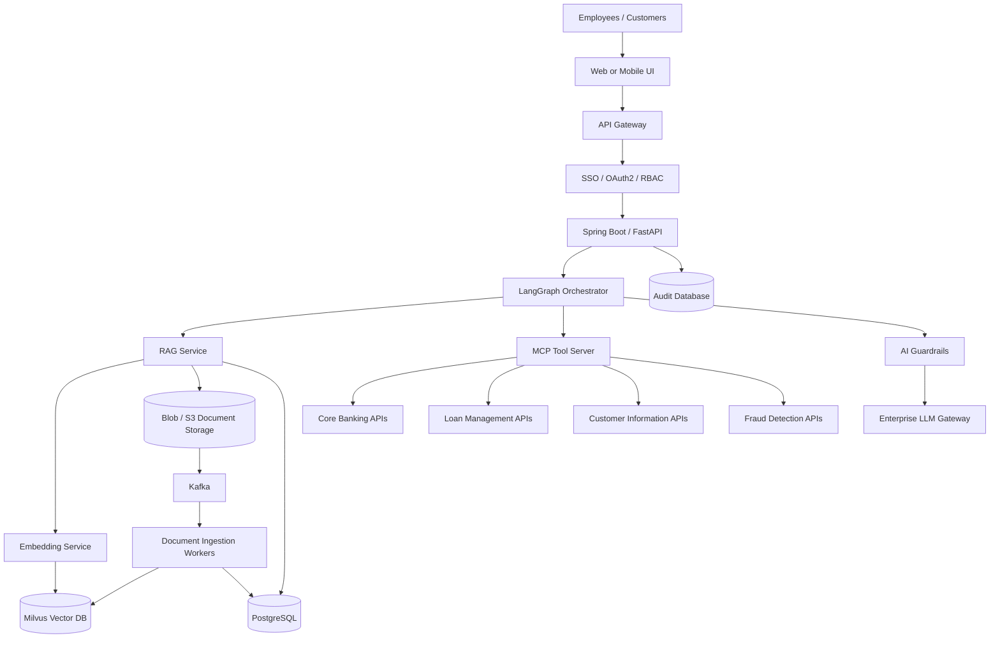

# Day 5 – Enterprise Banking AI Platform: Use Cases, Functional Requirements & Non-Functional Requirements

## 1. Business Problem Statement

A large bank provides services to millions of retail and corporate customers.

Bank employees handle thousands of customer requests every day across multiple departments:

- Customer service
- Account management
- Loan processing
- KYC and customer onboarding
- Fraud and risk management
- Compliance and legal
- Banking operations
- Document processing

Employees currently access information from multiple systems, including:

- Customer relationship management (CRM)
- Core banking systems
- Loan management systems
- Document management systems
- Internal knowledge repositories
- Compliance and regulatory databases
- Transaction processing systems

This creates several business challenges:

1. Employees spend significant time searching for information.
2. Customer requests require manual investigation across multiple systems.
3. Loan and KYC processing can take several days.
4. Employees may receive inconsistent answers from different knowledge sources.
5. Compliance teams spend considerable time reviewing documents.
6. Operational teams perform repetitive manual tasks.
7. It is difficult to maintain consistent audit trails across multiple systems.

## 2. Proposed AI Solution

Build an Enterprise Banking AI Assistant that helps bank employees and authorized customers retrieve information, understand documents, automate workflows, and perform approved operational tasks.

The platform combines:

- Large Language Models (LLMs)
- Retrieval-Augmented Generation (RAG)
- Agentic AI
- Model Context Protocol (MCP)
- Enterprise APIs
- Vector databases
- Workflow orchestration
- Human-in-the-loop approvals
- AI guardrails and governance

The platform should not autonomously approve loans, execute financial transactions, or make regulated decisions without the appropriate authorization and controls.

## 3. AI Use Cases

Before designing the architecture, identify the business use cases.

### Use Case 1: Banking Knowledge Assistant

**Business problem:**

Bank employees spend time searching internal policies, product documentation, procedures, and regulatory guidelines.

**AI solution:**

Build a conversational RAG assistant that retrieves information from approved internal documents.

**Example user question:**

"What are the KYC requirements for opening a corporate bank account?"

**Workflow:**

1. Employee asks a question.
2. AI identifies the intent.
3. RAG retrieves relevant KYC policies.
4. LLM generates a grounded response.
5. System returns the answer with document references and page numbers.

**AI technologies:**

- RAG
- Embeddings
- Milvus
- LLM
- Hybrid search
- Reranking

### Use Case 2: Customer Service Agent

**Business problem:**

Customer service representatives handle repetitive questions about accounts, transactions, loans, and banking products.

**AI solution:**

Build an AI assistant that retrieves customer information through authorized backend APIs and provides contextual responses.

**Example user question:**

"Why was my recent transaction declined?"

**Workflow:**

1. Authenticate the customer.
2. Validate account ownership and permissions.
3. Retrieve transaction information through a banking API.
4. Retrieve relevant transaction or account policies if needed.
5. Use the LLM to explain the available information.
6. Return the response.

**AI technologies:**

- Agentic AI
- MCP tools
- REST APIs
- RAG
- LLM
- Identity and access management

Important: The LLM should not invent a transaction decline reason. It should explain only information returned by authorized systems.

### Use Case 3: KYC Document Intelligence

**Business problem:**

Banks receive large volumes of documents during customer onboarding.

Examples:

- Passports
- Business registration documents
- Proof of address
- Tax documents
- Ownership information

Employees manually review these documents.

**AI solution:**

Build a document intelligence platform that extracts information, validates document completeness, and identifies potential inconsistencies.

**Workflow:**

1. Customer uploads documents.
2. Documents are stored in object storage.
3. OCR and document parsing extract text.
4. AI classifies document types.
5. Extraction models identify relevant fields.
6. Validation services compare extracted fields against onboarding requirements.
7. Potential discrepancies are sent for human review.

**AI technologies:**

- OCR
- Document AI
- LLM extraction
- RAG
- Workflow orchestration
- Human-in-the-loop

### Use Case 4: Loan Processing Assistant

**Business problem:**

Loan processing requires information from several systems and manual verification.

**AI solution:**

Build an AI-assisted loan processing workflow.

**Example user question:**

"Show me the outstanding requirements for loan application 12345."

**Workflow:**

1. Retrieve loan application details.
2. Retrieve customer documents.
3. Check document completeness.
4. Retrieve applicable lending policies.
5. Identify missing information.
6. Generate an application summary.
7. Route the application to the authorized loan officer.

**AI technologies:**

- Agentic workflows
- RAG
- MCP
- REST APIs
- Saga pattern
- Human approval

### Use Case 5: Compliance Document Assistant

**Business problem:**

Compliance teams review thousands of documents to identify potential policy violations.

**AI solution:**

Build a compliance assistant that compares submitted documents against approved policies.

**Example:**

A marketing employee uploads a banking product brochure.

The AI:

1. Extracts the document text.
2. Retrieves applicable compliance policies.
3. Identifies potentially unsupported claims.
4. Highlights relevant document sections.
5. Provides policy references.
6. Allows the submitter to accept or reject suggestions.
7. Routes the document to a human compliance officer for final approval.

**AI technologies:**

- RAG
- LLM
- Vector database
- Guardrails
- Human-in-the-loop
- Audit logging

### Use Case 6: Fraud Investigation Assistant

**Business problem:**

Fraud investigators review alerts, transaction histories, customer information, and investigation notes.

**AI solution:**

Build an AI assistant that summarizes relevant evidence and supports investigators.

**Example user question:**

"Summarize the unusual transaction activity associated with this fraud alert."

**Workflow:**

1. Retrieve the authorized fraud alert.
2. Retrieve relevant transaction records.
3. Retrieve applicable investigation policies.
4. Identify unusual patterns using approved analytics services.
5. Generate an investigation summary.
6. Provide references to the source records.
7. Route the case to an investigator.

**AI technologies:**

- Agentic AI
- RAG
- Transaction analytics
- MCP tools
- LLM
- Human review

The AI supports investigation; it does not independently determine guilt or freeze accounts.

### Use Case 7: Banking Operations Assistant

**Business problem:**

Operations teams spend time investigating failed transactions, reconciliation mismatches, and settlement exceptions.

**AI solution:**

Build an operations assistant that retrieves operational data and helps explain exceptions.

**Example question:**

"Why did this transaction fail during settlement?"

**Workflow:**

1. Retrieve transaction status.
2. Retrieve settlement records.
3. Retrieve operational logs.
4. Identify the failed processing stage.
5. Retrieve relevant operational procedures.
6. Generate an explanation.
7. Suggest approved remediation steps.

**AI technologies:**

- RAG
- MCP
- Operational APIs
- Log analytics
- Workflow orchestration

## 4. Overall Business Requirements

Business requirements describe what the organization wants to achieve.

| ID    | Business Requirement               | Expected Outcome                              |
| ----- | ---------------------------------- | --------------------------------------------- |
| BR-01 | Reduce manual information searches | Improve employee productivity                 |
| BR-02 | Improve customer service           | Faster and more consistent responses          |
| BR-03 | Accelerate KYC processing          | Reduce onboarding delays                      |
| BR-04 | Improve loan processing efficiency | Reduce manual investigation                   |
| BR-05 | Improve compliance review          | Identify potential policy issues earlier      |
| BR-06 | Support fraud investigations       | Faster access to relevant evidence            |
| BR-07 | Improve banking operations         | Reduce manual exception investigation         |
| BR-08 | Improve auditability               | Maintain traceable AI interactions            |
| BR-09 | Protect customer information       | Enforce strict data access controls           |
| BR-10 | Support enterprise scalability     | Serve multiple departments and business units |

## 5. Functional Requirements (FR)

Functional requirements describe what the system must do.

### FR-01: User Authentication

- Authenticate employees and customers using enterprise identity providers.
- Support OAuth2 and OpenID Connect.
- Validate user roles and permissions.
- Support session management.

### FR-02: Document Ingestion

- Allow authorized users to upload documents.
- Support PDF, Word, Excel, and text files.
- Store original files in object storage.
- Extract text and tables.
- Perform OCR for scanned documents.
- Track document ingestion status.

### FR-03: Document Processing

- Classify documents.
- Extract relevant information.
- Split documents into meaningful chunks.
- Generate embeddings.
- Store embeddings in a vector database.
- Store metadata in a relational database.
- Support document versioning.

### FR-04: Enterprise Search

- Support semantic search.
- Support keyword search.
- Support hybrid retrieval.
- Apply metadata filters.
- Enforce access permissions during retrieval.
- Return relevant document references.

### FR-05: Conversational AI

- Accept natural-language questions.
- Maintain conversation context.
- Retrieve relevant enterprise knowledge.
- Generate grounded responses.
- Return citations and source references.
- Support follow-up questions.

### FR-06: Agentic AI

- Classify user intent.
- Select appropriate tools.
- Call authorized backend APIs.
- Execute controlled multi-step workflows.
- Maintain workflow state.
- Support retries and failure recovery.
- Route sensitive tasks for human approval.

### FR-07: Enterprise API Integration

Integrate with:

- Customer information systems.
- Core banking systems.
- Loan management systems.
- Transaction processing systems.
- Fraud detection systems.
- Compliance repositories.
- Document management systems.

### FR-08: Human-in-the-Loop

- Route sensitive decisions for human review.
- Allow authorized employees to approve or reject proposed actions.
- Maintain approval history.
- Record reviewer comments.
- Prevent unauthorized execution before approval.

### FR-09: Audit and Monitoring

- Record user requests.
- Record tool invocations.
- Record document references.
- Track model versions.
- Record workflow execution status.
- Monitor failures and latency.

### FR-10: Administration

- Manage users and roles.
- Manage document repositories.
- Configure model access.
- Manage prompts and guardrails.
- Configure approved MCP tools.
- Monitor AI application usage.

## 6. Non-Functional Requirements (NFR)

Non-functional requirements describe how well the system must operate.

They cover scalability, performance, availability, reliability, security, and maintainability.

### NFR-01: Scalability

**Requirement:**

The platform should support increasing users, documents, and concurrent requests.

Illustrative targets:

- 20,000 registered employees.
- 5,000 concurrent users.
- 2 million documents.
- 10 million or more document chunks.
- Independently scalable ingestion and query services.

**Design considerations:**

- Kubernetes horizontal pod autoscaling.
- Kafka for asynchronous processing.
- Redis caching.
- Distributed vector search.
- Independent microservice scaling.

### NFR-02: Performance and Latency

**Requirement:**

The platform should return responses within acceptable time limits.

Illustrative targets:

| Operation              |              Target |
| ---------------------- | ------------------: |
| Simple API request     |    p95 under 300 ms |
| Metadata lookup        |    p95 under 200 ms |
| Vector retrieval       |    p95 under 500 ms |
| RAG response           | p95 under 5 seconds |
| Document ingestion     |        Asynchronous |
| Complex agent workflow | Depends on workflow |

Important: LLM generation time varies by model, prompt size, and output length. These are design targets, not guaranteed response times.

**Design considerations:**

- Redis caching.
- Parallel retrieval.
- Query optimization.
- Model selection.
- Streaming responses.
- Token limits.

### NFR-03: Availability

**Requirement:**

The platform should remain available during normal operations and recover from component failures.

Illustrative target:

- 99.9% monthly availability for core query services.

**Design considerations:**

- Multiple application instances.
- Kubernetes deployments across availability zones.
- Database replication.
- Load balancing.
- Health checks.
- Disaster recovery.

### NFR-04: Reliability

**Requirement:**

The system should process requests and events without silently losing work.

**Design considerations:**

- Transactional Outbox Pattern.
- Kafka durable messaging.
- Idempotent consumers.
- Retry with exponential backoff.
- Dead Letter Queues.
- Durable workflow state.
- Circuit breakers.

### NFR-05: Fault Tolerance

**Requirement:**

Failure of one component should not bring down the entire platform.

Examples:

- LLM provider unavailable.
- Vector database unavailable.
- Kafka consumer failure.
- External banking API timeout.
- Document parser failure.

**Design considerations:**

- Circuit breakers.
- Bulkheads.
- Fallback models where approved.
- Controlled degradation.
- Retry policies.
- DLQs.
- Service isolation.

### NFR-06: Security

**Requirement:**

Protect sensitive banking and customer information.

**Design considerations:**

- OAuth2/OIDC.
- Role-based access control.
- Attribute-based access control.
- Encryption at rest and in transit.
- Secrets management.
- API authentication and authorization.
- Network segmentation.
- Audit logging.
- Data masking.

### NFR-07: Data Isolation

**Requirement:**

Users should only retrieve information they are authorized to access.

Examples:

- Retail banking users cannot access corporate banking customer records without authorization.
- Employees cannot retrieve another customer's account information.
- Compliance documents may have restricted access.
- Sensitive loan records must be restricted to authorized teams.

**Design considerations:**

- Tenant and department filters.
- Customer-level access controls.
- Retrieval-time authorization.
- Database-level controls where appropriate.
- Authorization checks on every tool call.

### NFR-08: AI Accuracy and Groundedness

**Requirement:**

AI responses should be supported by reliable sources and avoid unsupported statements.

**Design considerations:**

- RAG.
- Source citations.
- Retrieval evaluation.
- Answer groundedness evaluation.
- Output validation.
- Human review.
- Approved model versions.

Evaluation metrics:

- Precision.
- Recall.
- F1 score.
- Context relevance.
- Faithfulness.
- Citation correctness.
- Hallucination rate.

### NFR-09: Observability

**Requirement:**

The platform should provide end-to-end visibility into application and AI behavior.

**Infrastructure metrics:**

- CPU and memory.
- API latency.
- Request throughput.
- Error rates.
- Kafka consumer lag.
- Database latency.

**AI metrics:**

- Prompt token usage.
- Completion token usage.
- LLM latency.
- Retrieval relevance.
- Tool-call success rate.
- Model failure rate.
- Hallucination and groundedness scores.

**Tools:**

- Prometheus.
- Grafana.
- OpenTelemetry.
- Centralized logging.
- LLM evaluation tools.

### NFR-10: Maintainability and Extensibility

**Requirement:**

The platform should support adding new AI use cases without redesigning the entire architecture.

**Design considerations:**

- Microservices.
- Modular AI services.
- Standardized APIs.
- MCP tool interfaces.
- Reusable RAG components.
- Configuration-driven workflows.
- CI/CD automation.

### NFR-11: Disaster Recovery

**Requirement:**

The platform should recover from major infrastructure failures.

Define:

- RTO: Recovery Time Objective.
- RPO: Recovery Point Objective.

Illustrative targets:

- RTO: 30 minutes.
- RPO: 15 minutes.

**Design considerations:**

- Database backups.
- Cross-region replication.
- Object storage replication.
- Infrastructure as code.
- Documented recovery procedures.
- Periodic DR testing.

### NFR-12: Compliance and Auditability

**Requirement:**

The platform should support financial-services governance and regulatory obligations.

**Design considerations:**

- Immutable or tamper-evident audit records.
- Data retention policies.
- Model and prompt version tracking.
- User activity tracking.
- Approval history.
- Data lineage.
- Access reviews.

## 7. Functional vs Non-Functional Requirements

| Area               | Functional Requirement                  | Non-Functional Requirement                   |
| ------------------ | --------------------------------------- | -------------------------------------------- |
| Authentication     | User can log in                         | Authentication is secure and reliable        |
| Search             | User can search documents               | Search returns results within latency target |
| RAG                | System generates answers from documents | Answers are grounded and accurate            |
| Document ingestion | User can upload documents               | Processing scales reliably                   |
| Agent tools        | Agent can call banking APIs             | Calls are authorized and resilient           |
| Loan workflow      | System tracks application steps         | Workflow survives service failures           |
| Audit              | System records interactions             | Audit records are secure and traceable       |
| Portfolio          | User can retrieve portfolio information | Data remains isolated and protected          |

## 8. High-Level Architecture

## 9. How to Convert Business Requirements into Architecture

Example:

**Business requirement:**

Reduce manual effort in KYC document processing.

**Functional requirements:**

1. Upload documents.
2. Extract document text.
3. Classify document types.
4. Extract customer information.
5. Validate mandatory fields.
6. Identify missing documents.
7. Route exceptions to human reviewers.

**Non-functional requirements:**

1. Process documents reliably.
2. Support high ingestion volume.
3. Protect sensitive customer data.
4. Maintain audit history.
5. Recover from parsing failures.
6. Meet processing latency targets.

**Architecture decisions:**

1. Blob Storage for original documents.
2. Kafka for asynchronous processing.
3. Python/FastAPI for document AI services.
4. OCR and LLM extraction where appropriate.
5. PostgreSQL for structured metadata.
6. Milvus for semantic retrieval when document search is needed.
7. Saga or durable workflow orchestration for multi-step processes.
8. DLQ for permanently failing documents.
9. Human review for exceptions.

## 10. Interview Approach: Requirements First

When an interviewer asks you to design an AI banking platform, do not immediately start drawing boxes.

Follow this sequence:

### Step 1: Clarify the Problem

Ask:

- Who are the users?
- What business problem are we solving?
- Which banking departments are in scope?
- Are we building an internal employee assistant or customer-facing application?
- Which data sources must be integrated?

### Step 2: Identify Use Cases

Examples:

- Banking knowledge assistant.
- Customer service assistant.
- KYC document intelligence.
- Loan processing assistant.
- Compliance assistant.
- Fraud investigation assistant.

### Step 3: Define Functional Requirements

Ask what the platform must do.

Examples:

- Authenticate users.
- Upload documents.
- Search documents.
- Answer questions.
- Call backend tools.
- Track workflow state.
- Support approvals.
- Maintain audit records.

### Step 4: Define Non-Functional Requirements

Use SCARF:

- **S – Scalability:** Can the platform support growing traffic and data?
- **C – Consistency:** Are business records and events handled correctly?
- **A – Availability:** Can users access the platform when needed?
- **R – Reliability:** Can the platform recover from failures?
- **F – Fault Tolerance:** Can individual component failures be isolated?

Also cover:

- Security.
- Performance.
- Observability.
- AI accuracy.
- Compliance.
- Disaster recovery.

### Step 5: Estimate Capacity

Estimate:

- Number of users.
- Daily active users.
- Concurrent users.
- Documents per day.
- Queries per second.
- Average document size.
- Vector count.
- LLM tokens per request.

### Step 6: Draw the High-Level Architecture

Identify:

- UI.
- API Gateway.
- Authentication.
- Backend services.
- RAG.
- Vector database.
- LLM gateway.
- MCP tools.
- Relational database.
- Messaging.
- Cache.
- Observability.

### Step 7: Explain Failure Scenarios

Examples:

- What if Kafka is unavailable?
- What if the LLM times out?
- What if Milvus is unavailable?
- What if the same event is processed twice?
- What if a workflow fails halfway through?
- What if a user tries to access another customer's documents?

### Step 8: Explain Trade-offs

Examples:

- RAG versus fine-tuning.
- Synchronous REST versus asynchronous Kafka.
- SQL versus vector database.
- Single agent versus multi-agent architecture.
- Choreography versus orchestration.
- Strong consistency versus eventual consistency.

## 11. Final  Summary

"I would start by understanding the business problem and identifying the major use cases, such as banking knowledge search, KYC document processing, loan assistance, compliance review, and fraud investigation.

Then I would define functional requirements, including authentication, document ingestion, enterprise search, conversational AI, tool integrations, workflow orchestration, and human approval.

For non-functional requirements, I would focus on scalability, consistency, availability, reliability, fault tolerance, security, data isolation, performance, and AI governance.

Based on these requirements, I would design a modular architecture using Spring Boot and Python services, Kafka for asynchronous processing, PostgreSQL for transactional data, Milvus for vector retrieval, LangGraph for stateful agent workflows, MCP for authorized tool integration, and an enterprise LLM gateway.

I would also incorporate distributed systems patterns such as Outbox, Saga, Idempotency, Circuit Breaker, and DLQ to ensure the platform is reliable and production-ready."
