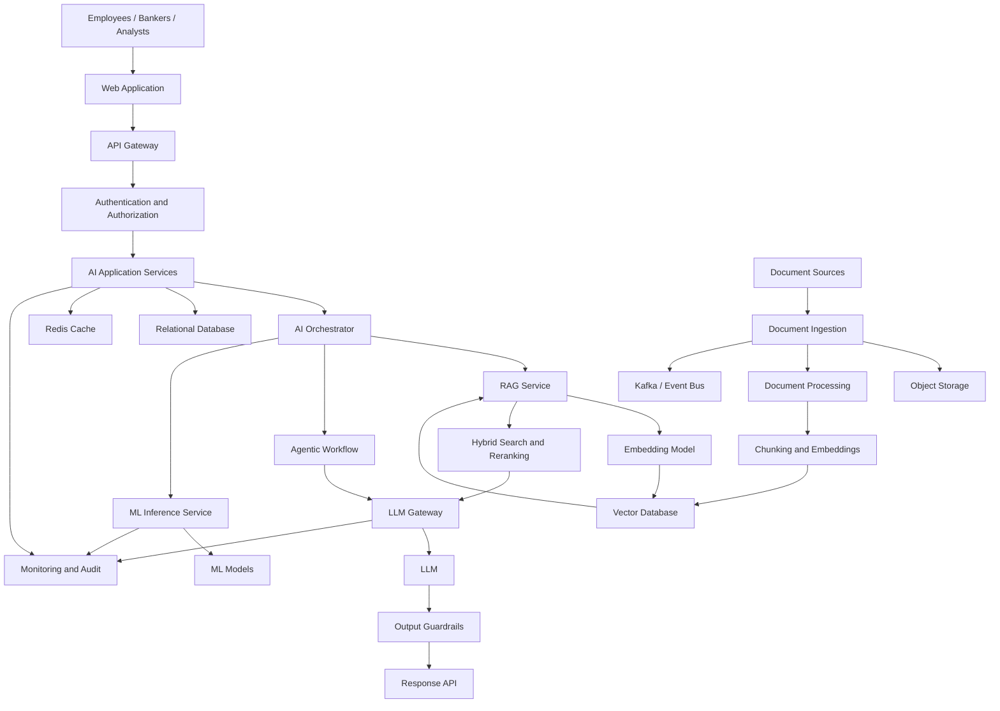

# Enterprise Financial Services AI Platform
## AI Use Cases, Business Requirements, Functional Requirements & Non-Functional Requirements

## 1. Business Problem

Financial institutions process large volumes of documents, financial transactions, customer requests, regulatory policies, and investment research.

Many business processes involve manual document reviews, repetitive analysis, fragmented data sources, and time-consuming workflows.

The objective is to build an enterprise AI platform that uses Generative AI, RAG, machine learning, and agentic AI to improve operational efficiency, reduce manual effort, and support faster business decisions.

### Business Goals

- Reduce manual document processing.
- Improve operational efficiency.
- Accelerate financial research and analysis.
- Improve compliance and regulatory oversight.
- Provide faster access to enterprise knowledge.
- Automate repetitive business workflows.
- Improve consistency and traceability.
- Maintain enterprise security and governance.

---

# 2. AI Use Cases in Financial Services

## Use Case 1: Banking Document Intelligence

### Business Problem

Bankers and credit analysts manually review large volumes of financial documents, loan agreements, annual reports, and financial statements.

This process takes time and makes it difficult to quickly identify important information.

### Proposed AI Solution

Build a document intelligence platform using OCR, LLMs, RAG, and structured data extraction.

### Business Users

- Credit analysts
- Relationship managers
- Loan officers
- Risk analysts
- Investment bankers

### AI Capabilities

- Extract key financial information.
- Summarize financial statements.
- Identify important clauses.
- Answer questions about documents.
- Compare different document versions.
- Identify missing information.
- Generate summaries with source citations.

### Example

A banker uploads a company's annual report.

The AI assistant extracts:

- Revenue
- EBITDA
- Net income
- Total debt
- Cash flow
- Liquidity information

The banker can ask:

"What is the company's debt-to-EBITDA ratio?"

The system retrieves the relevant financial information and calculates the ratio using a validated calculation service.

The LLM explains the result and provides source references.

---

## Use Case 2: Credit Risk Assessment

### Business Problem

Banks need to evaluate the creditworthiness of borrowers before approving loans.

Credit analysts examine financial statements, repayment history, outstanding liabilities, and other risk factors.

### Proposed AI Solution

Use machine learning models for risk prediction and LLMs for explaining the results.

### AI Capabilities

- Extract financial information from statements.
- Calculate financial ratios.
- Predict probability of default using a trained ML model.
- Categorize borrowers into approved risk bands through an approved policy engine.
- Generate explanations for credit analysts.
- Identify missing financial information.

### Example

A bank receives a commercial loan application.

The application extracts:

- Annual revenue
- EBITDA
- Debt
- Cash flow
- Existing liabilities

A trained XGBoost model predicts a probability of default.

A policy engine applies approved thresholds and business rules.

The LLM generates an explanation for the credit analyst.

**Important:** The LLM should not independently calculate or approve regulated credit decisions.

---

## Use Case 3: Fraud Detection

### Business Problem

Financial institutions process millions of transactions and need to identify suspicious activity.

Traditional rule-based systems may miss emerging fraud patterns.

### Proposed AI Solution

Use supervised ML models and anomaly detection to identify potentially fraudulent transactions.

### AI Capabilities

- Analyze transaction patterns.
- Identify unusual transaction behavior.
- Calculate fraud risk scores.
- Detect suspicious transaction sequences.
- Prioritize cases for investigation.
- Generate investigation summaries.

### Example

A customer usually performs transactions between $20 and $500.

Suddenly, the customer performs multiple high-value transactions from unusual locations.

An ML model identifies the unusual behavior and generates a risk score.

A case management system creates an investigation case for a fraud analyst.

---

## Use Case 4: Compliance and Regulatory AI Assistant

### Business Problem

Compliance teams review marketing materials, investment documents, and internal communications against regulatory requirements and organizational policies.

Manual review can be time-consuming.

### Proposed AI Solution

Build a compliance assistant using RAG and LLMs.

### AI Capabilities

- Retrieve applicable compliance policies.
- Identify potentially non-compliant statements.
- Compare marketing content against policy documents.
- Highlight supporting policy sections.
- Generate compliance review summaries.
- Track submitter feedback and reviewer decisions.

### Example

A marketing employee uploads an investment presentation.

The AI agent compares the content against approved marketing and compliance policies.

It identifies potentially problematic statements and highlights the relevant policy sections.

The submitter can accept or reject the suggestions.

A human compliance officer makes the final approval decision.

---

## Use Case 5: Investment Banking M&A Research Assistant

### Business Problem

Investment bankers analyze large volumes of documents during mergers and acquisitions.

These documents include:

- Annual reports
- Financial statements
- Acquisition agreements
- Company presentations
- Due diligence reports
- Market research

Manually reviewing these documents takes significant time.

### Proposed AI Solution

Build an AI research assistant using RAG, document intelligence, and agentic workflows.

### AI Capabilities

- Summarize acquisition documents.
- Extract financial metrics.
- Compare target companies.
- Identify transaction risks.
- Summarize due diligence findings.
- Retrieve historical M&A research.
- Generate preliminary research reports.

### Example

A banker asks:

"Compare the financial performance of Company A and Company B for the last three years."

The system retrieves financial statements, extracts revenue and EBITDA, and uses a calculation service to compare the companies.

The LLM generates a comparison with source citations.

---

## Use Case 6: Hedge Fund Investment Research Assistant

### Business Problem

Investment research teams analyze company filings, earnings reports, market research, and financial news.

Researchers need to access information quickly and identify important changes.

### Proposed AI Solution

Build an investment research assistant using RAG, financial data APIs, ML models, and agentic AI.

### AI Capabilities

- Summarize company earnings reports.
- Extract financial metrics.
- Compare quarterly performance.
- Retrieve analyst research.
- Identify changes in company fundamentals.
- Generate research summaries.
- Call approved market data tools.

### Example

An analyst asks:

"Summarize the latest quarterly results and identify changes in operating margins."

The system retrieves the latest earnings reports, extracts financial metrics, calculates margin changes, and generates an evidence-based summary.

**Important:** Investment recommendations and trading decisions must follow approved investment processes and controls.

---

## Use Case 7: Customer Support AI Assistant

### Business Problem

Banks receive large volumes of customer inquiries related to account services, transactions, loans, and financial products.

Customer support representatives spend significant time searching internal knowledge bases.

### Proposed AI Solution

Build an enterprise conversational AI assistant using RAG and controlled tool calling.

### AI Capabilities

- Answer frequently asked questions.
- Retrieve approved product information.
- Explain transaction statuses.
- Retrieve customer-specific information with authorization.
- Create service requests.
- Escalate complex requests to human agents.

### Example

A customer asks:

"What is the status of my loan application?"

The assistant authenticates the customer, calls an authorized loan-status API, retrieves the application status, and explains the result.

The LLM does not invent or independently determine the application status.

---

## Use Case 8: Financial Market Risk Analysis

### Business Problem

Financial institutions need to understand portfolio exposure and potential losses under different market conditions.

### Proposed AI Solution

Use traditional quantitative models and ML models, with LLMs providing explanations and research summaries.

### AI Capabilities

- Calculate portfolio exposure.
- Calculate Value at Risk (VaR).
- Perform stress testing.
- Forecast volatility.
- Identify unusual portfolio movements.
- Generate risk summaries.

### Example

A risk analyst asks:

"Summarize the portfolio's exposure to interest rate changes."

A risk service retrieves portfolio positions and runs approved risk calculations.

The LLM summarizes the calculated results and explains the key exposures.

---

# 3. Business Requirements (BR)

Business requirements describe what the organization wants to achieve and why.

They focus on business outcomes rather than implementation details.

| ID | Business Requirement | Expected Business Outcome |
|---|---|---|
| BR-01 | Reduce manual document reviews | Improve operational efficiency |
| BR-02 | Provide faster access to enterprise knowledge | Reduce research time |
| BR-03 | Automate repetitive business workflows | Reduce operational costs |
| BR-04 | Improve fraud identification | Reduce financial losses |
| BR-05 | Improve compliance review consistency | Reduce compliance risk |
| BR-06 | Support financial analysis | Accelerate business decisions |
| BR-07 | Improve customer support | Reduce response time |
| BR-08 | Maintain auditability | Improve governance and traceability |
| BR-09 | Protect confidential financial information | Reduce data exposure |
| BR-10 | Support future AI use cases | Enable enterprise AI reuse |

## Business Success Metrics

| Metric | Example Target |
|---|---|
| Manual processing time | Reduce by 40% |
| Document review time | Reduce by 50% |
| Customer support workload | Reduce by 20% |
| Document extraction accuracy | At least 95% on defined fields |
| Compliance finding traceability | 100% of findings linked to evidence |
| User adoption | 70% of targeted users |

These are illustrative business targets. Actual targets must be agreed with business stakeholders and validated through a baseline assessment.

---

# 4. Functional Requirements (FR)

Functional requirements describe what the system must do.

They define the features, workflows, APIs, and capabilities required to deliver the business requirements.

## 4.1 User Management and Authentication

- FR-01: The system shall authenticate users through enterprise identity providers.
- FR-02: The system shall support role-based access control (RBAC).
- FR-03: The system shall enforce document-level authorization.
- FR-04: The system shall maintain user activity and audit records.

## 4.2 Document Ingestion

- FR-05: The system shall support PDF, DOCX, XLSX, and other approved document formats.
- FR-06: The system shall upload documents to enterprise object storage.
- FR-07: The system shall extract text using document parsers and OCR.
- FR-08: The system shall classify documents based on document type.
- FR-09: The system shall extract metadata such as document ID, owner, region, and version.
- FR-10: The system shall detect duplicate documents.

## 4.3 Document Processing

- FR-11: The system shall split documents into meaningful chunks.
- FR-12: The system shall generate embeddings using an embedding model.
- FR-13: The system shall store embeddings in a vector database.
- FR-14: The system shall maintain document and chunk metadata.
- FR-15: The system shall support document versioning.
- FR-16: The system shall support incremental reprocessing of changed documents.

## 4.4 RAG and Conversational AI

- FR-17: The system shall accept natural-language questions.
- FR-18: The system shall generate query embeddings.
- FR-19: The system shall retrieve relevant document chunks.
- FR-20: The system shall support hybrid search using keyword and vector retrieval.
- FR-21: The system shall support reranking of retrieved results.
- FR-22: The system shall construct prompts using retrieved context.
- FR-23: The system shall generate responses using an approved LLM.
- FR-24: The system shall provide citations to source documents.
- FR-25: The system shall indicate when sufficient supporting information is unavailable.

## 4.5 ML and Predictive AI

- FR-26: The system shall integrate with approved ML inference services.
- FR-27: The system shall validate input features before model inference.
- FR-28: The system shall return predictions and relevant model metadata.
- FR-29: The system shall apply approved business rules to model outputs.
- FR-30: The system shall record prediction results for audit and evaluation.

## 4.6 Agentic AI and Tool Integration

- FR-31: The system shall support controlled tool invocation.
- FR-32: The system shall integrate with approved enterprise APIs.
- FR-33: The system shall validate tool arguments before execution.
- FR-34: The system shall enforce user authorization for each tool.
- FR-35: The system shall support human approval for sensitive actions.
- FR-36: The system shall maintain workflow execution state.
- FR-37: The system shall support retries and failure recovery.

## 4.7 Monitoring and Governance

- FR-38: The system shall capture request and response metadata.
- FR-39: The system shall monitor LLM latency and token consumption.
- FR-40: The system shall evaluate retrieval and response quality.
- FR-41: The system shall record model versions and prompt versions.
- FR-42: The system shall support audit reporting.
- FR-43: The system shall provide operational dashboards.

---

# 5. Non-Functional Requirements (NFR)

Non-functional requirements describe how well the system must operate.

They define quality attributes such as scalability, performance, availability, reliability, security, and maintainability.

## 5.1 Performance

- NFR-01: The system should return standard RAG responses within a target p95 latency of 5 seconds, subject to document size and model behavior.
- NFR-02: The system should support streaming responses.
- NFR-03: The system should optimize retrieval and inference latency.
- NFR-04: Document ingestion should support asynchronous processing.

## 5.2 Scalability

- NFR-05: The system should support horizontal scaling of application services.
- NFR-06: The system should support increasing document volumes.
- NFR-07: The system should scale inference capacity based on demand.
- NFR-08: The vector database should support distributed indexing and search.
- NFR-09: The system should support multiple business units and tenants.

## 5.3 Availability

- NFR-10: Critical services should target 99.9% availability.
- NFR-11: The system should support health checks and service recovery.
- NFR-12: Critical infrastructure components should avoid single points of failure.
- NFR-13: The system should provide graceful degradation when optional AI services are unavailable.

## 5.4 Reliability and Fault Tolerance

- NFR-14: The system should implement bounded retries with exponential backoff and jitter.
- NFR-15: The system should implement circuit breakers for dependent services.
- NFR-16: The system should support idempotent request processing.
- NFR-17: Failed asynchronous events should be routed to a dead-letter queue (DLQ).
- NFR-18: The system should recover from temporary downstream failures.
- NFR-19: The system should preserve workflow state during recoverable failures.

## 5.5 Security

- NFR-20: The system shall encrypt data at rest and in transit.
- NFR-21: The system shall enforce RBAC and least-privilege access.
- NFR-22: The system shall prevent cross-tenant data exposure.
- NFR-23: The system shall protect against prompt injection and malicious document instructions.
- NFR-24: The system shall implement input and output guardrails.
- NFR-25: The system shall protect sensitive information and PII.
- NFR-26: The system shall maintain secure secrets and key management.

## 5.6 Data Governance and Compliance

- NFR-27: The system shall maintain document lineage and version history.
- NFR-28: The system shall maintain audit trails for important actions.
- NFR-29: The system shall enforce data retention and deletion policies.
- NFR-30: The system shall support data residency requirements.
- NFR-31: The system shall maintain model and prompt version traceability.
- NFR-32: The system shall support human review for high-risk outputs.

## 5.7 Observability

- NFR-33: The system shall provide centralized logging.
- NFR-34: The system shall expose service metrics.
- NFR-35: The system shall support distributed tracing.
- NFR-36: The system shall monitor token usage and inference cost.
- NFR-37: The system shall monitor retrieval quality and model performance.
- NFR-38: The system shall generate alerts for operational failures.

## 5.8 Maintainability and Extensibility

- NFR-39: The system should use modular microservices where justified by independent scaling and ownership.
- NFR-40: The system should support independent deployment of application and AI components.
- NFR-41: The system should support model replacement through a model gateway.
- NFR-42: The system should support configurable prompts and guardrails.
- NFR-43: The system should support CI/CD and automated testing.

---

# 6. SCARF – System Design NFR Framework

Use SCARF to remember the major non-functional requirements during system design interviews.

| Letter | Attribute | Questions to Ask |
|---|---|---|
| S | Scalability | How many users, requests, documents, and concurrent sessions? |
| C | Consistency | How do we maintain correct and consistent data? |
| A | Availability | What happens when a service or region is unavailable? |
| R | Reliability | How do we handle failures and recover requests? |
| F | Fault Tolerance | Can the system continue operating when dependencies fail? |

Additional NFR categories:

- Performance
- Security
- Privacy
- Observability
- Maintainability
- Compliance
- Cost efficiency

---

# 7. Translate Business Requirements into Functional and Non-Functional Requirements

This is particularly important in architecture interviews.

| Business Requirement | Functional Requirement | Non-Functional Requirement |
|---|---|---|
| Reduce document review time | Extract and summarize document content | Low processing latency |
| Improve knowledge access | Retrieve relevant documents using RAG | High retrieval availability |
| Protect confidential information | Enforce document-level access control | Encryption and tenant isolation |
| Improve fraud detection | Integrate ML inference services | High throughput and low latency |
| Improve compliance | Compare documents with policy requirements | Auditability and traceability |
| Support business growth | Support additional AI use cases | Horizontal scalability |
| Improve operational resilience | Retry failed workflows | Fault tolerance and recovery |

---

# 8. Capacity Planning – Illustrative Requirements

Before designing the high-level architecture, estimate the expected workload.

Assume the business provides the following requirements:

| Parameter | Illustrative Value |
|---|---:|
| Registered users | 20,000 |
| Daily active users | 5,000 |
| Peak concurrent users | 1,000 |
| Average queries per active user/day | 20 |
| Daily queries | 100,000 |
| Average input tokens/request | 2,000 |
| Average output tokens/request | 500 |
| Documents | 2 million |
| Average document size | 2 MB |
| Target availability | 99.9% |
| Target p95 response latency | 5 seconds |

### Calculate Daily Requests

Daily queries:

```text
5,000 active users × 20 queries
= 100,000 queries/day
```

Average requests per second:

```text
100,000 / 86,400
= 1.16 requests/second
```

If peak traffic is 10 times average:

```text
1.16 × 10
= 11.6 requests/second
```

### Calculate Daily Token Consumption

Input tokens:

```text
100,000 × 2,000
= 200 million input tokens/day
```

Output tokens:

```text
100,000 × 500
= 50 million output tokens/day
```

Total:

```text
250 million tokens/day
```

These estimates are illustrative. Actual capacity planning should account for peak distributions, retries, context size, model selection, caching, batching, and document ingestion workloads.

---

# 9. High-Level Architecture



## Architecture Components

| Component | Responsibility |
|---|---|
| Web Application | User interaction |
| API Gateway | Routing, rate limiting, authentication integration |
| Authentication | Identity verification and authorization |
| Spring Boot Services | Enterprise business logic |
| Python AI Services | RAG, orchestration, and ML integration |
| Kafka | Asynchronous event processing |
| Object Storage | Original documents |
| Relational Database | Users, workflows, metadata, audit |
| Embedding Model | Vector generation |
| Milvus | Vector search |
| LLM Gateway | Model routing and governance |
| LLM | Text generation |
| Redis | Caching |
| Monitoring | Logs, metrics, tracing, and evaluation |

---

# 10. Requirement Gathering – Questions for Business Stakeholders

As an AI Architect, I would not start with the technology stack.

I would first understand the business problem and ask:

### Business Questions

1. What business problem are we solving?
2. Who are the end users?
3. What is the existing manual process?
4. How much time does the current process take?
5. What business outcome do we expect?
6. How will we measure success?
7. Which workflows can be automated?
8. Which workflows require human approval?

### Data Questions

1. What data sources are available?
2. Are documents structured or unstructured?
3. How frequently does the data change?
4. What is the expected document volume?
5. Is the data confidential or regulated?
6. Are there data residency requirements?
7. Who owns the data?

### AI Questions

1. Do we need RAG, ML, an LLM, or an agentic workflow?
2. Do we need real-time or batch inference?
3. Is document-level citation required?
4. How will we evaluate model accuracy?
5. What happens when the model is uncertain?
6. Does the workflow require human-in-the-loop approval?
7. Are there restrictions on model providers?

### NFR Questions

1. How many users will access the application?
2. What is the expected peak concurrency?
3. What is the target response time?
4. What is the required availability?
5. What are the RTO and RPO requirements?
6. What security and compliance standards apply?
7. What are the infrastructure and inference cost constraints?

---

# 11. Interview Answer – How Do You Start an AI System Design?

"If I am asked to design an enterprise AI application, I start by understanding the business problem and identifying the target users.

For example, if we are building a banking document intelligence platform, I first identify the manual document review process and understand how bankers, credit analysts, and compliance teams currently work.

Next, I identify the business requirements, such as reducing document review time, improving access to financial information, and maintaining auditability.

Then I translate those into functional requirements, such as document ingestion, OCR, classification, extraction, RAG-based retrieval, and conversational question answering.

After that, I define the non-functional requirements, including scalability, performance, availability, reliability, security, and fault tolerance.

I also estimate the number of users, concurrent requests, document volume, and token consumption.

Based on those requirements, I design the high-level architecture, select appropriate technologies, identify integration points, and address failure scenarios, security, monitoring, and governance.

Finally, I validate the architecture against business success metrics and operational constraints."

---

# 12. Common Interview Questions

### Q1. What is the difference between business requirements and functional requirements?

Business requirements describe what the business wants to achieve.

Functional requirements describe what the system must do to achieve those business objectives.

Example:

- Business requirement: Reduce manual document review time.
- Functional requirement: The system must extract and summarize financial information from uploaded documents.

### Q2. What is the difference between functional and non-functional requirements?

Functional requirements describe system capabilities and features.

Non-functional requirements describe quality attributes such as performance, scalability, availability, security, and reliability.

### Q3. How do you identify NFRs for an AI application?

I discuss expected users, concurrent requests, document volume, inference latency, availability, security, recovery objectives, and operating costs with business and infrastructure stakeholders.

Then I translate these into measurable engineering targets.

### Q4. How do you prioritize requirements?

I prioritize based on:

1. Business value.
2. Regulatory and security requirements.
3. Critical user journeys.
4. Performance and availability needs.
5. Delivery complexity and cost.

Security and compliance controls are foundational, not optional enhancements.

### Q5. What if the business wants 100% AI accuracy?

I would explain that 100% accuracy cannot be guaranteed for probabilistic AI systems.

I would establish measurable evaluation targets, use trusted data sources, implement validation and confidence-based escalation, and require human review for high-risk decisions.

### Q6. How do you handle conflicting business requirements?

I would identify the trade-offs and discuss them with stakeholders.

For example, a requirement for very low latency may conflict with using a large LLM and multiple retrieval and reranking stages.

I would compare quality, cost, latency, and risk, then agree on measurable service-level objectives.

### Q7. How do you ensure the AI system meets business objectives?

I establish baseline metrics before implementation and track business outcomes after deployment.

Examples include document processing time, manual review reduction, user adoption, extraction accuracy, response quality, and operational cost.

---

# 13. Final Checklist for AI System Design Interviews

- [ ] Understand the business problem.
- [ ] Identify business users and stakeholders.
- [ ] Identify AI use cases.
- [ ] Define business requirements.
- [ ] Define functional requirements.
- [ ] Define non-functional requirements.
- [ ] Clarify security and regulatory constraints.
- [ ] Estimate traffic, concurrency, and data volume.
- [ ] Select appropriate AI techniques.
- [ ] Design the high-level architecture.
- [ ] Identify APIs and integrations.
- [ ] Define database and data models.
- [ ] Address scalability and fault tolerance.
- [ ] Address AI quality and evaluation.
- [ ] Address monitoring and governance.
- [ ] Validate architecture against business outcomes.


**Business Problem → Use Cases → Business Requirements → Functional Requirements → Non-Functional Requirements → Capacity Planning → High-Level Design → Detailed Design → Trade-offs**

Always understand the business problem before selecting the technology.
