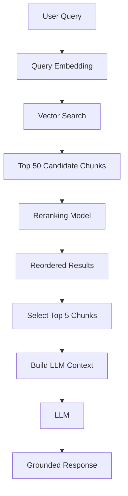

# Reranking in LLM – Fundamentals and System Design

## 1. What is Reranking?

Reranking is a technique used in information retrieval and Retrieval-Augmented Generation (RAG) to improve the relevance of retrieved documents.

When a user asks a question, the retrieval system searches a large collection of documents and returns a list of potentially relevant results.

However, the initial search results may not always be ordered by relevance.

A reranker evaluates the retrieved documents again and reorders them based on how relevant they are to the user's query.

**In simple terms:**

- Retrieval finds potentially relevant documents.
- Reranking identifies which retrieved documents are most relevant.
- The LLM uses the highest-quality results to generate an answer.

### Example

User query:

"What are the early repayment penalties in the loan agreement?"

Initial vector search results:

| Document | Initial Similarity Score |
|---|---:|
| Document A – General Loan Information | 0.91 |
| Document B – Interest Rate Terms | 0.87 |
| Document C – Early Repayment Clause | 0.82 |
| Document D – Loan Eligibility | 0.79 |
| Document E – Repayment Penalties | 0.75 |

The initial retrieval ranks Document A highest based on semantic similarity.

However, Document C and Document E contain the actual information about early repayment penalties.

After reranking:

| Document | Reranking Score | New Rank |
|---|---:|---:|
| Document C – Early Repayment Clause | 0.98 | 1 |
| Document E – Repayment Penalties | 0.96 | 2 |
| Document B – Interest Rate Terms | 0.72 | 3 |
| Document A – General Loan Information | 0.55 | 4 |
| Document D – Loan Eligibility | 0.30 | 5 |

The reranker improves the relevance of the context provided to the LLM.

*Scores above are illustrative, not actual model outputs.*

---

## 2. Why Do We Need Reranking?

Traditional vector search uses embeddings to find semantically similar content.

However, embedding similarity does not always guarantee that a retrieved document answers the user's exact question.

For example:

Query:
"What is the maturity date of the loan?"

Retrieved content:
- Loan interest rate.
- Loan repayment frequency.
- Loan maturity date.
- Loan eligibility criteria.

All four documents may have similar semantic embeddings because they discuss loans.

But only one directly answers the question.

Reranking helps prioritize the most relevant content.

### Benefits

1. Improves retrieval relevance.
2. Reduces irrelevant context sent to the LLM.
3. Helps improve answer quality and groundedness.
4. Improves precision of retrieved results.
5. Helps reduce unnecessary context and token consumption.
6. Supports better question answering over large document collections.

---

## 3. Where Does Reranking Fit in RAG Architecture?

A typical RAG architecture has two retrieval stages:

1. Initial retrieval.
2. Reranking.

### Architecture



### Step-by-step flow

**Step 1 – User Query**

The user asks:

"What are the financial covenants in this credit agreement?"

**Step 2 – Query Embedding**

The embedding model converts the query into a numerical vector.

**Step 3 – Initial Retrieval**

Milvus performs vector similarity search and retrieves the top 50 candidate chunks.

**Step 4 – Reranking**

The reranking model evaluates the relationship between the user query and each retrieved chunk.

**Step 5 – Select Top Results**

The system selects the top 5 most relevant chunks.

**Step 6 – LLM Context**

The selected chunks are passed to the LLM as context.

**Step 7 – Generate Answer**

The LLM generates an answer based on the retrieved information, with source citations.

---

## 4. What Are the Different Types of Reranking?

There are several approaches.

### 4.1 Cross-Encoder Reranking

A cross-encoder evaluates the query and document together.

It receives both inputs simultaneously and calculates a relevance score.

Example:

```text
Query:
What is the maturity date of the loan?

Document:
The loan agreement specifies that the facility
matures on December 31, 2028.
```

The model evaluates the relationship between the query and document and produces a relevance score.

Example output:

```json
{
  "document_id": "DOC-1001",
  "relevance_score": 0.98
}
```

**Advantages:**
- Usually provides strong relevance ranking.
- Understands relationships between query and document.
- Useful for precise enterprise document retrieval.

**Disadvantages:**
- More computationally expensive than vector similarity search.
- Each query-document pair needs model inference.
- Can increase retrieval latency.

### 4.2 Bi-Encoder / Embedding-Based Retrieval

A bi-encoder independently converts the query and documents into vectors.

The system compares the vectors using cosine similarity, dot product, or another supported similarity metric.

```text
Query --> Embedding Model --> Query Vector

Document --> Embedding Model --> Document Vector

Query Vector + Document Vector --> Similarity Score
```

This is commonly used for initial retrieval rather than expensive second-stage reranking.

**Advantages:**
- Fast retrieval.
- Efficient for large document collections.
- Document embeddings can be precomputed.

**Disadvantages:**
- Query and document are encoded independently.
- May miss precise
