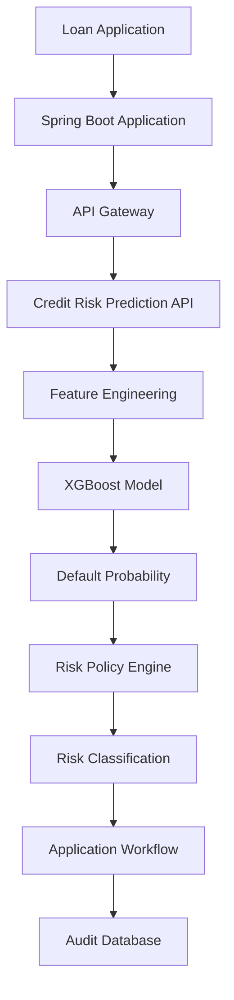
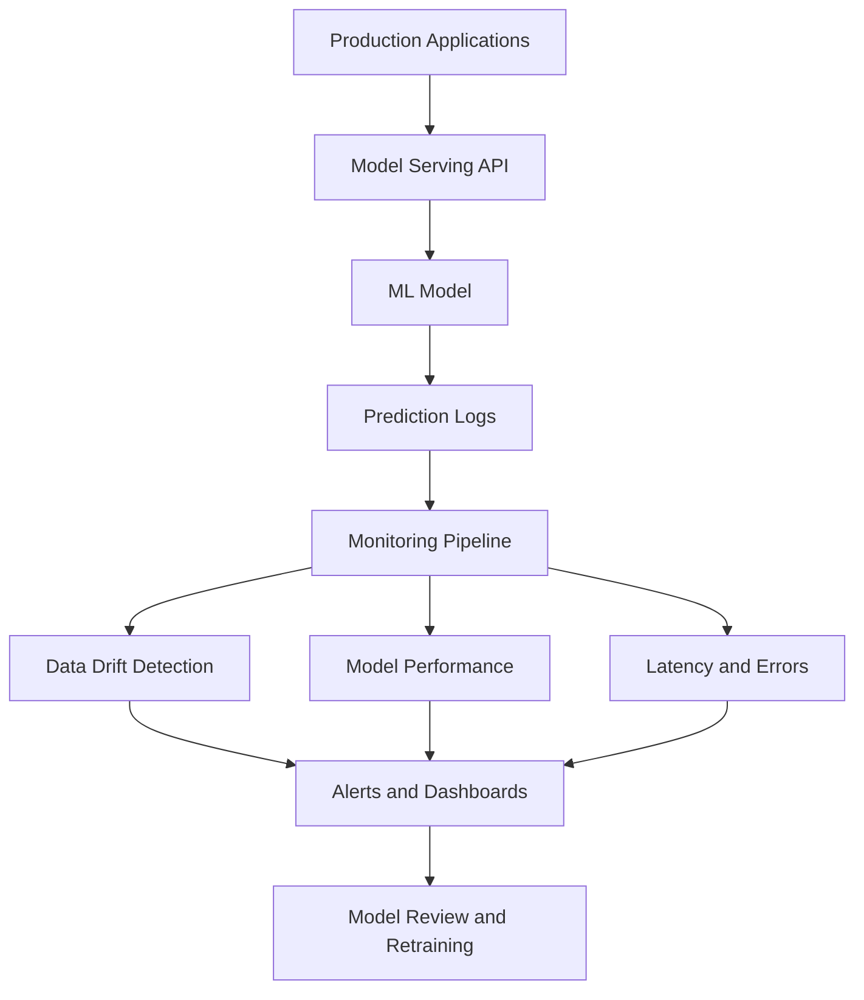

# Machine Learning Fundamentals

## 1. Introduction to Machine Learning

Machine Learning (ML) is a branch of Artificial Intelligence (AI) that enables computers to learn patterns from historical data and make predictions or decisions without being explicitly programmed for every scenario.

Instead of writing fixed rules for every situation, we train a model using historical data so it can identify patterns and apply what it has learned to new data.

### Real-World Financial Services Examples

| Business Problem | Machine Learning Application |
|---|---|
| Credit risk | Predict probability of loan default |
| Fraud detection | Identify suspicious transactions |
| Customer churn | Predict customers likely to leave |
| Market risk | Forecast volatility and potential losses |
| Investment research | Classify financial documents and extract insights |
| AML | Identify unusual transaction patterns |
| Customer segmentation | Group customers based on behavior |
| Loan processing | Predict application risk and processing outcomes |

---

## 2. Types of Machine Learning

There are four major categories of machine learning.

### 2.1 Supervised Learning

Supervised learning uses labeled historical data to train a model.

The training dataset contains:
- Input features (X)
- Known target or outcome (Y)

The model learns the relationship between X and Y and predicts outcomes for new records.

**Example: Credit Risk Prediction**

Historical loan data:

| Income | Credit Score | Debt-to-Income | Default |
|---:|---:|---:|---|
| 90000 | 750 | 25% | No |
| 45000 | 580 | 65% | Yes |
| 120000 | 790 | 20% | No |
| 55000 | 610 | 55% | Yes |

The model learns patterns from historical records and predicts the probability of default for a new loan applicant.

Common supervised learning problems:

1. Classification
2. Regression

### 2.2 Unsupervised Learning

Unsupervised learning uses data without predefined labels.

The model identifies hidden patterns, groups, or unusual behavior.

**Example: Customer Segmentation**

A bank wants to group customers based on:
- Income
- Transaction frequency
- Account balance
- Spending behavior
- Investment activity

The model may identify groups such as:
- High-value customers
- Frequent transaction customers
- Savings-focused customers
- Investment-oriented customers

Common algorithms:
- K-Means
- DBSCAN
- Hierarchical Clustering
- Principal Component Analysis (PCA)

### 2.3 Semi-Supervised Learning

Semi-supervised learning combines:
- A small amount of labeled data
- A large amount of unlabeled data

Example:

A bank has 10,000 manually reviewed fraud transactions but millions of transactions without confirmed labels.

Semi-supervised techniques can use both datasets to improve learning.

### 2.4 Reinforcement Learning

Reinforcement learning trains an agent to make decisions by interacting with an environment.

The agent receives:
- State
- Action
- Reward
- Next state

The objective is to learn a strategy that maximizes cumulative rewards.

Examples:
- Portfolio allocation research
- Trading strategy simulations
- Dynamic resource allocation

Reinforcement learning is not the default approach for credit scoring or fraud classification. Those problems commonly use supervised learning and anomaly detection.

---

## 3. Classification vs Regression

These are the two most common supervised learning problems.

### 3.1 Classification

Classification predicts a category or class.

Examples:

| Use Case | Prediction |
|---|---|
| Credit risk | Default / No Default |
| Fraud detection | Fraud / Legitimate |
| Customer churn | Churn / No Churn |
| Document classification | Loan Agreement / Invoice / KYC |
| AML | Suspicious / Not Suspicious |

Common algorithms:

- Logistic Regression
- Decision Tree
- Random Forest
- XGBoost
- LightGBM
- Support Vector Machine (SVM)
- Neural Networks

**Example: Credit Default Classification**

Input:
- Annual income
- Credit score
- Debt-to-income ratio
- Employment history
- Loan amount

Output:

```text
Probability of Default: 0.82
Predicted Class: Default
```

The probability and classification threshold must be evaluated and approved for the intended business use.

### 3.2 Regression

Regression predicts a continuous numerical value.

Examples:

| Use Case | Prediction |
|---|---|
| Revenue forecasting | Expected revenue |
| Market risk | Expected volatility |
| Property valuation | Estimated property value |
| Portfolio management | Expected return |
| Loan processing | Estimated processing time |

Common algorithms:

- Linear Regression
- Polynomial Regression
- Decision Tree Regressor
- Random Forest Regressor
- XGBoost Regressor
- Neural Networks

**Example: Revenue Prediction**

Input:
- Historical revenue
- Customer growth
- Market conditions
- Operating expenses

Output:

```text
Predicted Quarterly Revenue: $15,500,000
```

### Classification vs Regression

| Feature | Classification | Regression |
|---|---|---|
| Output | Category | Numerical value |
| Example | Fraud / Not Fraud | Expected loss |
| Target | Discrete | Continuous |
| Common metric | Precision, Recall, F1 | MAE, RMSE, R² |
| Algorithms | Logistic Regression, XGBoost | Linear Regression, XGBoost |

---

## 4. Important Machine Learning Algorithms

### 4.1 Linear Regression

Used to predict a continuous numerical value.

Example:
- Predict revenue
- Estimate property value
- Forecast expenses

Basic equation:

```text
Y = b0 + b1X1 + b2X2 + ... + bnXn
```

Where:
- Y = predicted value
- b0 = intercept
- b1, b2 = model coefficients
- X1, X2 = input features

### 4.2 Logistic Regression

Used for classification, especially binary classification.

Example:
- Predict whether a customer will default.
- Predict whether a transaction is fraudulent.
- Predict whether a customer will churn.

It produces a probability between 0 and 1.

```text
Probability = 0.85

If threshold = 0.50:
    Prediction = Positive
```

Important: The threshold is a business and model-governance decision, not automatically 0.50.

### 4.3 Decision Tree

A decision tree makes predictions through a sequence of decision rules.

Example:

```text
                 Credit Score
                      |
              Is score < 600?
                 /       \
               Yes        No
               |           |
          High Risk    Check Income
                           |
                     Income < 50K?
                       /      \
                     Yes       No
                     |          |
                 Medium Risk  Low Risk
```

Advantages:
- Easy to understand
- Supports classification and regression
- Can capture nonlinear relationships

Disadvantages:
- Can overfit
- A single tree may be less accurate than ensemble methods

### 4.4 Random Forest

Random Forest combines multiple decision trees to improve prediction performance.

How it works:
1. Creates multiple training samples using bootstrap sampling.
2. Trains multiple decision trees.
3. Each tree produces a prediction.
4. Combines predictions through voting or averaging.

Example:

```text
Decision Tree 1 -> Default
Decision Tree 2 -> No Default
Decision Tree 3 -> Default
Decision Tree 4 -> Default
Decision Tree 5 -> Default

Final Prediction -> Default
```

### 4.5 XGBoost

XGBoost is a gradient-boosting algorithm that builds decision trees sequentially.

Each new tree focuses on correcting errors made by previous trees.

Common applications:
- Credit risk scoring
- Fraud detection
- Customer churn prediction
- Financial forecasting

Advantages:
- Strong performance on structured/tabular data
- Handles nonlinear relationships
- Supports regularization
- Provides feature importance information

### 4.6 LightGBM

LightGBM is another gradient-boosting framework designed for efficient training, especially on large datasets.

Common applications:
- Fraud detection
- Credit scoring
- Customer behavior prediction
- Risk modeling

### 4.7 K-Means Clustering

K-Means groups similar records into K clusters.

Example:

A bank wants to segment customers into five groups based on:
- Income
- Spending
- Account balance
- Investment activity

The algorithm groups customers with similar feature patterns.

Important:
- K must be selected.
- Features should be appropriately scaled.
- Cluster labels do not automatically have business meaning; analysts interpret them.

### 4.8 Isolation Forest

Isolation Forest is an anomaly detection algorithm.

It identifies unusual records by isolating observations that differ significantly from the majority.

Example:
- Unusually large bank transfers
- Unusual transaction frequency
- Transactions from unexpected locations

It can help identify potential fraud, but an anomaly is not necessarily fraud.

---

## 5. Feature Engineering

Feature engineering is the process of transforming raw data into useful input variables that help a model learn patterns.

Good features can significantly improve model performance.

### Example: Credit Risk

Raw data:

```text
Annual Income = 100000
Monthly Debt = 3000
Loan Amount = 250000
Credit Score = 720
```

Engineered features:

```text
Debt-to-Income Ratio = Monthly Debt / Monthly Income

Loan-to-Income Ratio = Loan Amount / Annual Income

Monthly Income = Annual Income / 12
```

Example Python:

```python
import pandas as pd

df = pd.DataFrame({
    "annual_income": [100000, 60000],
    "monthly_debt": [3000, 2500],
    "loan_amount": [250000, 180000]
})

df["monthly_income"] = df["annual_income"] / 12

df["debt_to_income"] = (
    df["monthly_debt"] / df["monthly_income"]
)

df["loan_to_income"] = (
    df["loan_amount"] / df["annual_income"]
)

print(df)
```

Other feature engineering techniques:

- Handling missing values
- Encoding categorical variables
- Scaling numerical features
- Extracting date and time features
- Aggregating transaction history
- Calculating rolling averages
- Creating customer behavior features

---

## 6. Training, Validation, and Test Data

A dataset is commonly divided into three parts.

| Dataset | Purpose |
|---|---|
| Training | Teach the model |
| Validation | Tune hyperparameters and select models |
| Test | Evaluate final performance on unseen data |

Example:

```text
Total Dataset = 100,000 records

Training Dataset   = 70,000 (70%)
Validation Dataset = 15,000 (15%)
Test Dataset       = 15,000 (15%)
```

Typical workflow:

```text
Historical Data
      |
      v
Data Cleaning
      |
      v
Feature Engineering
      |
      v
Train / Validation / Test Split
      |
      v
Model Training
      |
      v
Hyperparameter Tuning
      |
      v
Final Test Evaluation
      |
      v
Model Deployment
```

Important considerations:

- Avoid data leakage.
- Do not use future information to predict past outcomes.
- Use time-based splits for time-dependent prediction problems.
- For imbalanced classification, use stratified splits where appropriate.
- Keep the test dataset isolated until final evaluation.

---

## 7. Model Evaluation Metrics

Different ML problems require different evaluation metrics.

### 7.1 Confusion Matrix

A confusion matrix evaluates classification predictions.

| | Predicted Positive | Predicted Negative |
|---|---|---|
| Actual Positive | True Positive (TP) | False Negative (FN) |
| Actual Negative | False Positive (FP) | True Negative (TN) |

Example: Fraud Detection

- True Positive: Fraud correctly identified.
- False Positive: Legitimate transaction incorrectly flagged.
- False Negative: Fraud transaction incorrectly classified as legitimate.
- True Negative: Legitimate transaction correctly identified.

### 7.2 Accuracy

Percentage of total predictions that are correct.

```text
Accuracy = (TP + TN) / (TP + TN + FP + FN)
```

Accuracy can be misleading when the dataset is highly imbalanced.

### 7.3 Precision

Of all transactions predicted as fraud, how many were actually fraud?

```text
Precision = TP / (TP + FP)
```

High precision means fewer false alarms.

### 7.4 Recall

Of all actual fraud transactions, how many did the model identify?

```text
Recall = TP / (TP + FN)
```

High recall means fewer missed fraud cases.

### 7.5 F1 Score

F1 combines precision and recall using their harmonic mean.

```text
F1 = 2 * (Precision * Recall) / (Precision + Recall)
```

Useful when both false positives and false negatives matter.

### 7.6 ROC-AUC

ROC-AUC measures how well a classification model distinguishes between positive and negative classes across different thresholds.

A higher AUC generally indicates better ranking discrimination.

### 7.7 Regression Metrics

| Metric | Meaning |
|---|---|
| MAE | Mean Absolute Error |
| MSE | Mean Squared Error |
| RMSE | Root Mean Squared Error |
| R² | Proportion of variance explained by the model |

Example:

If actual revenue is $1,000,000 and predicted revenue is $950,000:

```text
Absolute Error = $50,000
```

---

## 8. Imbalanced Datasets

In financial services, positive events are sometimes rare.

Example:

```text
Total Transactions = 1,000,000

Legitimate Transactions = 990,000
Fraud Transactions = 10,000
```

Only 1% of transactions are fraudulent.

A model predicting every transaction as legitimate would achieve 99% accuracy but identify zero fraud cases.

This is why accuracy alone is insufficient.

Techniques for handling imbalance:

1. Class weights
2. Oversampling
3. Undersampling
4. SMOTE
5. Threshold tuning
6. Precision-recall analysis

The appropriate approach depends on the cost of false positives and false negatives.

---

## 9. Overfitting and Underfitting

### Overfitting

The model performs very well on training data but poorly on unseen data.

Possible causes:
- Model is too complex.
- Training data is too small.
- Too many features.
- Insufficient regularization.

Solutions:
- Cross-validation
- Regularization
- Feature selection
- More representative training data
- Simpler models
- Early stopping

### Underfitting

The model performs poorly on both training and test data.

Possible causes:
- Model is too simple.
- Important features are missing.
- Training is insufficient.
- Data quality is poor.

Solutions:
- Use a more suitable model.
- Improve features.
- Train appropriately.
- Reduce excessive regularization.

---

## 10. Hyperparameter Tuning

Hyperparameters are configuration values selected before or during model training.

Examples for XGBoost:

```python
params = {
    "n_estimators": 200,
    "max_depth": 5,
    "learning_rate": 0.05,
    "subsample": 0.8,
    "colsample_bytree": 0.8
}
```

Important hyperparameters:

| Parameter | Meaning |
|---|---|
| n_estimators | Number of boosting trees |
| max_depth | Maximum tree depth |
| learning_rate | Contribution of each new tree |
| subsample | Fraction of training rows sampled |
| colsample_bytree | Fraction of features sampled per tree |

Common tuning techniques:
- Grid Search
- Random Search
- Bayesian Optimization
- Cross-validation

---

## 11. End-to-End Machine Learning Lifecycle

A production ML lifecycle includes more than model training.

```text
1. Business Problem Definition
             |
             v
2. Data Collection
             |
             v
3. Data Validation
             |
             v
4. Data Cleaning
             |
             v
5. Feature Engineering
             |
             v
6. Model Training
             |
             v
7. Model Evaluation
             |
             v
8. Model Validation and Approval
             |
             v
9. Model Registry
             |
             v
10. Model Deployment
             |
             v
11. Inference
             |
             v
12. Monitoring and Retraining
```

### Important ML Lifecycle Components

| Component | Responsibility |
|---|---|
| Data Pipeline | Collects and prepares data |
| Feature Store | Manages reusable features |
| Training Pipeline | Trains ML models |
| Model Registry | Stores model versions and metadata |
| Model Serving | Exposes models for inference |
| Monitoring | Tracks performance and drift |
| Retraining Pipeline | Updates models when justified |

---

## 12. Training vs Inference

### Model Training

Training is the process of learning patterns from historical data.

Example:

```text
Historical Loan Data
        |
        v
Feature Engineering
        |
        v
XGBoost Training
        |
        v
Trained Model
        |
        v
Model Registry
```

Training may take minutes, hours, or longer depending on data and model complexity.

### Model Inference

Inference means using a trained model to generate predictions for new data.

Example:

```text
New Loan Application
        |
        v
Feature Engineering
        |
        v
Trained XGBoost Model
        |
        v
Default Probability = 0.82
```

Inference can happen:
- In real time through an API
- In batches
- Through streaming pipelines

| Training | Inference |
|---|---|
| Learns model parameters | Uses learned parameters |
| Uses training data | Uses new input data |
| Produces a model | Produces predictions |
| Usually computationally intensive | Optimized for prediction latency and throughput |

---

## 13. Model Deployment Architecture

Example: Banking Credit Risk Prediction Platform.



Example prediction response:

```json
{
  "applicationId": "APP-10001",
  "defaultProbability": 0.82,
  "riskBand": "HIGH",
  "modelVersion": "credit-risk-v3",
  "decisionStatus": "REVIEW_REQUIRED"
}
```

Important architecture principle:

The ML model predicts risk. A separately governed policy or decision engine applies approved business rules to determine the next action.

A high-risk prediction does not automatically mean a loan must be rejected.

---

## 14. Python ML Example – Credit Risk Classification

Install dependencies:

```bash
pip install pandas scikit-learn
```

Example:

```python
import pandas as pd

from sklearn.model_selection import train_test_split
from sklearn.ensemble import RandomForestClassifier
from sklearn.metrics import classification_report
from sklearn.metrics import roc_auc_score

# Sample historical data
data = {
    "income": [90000, 45000, 120000, 55000, 80000, 40000],
    "credit_score": [750, 580, 790, 610, 700, 560],
    "debt_ratio": [0.25, 0.65, 0.20, 0.55, 0.30, 0.70],
    "default": [0, 1, 0, 1, 0, 1]
}

df = pd.DataFrame(data)

# Features
X = df[["income", "credit_score", "debt_ratio"]]

# Target
y = df["default"]

# Split data
X_train, X_test, y_train, y_test = train_test_split(
    X,
    y,
    test_size=0.33,
    random_state=42,
    stratify=y
)

# Train model
model = RandomForestClassifier(
    n_estimators=100,
    random_state=42
)

model.fit(X_train, y_train)

# Predict class
predictions = model.predict(X_test)

# Predict probability of default
probabilities = model.predict_proba(X_test)[:, 1]

print(classification_report(y_test, predictions))

print("ROC-AUC:", roc_auc_score(y_test, probabilities))
```

This is a small educational example. A production credit model requires representative data, appropriate validation, calibration analysis, bias testing, explainability, governance, and approval.

---

## 15. Model Monitoring

A model can perform well during development but degrade after deployment.

Production monitoring is essential.

### 15.1 Data Drift

Data drift occurs when the distribution of input data changes.

Example:

A bank originally trained its model using customers with average income of $80,000.

Over time, the customer population changes significantly.

The model may receive data it was not trained to handle.

### 15.2 Concept Drift

Concept drift occurs when the relationship between input features and target outcomes changes.

Example:

Economic conditions change, and historical relationships between income, debt, and loan defaults become less reliable.

### 15.3 Model Performance Monitoring

Track:
- Accuracy
- Precision
- Recall
- F1
- ROC-AUC
- False positive rate
- False negative rate
- Prediction distribution
- Data drift
- Feature drift
- Inference latency
- Error rate

### Monitoring Architecture



Tools:
- MLflow
- Evidently AI
- Prometheus
- Grafana
- Cloud monitoring services

---

## 16. Explainable AI (XAI)

Explainable AI helps users understand why a model produced a particular prediction.

This is particularly important in regulated financial services.

Example:

A credit risk model predicts a high probability of default.

Potential contributing features:
- High debt-to-income ratio
- Low credit score
- High outstanding loan balance
- Limited repayment history

Common techniques:
- SHAP
- LIME
- Feature importance
- Partial Dependence Plots

Example SHAP explanation:

```text
Base Risk Score: 0.30

High Debt-to-Income Ratio: +0.20
Low Credit Score:          +0.18
High Loan Amount:          +0.10
Stable Employment:         -0.05

Illustrative Model Output: 0.73
```

These values are illustrative. SHAP explanations should be interpreted according to the model and its output scale; feature contributions are not necessarily independent causal effects.

---

## 17. Machine Learning vs Generative AI vs LLM

| Technology | Purpose | Example |
|---|---|---|
| Traditional ML | Predicts outcomes | Credit default prediction |
| Deep Learning | Learns complex patterns | Image and speech recognition |
| LLM | Understands and generates language | Financial document Q&A |
| Generative AI | Generates new content | Reports and summaries |
| Embedding Model | Converts content into vectors | Semantic document search |
| Reranker | Reorders retrieved results | Relevant banking policy retrieval |

### Example: Banking AI Platform

A banking platform may combine several AI technologies:

```text
Loan Application
       |
       v
Traditional ML Model
       |
       v
Credit Risk Probability
       |
       v
Policy Engine
       |
       v
Approved Workflow Action
       |
       v
LLM
       |
       v
Human-Readable Explanation
```

The LLM can explain approved model outputs, but should not invent or independently calculate regulated risk scores.

---

## 18. Important ML Technologies

| Category | Technologies |
|---|---|
| Programming | Python, Java |
| Data Processing | Pandas, NumPy, Apache Spark |
| ML Frameworks | Scikit-learn, XGBoost, LightGBM |
| Deep Learning | PyTorch, TensorFlow |
| Model Tracking | MLflow |
| Feature Management | Feast |
| Model Monitoring | Evidently AI |
| Workflow Orchestration | Airflow, Kubeflow |
| Model Serving | FastAPI, BentoML |
| Containers | Docker |
| Orchestration | Kubernetes |
| Streaming | Kafka |
| Cloud | AWS, Azure, GCP |

