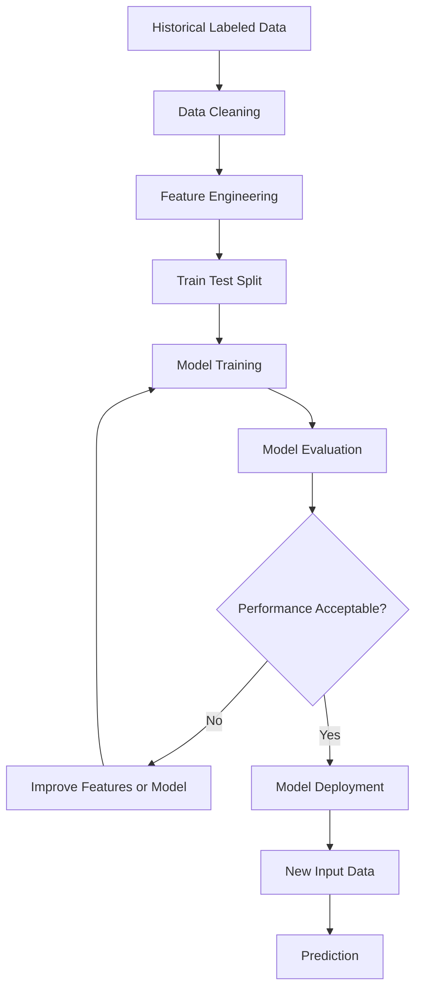
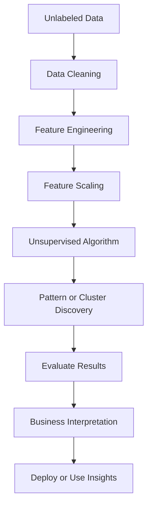
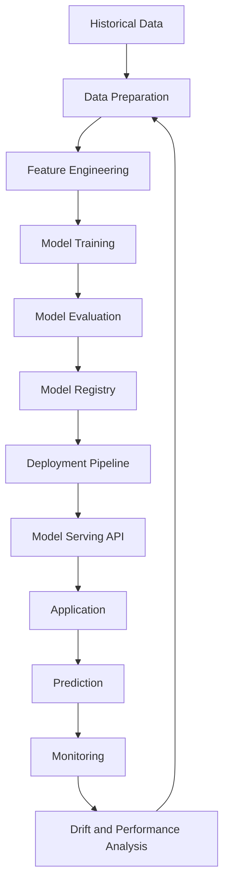

# Supervised vs. Unsupervised Learning

## 1. What is Machine Learning?

Machine Learning (ML) is a branch of Artificial Intelligence that enables computers to learn patterns from data and make predictions or identify patterns without explicitly programming every rule.

Machine learning algorithms learn from historical data and apply the learned patterns to new data.

There are three major categories:

1. Supervised Learning
2. Unsupervised Learning
3. Reinforcement Learning

This document focuses on supervised and unsupervised learning.

---

# 2. What is Supervised Learning?

Supervised learning is a machine learning approach where a model learns from labeled training data.

Labeled data contains:
- Input features (X)
- Known output or target labels (Y)

The model learns the relationship between X and Y and uses that relationship to predict outcomes for new data.

### Example: Bank Loan Approval

A bank wants to predict whether a loan applicant is likely to default.

Historical training data:

| Customer | Income | Credit Score | Existing Debt | Loan Default |
|---|---:|---:|---:|---|
| C101 | 90000 | 750 | 10000 | No |
| C102 | 45000 | 580 | 30000 | Yes |
| C103 | 120000 | 790 | 15000 | No |
| C104 | 50000 | 610 | 25000 | Yes |

Here:
- Income, Credit Score, Existing Debt = Features (X).
- Loan Default = Target (Y).

The model learns from historical examples.

For a new customer:

```text
Income = 85000
Credit Score = 720
Existing Debt = 12000
```

The model predicts:

```text
Default Probability = 0.08
```

This means the model estimates an 8% probability of default, based on its training and calibration.

The bank should combine this prediction with approved credit policies and other decision criteria rather than treating the prediction as an automatic approval decision.

---

# 3. How Does Supervised Learning Work?



### Steps

1. Collect historical labeled data.
2. Clean and preprocess the data.
3. Identify relevant input features.
4. Split data into training, validation, and test sets.
5. Train a machine learning model.
6. Evaluate model performance.
7. Tune hyperparameters if necessary.
8. Deploy the model.
9. Generate predictions for new data.
10. Monitor performance and data drift.

---

# 4. Types of Supervised Learning

Supervised learning is divided into two major categories:

1. Classification
2. Regression

## 4.1 Classification

Classification predicts a category or class.

Examples:
- Fraudulent vs. legitimate transaction.
- Loan default vs. no default.
- Customer churn vs. no churn.
- Spam vs. non-spam email.
- High-risk vs. low-risk transaction.

### Example: Fraud Detection

Input features:

```text
Transaction Amount = $5,000
Transaction Location = New York
Transaction Time = 2:00 AM
Transaction Frequency = High
```

Model output:

```text
Fraud Probability = 0.92
Predicted Class = Fraud
```

The model estimates a 92% fraud probability. A decision threshold and downstream business rules determine whether to flag, decline, or review the transaction.

### Common Classification Algorithms

| Algorithm | Description | Example |
|---|---|---|
| Logistic Regression | Predicts class probabilities | Loan default prediction |
| Decision Tree | Uses decision rules | Credit risk classification |
| Random Forest | Combines multiple decision trees | Fraud detection |
| XGBoost | Gradient-boosted decision trees | Customer churn |
| Support Vector Machine | Finds a separating boundary | Document classification |
| Naive Bayes | Uses Bayes' theorem | Spam detection |
| Neural Networks | Learns complex nonlinear patterns | Fraud detection |

### Types of Classification

**Binary Classification**

Predicts one of two classes.

Examples:
- Fraud / Not Fraud.
- Default / No Default.
- Churn / No Churn.

**Multiclass Classification**

Predicts one of more than two classes.

Example:

```text
Transaction Classification:
1. Fraud
2. Legitimate
3. Suspicious
4. Requires Manual Review
```

**Multilabel Classification**

Predicts multiple labels for the same input.

Example:

A financial document may be classified as:
- Compliance.
- Legal.
- Investment Research.

A document can belong to multiple categories.

---

## 4.2 Regression

Regression predicts a continuous numerical value.

Examples:
- Predicting house prices.
- Predicting customer lifetime value.
- Predicting revenue.
- Predicting transaction amounts.
- Predicting expected portfolio returns.

### Example: Predicting House Prices

Training data:

| House Size (sq ft) | Bedrooms | Price |
|---:|---:|---:|
| 1200 | 2 | $300,000 |
| 1800 | 3 | $420,000 |
| 2200 | 4 | $500,000 |
| 2800 | 4 | $620,000 |

The model learns the relationship between house characteristics and price.

New input:

```text
House Size = 2000 sq ft
Bedrooms = 3
```

Predicted output:

```text
Estimated Price = $460,000
```

### Common Regression Algorithms

| Algorithm | Description | Example |
|---|---|---|
| Linear Regression | Models a linear relationship | Revenue prediction |
| Polynomial Regression | Models nonlinear relationships | Demand prediction |
| Decision Tree Regression | Uses decision rules | Property price |
| Random Forest Regression | Combines multiple trees | Customer value |
| XGBoost Regression | Gradient-boosted trees | Financial forecasting |
| Neural Network Regression | Learns complex relationships | Time-series forecasting |

### Classification vs. Regression

| Classification | Regression |
|---|---|
| Predicts a category | Predicts a number |
| Fraud / Not Fraud | Expected loss amount |
| Churn / No Churn | Expected customer revenue |
| Default / No Default | Probability of default |
| Accuracy, Precision, Recall | MAE, MSE, RMSE, R² |

---

# 5. What is Unsupervised Learning?

Unsupervised learning is a machine learning approach where a model learns patterns from unlabeled data.

Unlike supervised learning, the training data does not contain a known target output.

The model identifies:
- Groups or clusters.
- Similarities.
- Relationships.
- Hidden patterns.
- Unusual observations.

### Example: Customer Segmentation

A bank wants to group customers based on their financial behavior.

Available data:

| Customer | Monthly Income | Monthly Spending | Transaction Count |
|---|---:|---:|---:|
| C101 | 9000 | 2500 | 45 |
| C102 | 8500 | 2200 | 40 |
| C103 | 3000 | 2500 | 90 |
| C104 | 3200 | 2700 | 95 |
| C105 | 15000 | 5000 | 25 |

There is no predefined customer segment label.

The algorithm identifies groups based on similarities in the data.

Possible results:

```text
Cluster 1: High-income customers
Cluster 2: High-spending customers
Cluster 3: Frequent transaction customers
```

These cluster descriptions are assigned by analyzing the resulting groups. The algorithm itself does not automatically know their business meaning.

---

# 6. How Does Unsupervised Learning Work?



### Steps

1. Collect unlabeled data.
2. Clean and preprocess the data.
3. Select relevant features.
4. Scale numerical features when appropriate.
5. Apply an unsupervised learning algorithm.
6. Identify clusters, associations, or anomalies.
7. Evaluate the results.
8. Interpret the discovered patterns.
9. Use the results for business decisions.

---

# 7. Types of Unsupervised Learning

The major categories include:

1. Clustering.
2. Dimensionality Reduction.
3. Association Rule Learning.
4. Anomaly Detection.

## 7.1 Clustering

Clustering groups similar data points together based on their features.

### Example: Bank Customer Segmentation

A bank wants to segment customers based on:
- Income.
- Spending.
- Transaction frequency.
- Account balance.
- Product usage.

The algorithm groups customers with similar characteristics.

### Common Clustering Algorithms

| Algorithm | Description | Use Case |
|---|---|---|
| K-Means | Groups data into K clusters | Customer segmentation |
| Hierarchical Clustering | Builds a hierarchy of clusters | Customer behavior analysis |
| DBSCAN | Finds dense regions and noise | Unusual transaction patterns |
| Gaussian Mixture Model | Uses probabilistic cluster membership | Customer segmentation |

### K-Means Example

Suppose a bank wants to group customers into three clusters.

```text
K = 3

Input:
Customer Income
Monthly Spending
Transaction Frequency

Output:
Cluster 1
Cluster 2
Cluster 3
```

K-Means attempts to minimize the within-cluster sum of squared distances between observations and their assigned cluster centroids.

### How K-Means Works

1. Select the number of clusters K.
2. Initialize K centroids.
3. Assign each data point to its nearest centroid.
4. Recalculate the centroids.
5. Repeat until assignments or centroids stabilize.

---

## 7.2 Dimensionality Reduction

Dimensionality reduction reduces the number of input features while preserving as much useful information as possible.

Example:

A bank has 100 customer features.

Some features may be redundant or highly correlated.

Dimensionality reduction can transform these 100 features into a smaller set of components.

### Common Algorithms

| Algorithm | Description | Use Case |
|---|---|---|
| PCA | Finds directions of maximum variance | Feature compression |
| t-SNE | Creates low-dimensional visualizations | Data visualization |
| UMAP | Preserves local and some global structure | Cluster visualization |
| Autoencoders | Neural networks that learn compressed representations | Data compression |

### Example: PCA

Principal Component Analysis transforms correlated features into a smaller number of principal components.

It is useful for:
- Reducing feature dimensions.
- Removing redundancy.
- Visualizing complex datasets.
- Improving computational efficiency in some workflows.

Important: PCA components may be harder to interpret than the original features.

---

## 7.3 Association Rule Learning

Association rule learning discovers relationships between items that frequently occur together.

Example:

A bank analyzes customer product usage.

It discovers:

```text
Customers with a mortgage
    |
    +---- Frequently have home insurance
```

Common algorithms:

- Apriori.
- FP-Growth.

Important concepts:

**Support:** How frequently an item combination appears.

**Confidence:** How frequently the consequent occurs when the antecedent occurs.

**Lift:** How much more frequently the consequent occurs with the antecedent compared with its overall frequency.

Example:

If customers who purchase a mortgage frequently also purchase home insurance, the bank can use this relationship to explore relevant product recommendations.

Association does not establish causation.

---

## 7.4 Anomaly Detection

Anomaly detection identifies observations that significantly differ from normal patterns.

Examples:
- Unusual transaction amounts.
- Unexpected login locations.
- Unusual transaction frequency.
- Abnormal account behavior.

### Common Algorithms

| Algorithm | Description | Example |
|---|---|---|
| Isolation Forest | Isolates unusual observations | Fraud investigation |
| Local Outlier Factor (LOF) | Identifies local density deviations | Unusual customer behavior |
| One-Class SVM | Learns a boundary around normal data | Network anomaly detection |
| Autoencoders | Identify unusual reconstruction errors | Transaction anomaly detection |

### Example: Banking Fraud

A customer normally performs transactions between $20 and $200.

Suddenly, the account performs:
- A $10,000 transaction.
- A transaction in a new country.
- Multiple transactions within a few minutes.

An anomaly detection model can flag the behavior for further investigation.

An anomaly is not necessarily fraud. It should be evaluated using additional evidence and business rules.

---

# 8. Supervised vs. Unsupervised Learning

| Feature | Supervised Learning | Unsupervised Learning |
|---|---|---|
| Training data | Labeled | Unlabeled |
| Target variable | Available | Not available |
| Objective | Predict known outcomes | Discover hidden patterns |
| Main techniques | Classification, Regression | Clustering, PCA, Anomaly Detection |
| Evaluation | Known labels and target metrics | Cluster quality and business validation |
| Example | Fraud classification | Customer segmentation |
| Output | Prediction | Cluster, pattern, or anomaly |

---

# 9. What is Semi-Supervised Learning?

Semi-supervised learning combines a small amount of labeled data with a larger amount of unlabeled data.

Example:

A bank has:
- 5,000 transactions labeled as fraudulent or legitimate.
- 1 million transactions without labels.

The model uses the labeled examples and additional information from the unlabeled dataset to improve learning.

It is useful when obtaining labels is expensive or requires manual review.

---

# 10. What is Self-Supervised Learning?

Self-supervised learning creates training signals from the data itself instead of relying on manually labeled examples.

Example:

A language model learns by predicting missing or next tokens from large amounts of text.

It is widely used in:
- Large Language Models.
- Natural Language Processing.
- Computer Vision.
- Representation Learning.

Self-supervised learning is one of the important techniques behind modern foundation models.

---

# 11. What is Reinforcement Learning?

Reinforcement learning is a machine learning approach where an agent learns by interacting with an environment and receiving rewards or penalties.

Key components:

| Component | Meaning |
|---|---|
| Agent | Learner or decision maker |
| Environment | System the agent interacts with |
| State | Current situation |
| Action | Decision made by the agent |
| Reward | Feedback from the environment |
| Policy | Strategy for selecting actions |

### Example

An agent learns how to optimize a sequence of actions in a simulated environment.

It receives positive rewards for achieving desired outcomes and penalties for undesirable outcomes.

Common algorithms:
- Q-Learning.
- Deep Q-Networks (DQN).
- Policy Gradient.
- Proximal Policy Optimization (PPO).

Reinforcement learning is different from supervised learning because the agent learns from interaction and reward feedback rather than only from labeled examples.

---

# 12. Financial Services Use Cases

| Business Use Case | Learning Type | Algorithm |
|---|---|---|
| Fraud detection | Supervised | XGBoost, Random Forest |
| Customer churn prediction | Supervised | Logistic Regression, XGBoost |
| Loan default prediction | Supervised | Logistic Regression, Gradient Boosting |
| Credit risk estimation | Supervised | Logistic Regression, XGBoost |
| Transaction anomaly detection | Unsupervised | Isolation Forest |
| Customer segmentation | Unsupervised | K-Means |
| Customer product association | Unsupervised | Apriori |
| Financial data compression | Unsupervised | PCA |
| Transaction classification | Supervised | Random Forest, Neural Networks |
| Recommendation optimization | Reinforcement Learning | Contextual Bandits, RL |

The correct model depends on the target, available labels, data quality, regulatory requirements, and business objectives.

---

# 13. How do you select between Supervised and Unsupervised Learning?

**Interview Answer:**

I would first understand the business problem and determine whether historical labeled outcomes are available.

If we have labeled data and need to predict a known outcome, I would consider supervised learning.

For example, if a bank has historical fraud labels and wants to predict whether new transactions are fraudulent, I would use a classification model.

If the goal is to discover hidden patterns without predefined labels, I would consider unsupervised learning.

For example, customer segmentation can use K-Means to group customers based on transaction behavior.

The final algorithm selection would depend on data quality, interpretability, model performance, scalability, and business requirements.

---

# 14. How do you evaluate Supervised Learning Models?

Evaluation depends on whether the problem is classification or regression.

## Classification Metrics

| Metric | Meaning |
|---|---|
| Accuracy | Percentage of correct predictions |
| Precision | Percentage of predicted positives that are correct |
| Recall | Percentage of actual positives identified |
| F1 Score | Harmonic mean of precision and recall |
| ROC-AUC | Measures ranking discrimination across thresholds |
| PR-AUC | Summarizes precision-recall performance across thresholds |

### Example: Fraud Detection

Suppose a model predicts fraudulent transactions.

- True Positive: Fraud correctly identified.
- True Negative: Legitimate transaction correctly identified.
- False Positive: Legitimate transaction incorrectly flagged.
- False Negative: Fraud missed by the model.

In fraud detection, recall is important because missing fraud can be expensive. Precision also matters because excessive false alerts create operational costs.

The correct trade-off depends on fraud losses, review capacity, customer impact, and business policy.

## Regression Metrics

| Metric | Meaning |
|---|---|
| MAE | Average absolute prediction error |
| MSE | Average squared prediction error |
| RMSE | Square root of average squared error |
| R² | Proportion of target variance explained by the model |

---

# 15. How do you evaluate Unsupervised Learning Models?

Unsupervised learning does not always have ground-truth labels, so evaluation is more challenging.

### Clustering Metrics

| Metric | Meaning |
|---|---|
| Silhouette Score | Measures cluster separation and cohesion |
| Davies-Bouldin Index | Measures similarity between clusters |
| Calinski-Harabasz Index | Measures between-cluster separation relative to within-cluster dispersion |

### Other Evaluation Methods

- Business expert validation.
- Cluster stability.
- Anomaly investigation results.
- Domain-specific validation.
- Visualization and interpretability.

A mathematically strong cluster is not necessarily useful for the business.

---

# 16. What is Overfitting?

Overfitting occurs when a model learns the training data too closely, including noise, and performs poorly on unseen data.

Example:

A fraud model achieves:
- Training accuracy: 99%.
- Test accuracy: 75%.

This may indicate overfitting, although the appropriate evaluation also depends on class imbalance and the chosen metrics.

### How to prevent overfitting

- Cross-validation.
- Regularization.
- Feature selection.
- Pruning decision trees.
- Early stopping.
- More representative training data.
- Appropriate model complexity.

---

# 17. What is Underfitting?

Underfitting occurs when a model is too simple to capture meaningful patterns in the training data.

Example:

A model achieves:
- Training accuracy: 65%.
- Test accuracy: 63%.

Possible solutions:
- Add relevant features.
- Use a more expressive model.
- Improve feature engineering.
- Reduce excessive regularization.
- Improve data quality.

---

# 18. What is Feature Engineering?

Feature engineering is the process of creating or transforming input variables to improve model performance.

Example: Fraud Detection

Raw transaction data:

- Transaction amount.
- Timestamp.
- Location.
- Customer ID.

Engineered features:

- Average transaction amount over 30 days.
- Number of transactions in the last hour.
- Distance from the customer's usual location.
- Percentage change from typical spending.
- Number of failed login attempts.

Good feature engineering can improve predictive performance and provide more meaningful signals to the model.

---

# 19. What is the difference between Training, Validation, and Test Data?

| Dataset | Purpose |
|---|---|
| Training | Used to learn model parameters |
| Validation | Used for model selection and hyperparameter tuning |
| Test | Used for final unbiased evaluation |

Example:

For 100,000 historical records:

- Training: 70,000.
- Validation: 15,000.
- Test: 15,000.

For time-dependent financial data, a chronological split is often more appropriate than random splitting to avoid using future information to predict the past.

---

# 20. What is Data Leakage?

Data leakage occurs when information that would not be available at prediction time enters the training process.

Example:

A bank builds a loan default model.

The training dataset includes a field showing whether the loan was eventually sent to collections.

This information may reveal the future outcome and make the model appear more accurate than it would be in production.

Prevention:
- Define the prediction timestamp.
- Exclude future information.
- Use time-aware validation.
- Review feature generation pipelines.
- Validate training and inference consistency.

---

# 21. How do you deploy a Machine Learning Model?

Typical production workflow:



Important production considerations:

- Model versioning.
- Feature consistency.
- API security.
- Low latency.
- Scalability.
- Monitoring.
- Data drift.
- Model drift.
- Retraining strategy.
- Explainability.
- Auditability.

---

# 22. What is Model Drift?

Model drift occurs when a deployed model becomes less effective over time.

Two important types:

**Data Drift**

The distribution of input features changes.

Example: Customer transaction behavior changes significantly.

**Concept Drift**

The relationship between input features and the target outcome changes.

Example: Fraudsters adopt new transaction patterns, changing the relationship between historical features and fraud outcomes.

Monitoring should include data distributions, model performance, and business outcomes.

---

# 23. Python Example: Supervised Learning – Classification

Example using Logistic Regression to predict whether a customer defaults.

```python
from sklearn.model_selection import train_test_split
from sklearn.linear_model import LogisticRegression
from sklearn.metrics import classification_report

# Input features
X = [
    [90000, 750, 10000],
    [45000, 580, 30000],
    [120000, 790, 15000],
    [50000, 610, 25000],
    [100000, 770, 12000],
    [40000, 550, 35000]
]

# Target labels: 0 = No Default, 1 = Default
y = [0, 1, 0, 1, 0, 1]

X_train, X_test, y_train, y_test = train_test_split(
    X, y, test_size=0.33, random_state=42, stratify=y
)

model = LogisticRegression(max_iter=1000)

model.fit(X_train, y_train)

predictions = model.predict(X_test)

print(classification_report(y_test, predictions))
```

This is an educational example. A production credit-risk model needs a much larger representative dataset, proper preprocessing, calibration, fairness testing, and time-aware validation.

---

# 24. Python Example: Unsupervised Learning – K-Means

Example of customer segmentation.

```python
from sklearn.cluster import KMeans
from sklearn.preprocessing import StandardScaler

# Customer features:
# Monthly income, monthly spending
X = [
    [9000, 2500],
    [8500, 2200],
    [3000, 2500],
    [3200, 2700],
    [15000, 5000],
    [14000, 4500]
]

# Scale features
scaler = StandardScaler()
X_scaled = scaler.fit_transform(X)

# Create 3 clusters
model = KMeans(
    n_clusters=3,
    random_state=42,
    n_init=10
)

model.fit(X_scaled)

# Assign cluster labels
clusters = model.labels_

print(clusters)
```

The output contains cluster IDs. Business analysts should inspect the characteristics of each cluster before assigning meaningful segment names.

---

# 25. Principal AI Architect Interview Questions

### Q1. What is the difference between supervised and unsupervised learning?

Supervised learning uses labeled data to predict known outcomes. Unsupervised learning uses unlabeled data to identify hidden patterns or groups.

### Q2. Is fraud detection supervised or unsupervised?

It can use both.

- Supervised learning predicts fraud using historical fraud labels.
- Unsupervised learning identifies unusual transaction patterns without predefined labels.

A production fraud platform may combine both approaches.

### Q3. Which algorithm would you use for customer segmentation?

I would consider K-Means if the data has meaningful numerical features and reasonably compact clusters. I would compare it with hierarchical clustering or DBSCAN based on the data distribution and business objectives.

### Q4. Which algorithm would you use for loan default prediction?

I would establish a baseline using Logistic Regression because it is relatively interpretable. I would compare it with Random Forest and XGBoost, evaluating predictive performance, calibration, explainability, and regulatory requirements.

### Q5. Can unsupervised learning be used for fraud detection?

Yes. Anomaly detection algorithms such as Isolation Forest can identify unusual transaction patterns. These findings can be used to prioritize investigations or as additional features in a supervised fraud model.

### Q6. What is the difference between classification and regression?

Classification predicts categories, while regression predicts continuous numerical values.

### Q7. Why is feature engineering important?

Feature engineering transforms raw data into meaningful signals that help models identify relevant patterns and improve prediction quality.

### Q8. How do you handle imbalanced datasets?

I would evaluate class distribution, use appropriate metrics such as precision, recall, and PR-AUC, and consider class weights, resampling, or threshold tuning. I would validate the approach using realistic test data.

### Q9. How do you prevent overfitting?

I would use cross-validation, regularization, early stopping, feature selection, and appropriate model complexity.

### Q10. How do you monitor a deployed model?

I would monitor prediction latency, error rates, data drift, model performance, calibration, business outcomes, and fairness metrics where applicable.

---

# 26. Quick Revision Cheat Sheet

| Concept | Key Point |
|---|---|
| Supervised Learning | Labeled data |
| Unsupervised Learning | Unlabeled data |
| Classification | Predict categories |
| Regression | Predict numerical values |
| Clustering | Group similar records |
| K-Means | Cluster data into K groups |
| PCA | Reduce dimensionality |
| Isolation Forest | Detect anomalies |
| Apriori | Discover associations |
| Reinforcement Learning | Learn through rewards |
| Semi-Supervised | Small labeled + large unlabeled data |
| Self-Supervised | Learn training signals from data itself |
| Overfitting | Learns training data too closely |
| Underfitting | Fails to learn important patterns |
| Feature Engineering | Create useful model inputs |
| Data Leakage | Unavailable information enters training |
| Data Drift | Input distribution changes |
| Concept Drift | Relationship between features and target changes |

---

# 27. Key Takeaways

1. Use supervised learning when historical labels are available and the goal is prediction.
2. Use unsupervised learning when the goal is to discover patterns without predefined labels.
3. Classification predicts categories.
4. Regression predicts continuous numerical values.
5. Clustering identifies similar groups.
6. Anomaly detection identifies unusual observations.
7. Feature engineering is critical to model performance.
8. Model evaluation must match the business objective.
9. Production ML requires monitoring, governance, explainability, and reliability.
10. Financial institutions may combine supervised and unsupervised models in the same risk and fraud platforms.

**Principal Architect perspective:**

Model selection should start with the business problem, target outcome, data availability, and decision requirements—not with the algorithm. The architecture must also support model explainability, monitoring, governance, scalability, and responsible use.
