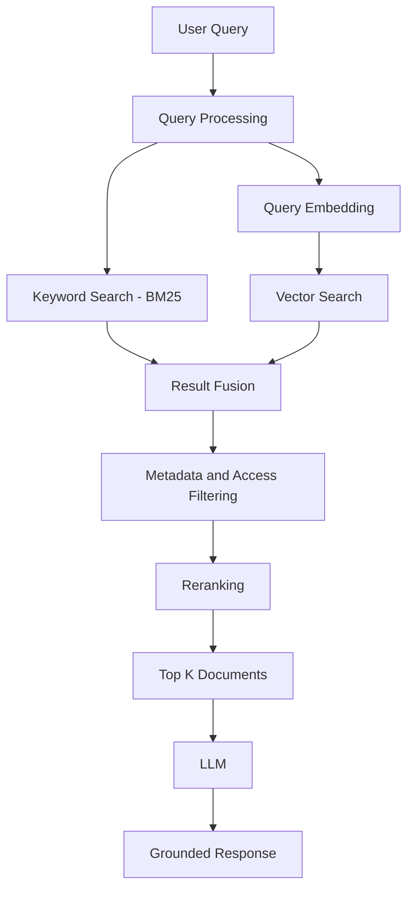
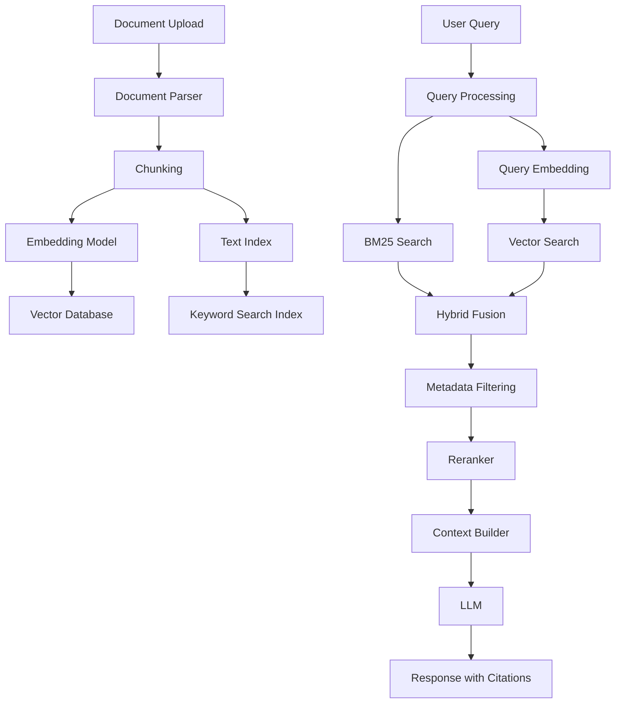
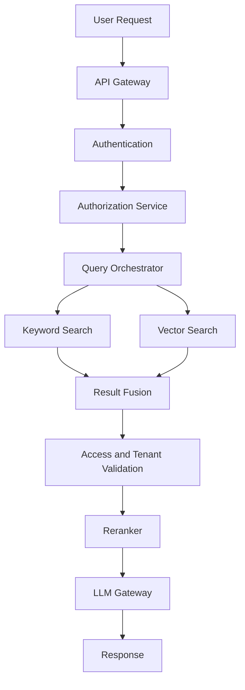

## 1. What is Hybrid Search?

**Answer:**

Hybrid search combines two search techniques:

1. **Keyword search (lexical search):** Finds documents based on exact words, phrases, and keyword relevance.
2. **Vector search (semantic search):** Finds documents based on the semantic meaning of the query using embeddings.

Hybrid search combines the strengths of both approaches to retrieve more relevant documents.

**Example:**

A user searches:

`What is  policy for restricted investments?`

- Keyword search finds documents containing exact terms such as "restricted investments."
- Vector search finds semantically related content such as "investment restrictions" or "prohibited securities."
- Hybrid search combines both result sets to improve retrieval quality.

---

## 2. Why do we need Hybrid Search?

**Answer:**

Vector search understands semantic meaning but may not perform well with exact identifiers, product codes, names, or technical terms.

Keyword search is effective for exact matches but may miss documents that use different terminology.

Hybrid search addresses these limitations by combining both methods.

**Advantages:**

- Better retrieval accuracy.
- Supports exact keyword matching.
- Understands semantic meaning.
- Improves recall.
- Works well with enterprise document search.
- Useful for financial, legal, and compliance applications.

---

## 3. What is the difference between Keyword Search, Vector Search, and Hybrid Search?

| Feature | Keyword Search | Vector Search | Hybrid Search |
|---|---|---|---|
| Search method | Exact terms | Semantic meaning | Both |
| Technology | BM25, TF-IDF | Embeddings | BM25 + Vector |
| Synonyms | Limited | Good | Good |
| Exact identifiers | Strong | Can be weak | Strong |
| Semantic understanding | Limited | Strong | Strong |
| Retrieval quality | Depends on query | Depends on query | Often more robust |

**Interview takeaway:** Hybrid search is useful when both exact matching and semantic understanding are important.

---

## 4. How does Hybrid Search work internally?

**Answer:**

Hybrid search typically follows these steps:

1. Receive the user's query.
2. Normalize and process the query.
3. Send the query to the keyword search engine.
4. Generate a query embedding.
5. Execute vector similarity search.
6. Retrieve results from both search methods.
7. Merge and rank the results.
8. Apply metadata and access-control filters.
9. Return the top relevant documents or chunks.
10. Pass the retrieved context to the LLM.

**Architecture:**



---

## 5. What is BM25?

**Answer:**

BM25 stands for Best Matching 25. It is a keyword-based information retrieval algorithm.

It ranks documents based on:
- How frequently query terms appear in a document.
- How rare those terms are across the document collection.
- Document length normalization.

A rare keyword appearing in a document can contribute more to its relevance than a very common word.

**Example:**

Query: `restricted investment policy`

BM25 searches for documents containing these terms and ranks documents based on their relevance.

BM25 is widely used in Elasticsearch and OpenSearch.

---

## 6. What is Reciprocal Rank Fusion (RRF)?

**Answer:**

Reciprocal Rank Fusion is a technique used to combine ranked results from multiple search systems.

For example:
- BM25 returns one ranking.
- Vector search returns another ranking.
- RRF combines the rankings into one unified ranking.

The formula is:

\[
RRF(d) = \sum_{r \in R} \frac{1}{k + rank_r(d)}
\]

Where:
- `d` = document.
- `R` = set of ranked result lists.
- `rank_r(d)` = document's rank in a result list.
- `k` = a smoothing constant, commonly 60.

**Example:**

| Document | BM25 Rank | Vector Rank |
|---|---:|---:|
| Doc A | 1 | 4 |
| Doc B | 3 | 1 |
| Doc C | 2 | 3 |

RRF combines the rankings and gives a higher score to documents that perform well across both search methods.

**Why use RRF?**

- Does not require keyword and vector scores to have the same scale.
- Combines multiple ranked lists.
- Simple and effective.
- Reduces dependence on manually tuning score weights.

---

## 7. What is Weighted Score Fusion?

**Answer:**

Weighted score fusion combines normalized keyword and vector relevance scores using configurable weights.

Formula:

\[
HybridScore(d) = \alpha \times VectorScore(d) + \beta \times KeywordScore(d)
\]

Where:

- `VectorScore` = semantic similarity score.
- `KeywordScore` = keyword relevance score.
- `α` = vector search weight.
- `β` = keyword search weight.
- Typically, α + β = 1 after normalization.

**Example:**

Suppose:

- Vector score = 0.90
- Keyword score = 0.80
- Vector weight = 0.60
- Keyword weight = 0.40

Then:

\[
HybridScore = (0.60 \times 0.90) + (0.40 \times 0.80)
\]

\[
HybridScore = 0.86
\]

**Important:** Keyword and vector scores should be calibrated or normalized before combining them. Their raw values may not be directly comparable.

---

## 8. What is the difference between RRF and Weighted Score Fusion?

| Feature | RRF | Weighted Score Fusion |
|---|---|---|
| Input | Search rankings | Search scores |
| Score normalization | Not required | Usually required |
| Configuration | Smoothing constant | Search weights |
| Complexity | Simple | Requires calibration |
| Use case | Combine ranked lists | Control relative search importance |

**Interview answer:**

I would start with RRF because it combines rankings without requiring the raw keyword and vector scores to be on the same scale. If the business requires more control over search relevance, I would evaluate weighted score fusion with normalized scores.

---

## 9. What is the difference between Hybrid Search and Reranking?

**Answer:**

Hybrid search combines results from keyword and vector search.

Reranking takes the retrieved candidates and evaluates them again using a more sophisticated relevance model.

Example:

1. BM25 retrieves 50 documents.
2. Vector search retrieves 50 documents.
3. Hybrid fusion combines the results.
4. Deduplication produces 70 unique candidates.
5. A reranker evaluates the query against those candidates.
6. The best 5–10 chunks are passed to the LLM.

**Key difference:**

- Hybrid search improves candidate retrieval.
- Reranking improves the ordering and relevance of retrieved candidates.

---

## 10. What is a Cross-Encoder Reranker?

**Answer:**

A cross-encoder takes the query and a candidate document together as input and predicts a relevance score.

Example:

Query: `What is the policy for restricted investments?`

Candidate document: `Employees must not trade securities listed on the restricted securities register.`

The cross-encoder evaluates the relationship between the query and the document.

**Advantages:**
- Often provides better relevance ranking.
- Understands the relationship between query and document.
- Useful after initial retrieval.

**Disadvantage:**
- More computationally expensive than vector similarity search.
- Usually applied to a smaller candidate set.

---

## 11. How does Hybrid Search work in a RAG architecture?

**Answer:**

In a Retrieval-Augmented Generation system, hybrid search retrieves relevant chunks from the knowledge base.

The workflow is:

1. Documents are uploaded.
2. Documents are parsed into text.
3. Text is split into chunks.
4. Embeddings are generated.
5. Chunks and embeddings are stored in a vector database.
6. Searchable text is indexed in a keyword search engine.
7. A user submits a query.
8. Keyword and vector searches run.
9. Results are merged using RRF or score fusion.
10. A reranker selects the best chunks.
11. The LLM generates an answer grounded in the retrieved context.

**Architecture:**



---

## 12. Which databases support Hybrid Search?

**Answer:**

Several technologies support hybrid search or provide components for implementing it.

| Technology | Hybrid Search Capabilities |
|---|---|
| Elasticsearch | BM25 and vector search |
| OpenSearch | Keyword and neural/vector search |
| Azure AI Search | Full-text and vector search |
| PostgreSQL + pgvector | SQL full-text search and vector similarity |
| Weaviate | Hybrid keyword and vector search |
| Milvus | Vector search and supported sparse/dense hybrid retrieval |
| Pinecone | Dense and sparse vector retrieval |

The choice depends on data volume, latency, filtering requirements, operational complexity, cloud strategy, and existing infrastructure.

---

## 13. How would you implement Hybrid Search using Elasticsearch?

**Answer:**

I would:

1. Index document text and metadata in Elasticsearch.
2. Generate embeddings for document chunks.
3. Store dense vectors in the index.
4. Execute a BM25 query for keyword relevance.
5. Execute a vector similarity query.
6. Combine the results using RRF or a supported hybrid-ranking mechanism.
7. Apply tenant and access-control filters.
8. Rerank the candidates if necessary.

The same general design can be implemented using OpenSearch or Azure AI Search.

---

## 14. What is Dense Vector Search?

**Answer:**

Dense vector search uses embeddings represented as dense numerical arrays.

Example:

```python
embedding = [0.12, 0.45, 0.78, 0.21, 0.91]
```

The embedding model converts text into a numerical representation that captures semantic meaning.

The search engine compares the query vector with document vectors using metrics such as:
- Cosine similarity.
- Dot product.
- Euclidean distance.

Dense vectors are useful for semantic retrieval.

---

## 15. What is Sparse Vector Search?

**Answer:**

Sparse vector search represents text using vectors where most dimensions are zero.

It emphasizes terms and their importance rather than dense semantic representations.

Examples of sparse retrieval approaches include:
- BM25.
- TF-IDF.
- SPLADE.

Sparse retrieval is useful for exact keywords, rare terms, and identifiers.

**Dense vs. Sparse:**

| Dense Vector | Sparse Vector |
|---|---|
| Semantic meaning | Keyword relevance |
| Most dimensions populated | Most dimensions are zero |
| Embedding models | Sparse retrieval models |
| Finds related concepts | Finds important matching terms |

---

## 16. What is the difference between Dense and Sparse Hybrid Search?

**Answer:**

Dense and sparse hybrid search combines:
- Dense vectors for semantic similarity.
- Sparse vectors for keyword relevance.

For example, a financial institution searches for:

`Rule 144A restricted securities`

Sparse retrieval helps identify exact regulatory terminology, while dense retrieval can find related explanations and policy documents.

The results are fused and reranked before being sent to the LLM.

---

## 17. How do you handle metadata filtering in Hybrid Search?

**Answer:**

Metadata filtering restricts search results based on attributes associated with documents or chunks.

Examples:
- Tenant ID.
- User ID or authorized groups.
- Document type.
- Region.
- Department.
- Effective date.
- Document version.
- Classification level.

Example:

```json
{
  "tenant_id": "tenant_123",
  "region": "US",
  "access_groups": ["compliance", "legal"],
  "document_status": "ACTIVE"
}
```

The search service must enforce authorization filters before returning results to the application.

**Important:** Metadata filtering is a security control, not merely a relevance optimization. Never rely on the LLM to decide whether a user is authorized to access a document.

---

## 18. How do you handle exact identifiers in Hybrid Search?

**Answer:**

For financial applications, users often search using:
- Account IDs.
- Transaction IDs.
- Security identifiers.
- Regulatory references.
- Policy numbers.
- Contract IDs.

I would preserve exact identifiers during query processing and use keyword or structured-field matching alongside semantic retrieval.

For example, if a user searches for `CUSIP 123456789`, exact keyword or structured lookup should be prioritized. Vector search can supplement it with related context.

---

## 19. How do you tune Hybrid Search?

**Answer:**

I would tune hybrid search using an evaluation dataset containing representative user queries and relevant documents.

The process:

1. Establish a keyword-only baseline.
2. Establish a vector-only baseline.
3. Evaluate hybrid search with RRF.
4. Evaluate weighted score fusion if needed.
5. Tune candidate counts and filters.
6. Evaluate reranking.
7. Measure retrieval quality and latency.
8. Validate performance across different query types.

Important metrics:

- Precision@K.
- Recall@K.
- Mean Reciprocal Rank (MRR).
- Normalized Discounted Cumulative Gain (NDCG).
- Search latency.
- Retrieval failure rate.

---

## 20. What is Precision@K?

**Answer:**

Precision@K measures how many of the top K retrieved results are relevant.

Formula:

\[
Precision@K = \frac{Relevant\ Documents\ in\ Top\ K}{K}
\]

Example:

If 8 out of the top 10 retrieved documents are relevant:

\[
Precision@10 = \frac{8}{10} = 0.8
\]

Higher precision means fewer irrelevant documents are returned in the top results.

---

## 21. What is Recall@K?

**Answer:**

Recall@K measures how many of all known relevant documents were retrieved in the top K results.

Formula:

\[
Recall@K = \frac{Relevant\ Documents\ Retrieved\ in\ Top\ K}{Total\ Relevant\ Documents}
\]

Example:

If there are 20 relevant documents and the search retrieves 15 of them in the top K:

\[
Recall@K = \frac{15}{20} = 0.75
\]

Higher recall means the search system finds more of the relevant documents.

---

## 22. What happens if Hybrid Search returns too many irrelevant documents?

**Answer:**

I would investigate:

1. Query preprocessing and normalization.
2. Keyword and vector search quality separately.
3. Candidate retrieval counts.
4. Metadata filtering.
5. RRF or score-fusion configuration.
6. Similarity thresholds.
7. Reranker quality.
8. Chunk size and overlap.
9. Embedding model suitability.

I would use a labeled evaluation dataset to identify the source of poor relevance rather than randomly adjusting search parameters.

---

## 23. How do you improve Hybrid Search latency?

**Answer:**

I would focus on:

- Efficient vector indexes such as HNSW.
- Optimized keyword indexes.
- Appropriate candidate counts.
- Metadata filter optimization.
- Parallel execution of keyword and vector retrieval.
- Caching frequently used queries where safe.
- Limiting reranking to a smaller candidate set.
- Monitoring database and network latency.

I would also measure p50, p95, and p99 latency to understand the actual user experience.

---

## 24. How do you handle document updates and deletions?

**Answer:**

I would maintain document IDs, chunk IDs, and document versions.

For an updated document:

1. Detect the changed document.
2. Parse the new version.
3. Identify changed sections or pages if incremental processing is supported.
4. Generate embeddings for changed chunks.
5. Update the vector index.
6. Update the keyword index.
7. Mark the old version inactive or remove its chunks.
8. Ensure search does not return stale content.

For deletions, I would delete or deactivate the document's chunks in both indexes and verify that they are no longer retrievable.

For financial documents, I would preserve the required audit history separately from the active search index.

---

## 25. How would you design Hybrid Search for a multi-tenant financial institution?

**Answer:**

I would design the system with strong tenant isolation and authorization controls.

**Architecture:**



**Key design considerations:**

- Tenant-aware metadata.
- Role-based access control.
- Document-level permissions.
- Region-specific data boundaries.
- Encryption in transit and at rest.
- Audit logging.
- Secure retrieval filters.
- Consistent document updates across indexes.
- Monitoring and evaluation.

The authorization service should establish the user's permissions. The retrieval layer must enforce those permissions before content reaches the LLM.

---

## 26. What happens if the Vector Database is unavailable?

**Answer:**

I would design the search system with graceful degradation.

Possible approach:

1. Detect vector database failures.
2. Apply bounded retries with exponential backoff.
3. Use circuit breakers to prevent repeated calls to an unhealthy service.
4. Continue with keyword search if it remains available.
5. Clearly identify the degraded retrieval mode in monitoring.
6. Avoid presenting reduced search results as if full hybrid retrieval succeeded.

For high-risk financial workflows, I would define whether degraded keyword-only retrieval is acceptable or whether the request must fail safely.

---

## 27. What happens if Keyword Search is unavailable?

**Answer:**

If keyword search is unavailable, vector retrieval may continue if the business allows degraded operation.

I would:
- Trigger circuit breakers.
- Retry transient errors within a defined limit.
- Continue with vector search where appropriate.
- Record the degraded mode.
- Monitor retrieval quality.
- Restore hybrid search after the keyword service recovers.

The system should not silently assume vector-only results are equivalent to hybrid results.

---

## 28. How do you prevent hallucinations when using Hybrid Search in RAG?

**Answer:**

Hybrid search improves the retrieval of relevant context, but it does not eliminate hallucinations.

I would use multiple controls:

1. Retrieve from approved and trusted knowledge sources.
2. Enforce access control before context reaches the LLM.
3. Use reranking to improve context relevance.
4. Provide citations and document references.
5. Instruct the LLM to answer only from the supplied context.
6. Use input and output guardrails.
7. Evaluate groundedness and answer relevance.
8. Return an appropriate response when evidence is insufficient.

For financial applications, the LLM should not invent investment policies, regulatory requirements, or transaction details.

---

## 29. What is Query Expansion in Hybrid Search?

**Answer:**

Query expansion enriches the original query with related terms, synonyms, or alternative expressions to improve retrieval.

Example:

Original query:

`restricted investments`

Expanded query:

`restricted investments, prohibited securities, trading restrictions, restricted list`

This can improve recall, especially when documents use different terminology.

However, expansion should be controlled because adding unrelated terms can reduce precision.

---

## 30. What is Query Rewriting?

**Answer:**

Query rewriting transforms a user's original question into a more search-friendly query.

Example:

User asks:

`Can employees trade stocks that are on the restricted list?`

Rewritten search query:

`Employee trading restrictions for securities on the restricted list`

Query rewriting can:
- Resolve conversational references.
- Remove unnecessary words.
- Expand abbreviations.
- Preserve important identifiers.
- Improve keyword and semantic retrieval.

I would preserve the original query and validate that rewriting does not change the user's intent.

---

## 31. What is the difference between Query Expansion and Query Rewriting?

| Query Expansion | Query Rewriting |
|---|---|
| Adds related terms | Rephrases the original query |
| Can create multiple search terms | Produces a cleaner search query |
| Primarily improves recall | Improves query clarity |
| Example: adding synonyms | Example: resolving conversational references |

---

## 32. How would you explain Hybrid Search in a Principal AI Architect interview?

**Answer:**

I would explain hybrid search as a retrieval strategy that combines keyword-based and semantic search to improve the quality of RAG applications.

For example, in a financial institution, a user may search for a specific policy number or regulatory term. Keyword search is effective for exact matches, while vector search helps retrieve documents with similar meaning even when they use different terminology.

I would execute both searches, combine their rankings using Reciprocal Rank Fusion, apply tenant and document-level authorization filters, and optionally use a cross-encoder reranker to select the most relevant chunks.

The final context is passed to the LLM with citations and grounding instructions. I would evaluate the solution using Precision@K, Recall@K, MRR, NDCG, and latency.

My focus would be on retrieval quality, security, scalability, observability, and consistency across document updates.

---

# 33. Practical Example: Financial Compliance RAG

**Business scenario:**

A compliance analyst asks:

`What are the restrictions on trading securities included in the restricted list?`

**Search execution:**

| Step | Action |
|---|---|
| 1 | Receive user query |
| 2 | Authenticate user and resolve access groups |
| 3 | Run BM25 keyword search |
| 4 | Generate query embedding |
| 5 | Run vector similarity search |
| 6 | Combine results using RRF |
| 7 | Apply tenant and document access filters |
| 8 | Rerank top candidates |
| 9 | Send relevant policy chunks to LLM |
| 10 | Generate answer with citations |

**Example retrieved documents:**

- Employee Personal Trading Policy.
- Restricted Securities Procedure.
- Compliance Trading Restrictions.
- Employee Code of Conduct.

**Expected result:**

The LLM provides an answer grounded in the approved policy documents and includes source references. If the retrieved evidence is insufficient, it should say so rather than inventing a policy.

---

# 34. Key Interview Revision

| Topic | Remember |
|---|---|
| Hybrid Search | Keyword + Vector |
| Keyword algorithm | BM25 |
| Dense retrieval | Embedding vectors |
| Sparse retrieval | Keyword-oriented sparse representations |
| Fusion | RRF or weighted score fusion |
| Reranking | Cross-encoder |
| Candidate retrieval | Top-K |
| Filtering | Tenant, RBAC, metadata |
| Retrieval metrics | Precision@K, Recall@K, MRR, NDCG |
| RAG | Retrieve, augment, generate |
| Security | Enforce authorization before LLM context |
| Reliability | Retry, circuit breaker, graceful degradation |

---

# 35. Principal Architect Design Checklist

When designing production hybrid search, consider:

- [ ] Query normalization and rewriting.
- [ ] BM25 keyword retrieval.
- [ ] Dense vector retrieval.
- [ ] Optional sparse vector retrieval.
- [ ] Parallel search execution.
- [ ] RRF or calibrated weighted fusion.
- [ ] Deduplication.
- [ ] Tenant and document-level access filters.
- [ ] Cross-encoder reranking.
- [ ] Context assembly and citation tracking.
- [ ] Document version management.
- [ ] Index synchronization.
- [ ] Search caching.
- [ ] Retrieval evaluation.
- [ ] Latency and cost monitoring.
- [ ] Failure handling and graceful degradation.
- [ ] Audit logging and governance.

---

# 36. Recommended Learning Order

1. Keyword Search and BM25.
2. Dense Vector Search.
3. Sparse Vector Search.
4. Hybrid Search Architecture.
5. Reciprocal Rank Fusion.
6. Weighted Score Fusion.
7. Reranking and Cross-Encoders.
8. Metadata Filtering and Tenant Isolation.
9. RAG Integration.
10. Production Evaluation and Optimization.

**Principal Architect takeaway:**

Hybrid search is not simply running two searches. It is designing a secure, scalable retrieval pipeline that combines lexical relevance and semantic relevance, fuses results, reranks candidates, and provides grounded context to the LLM.
