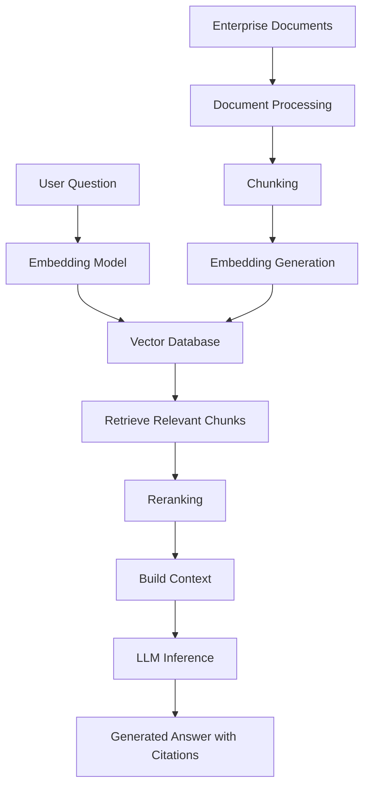
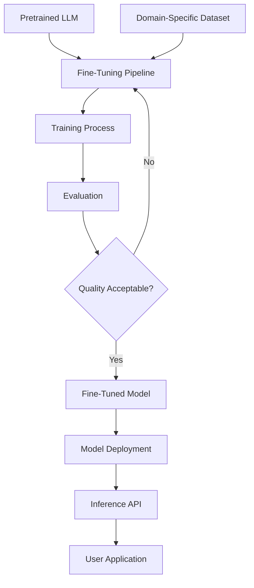
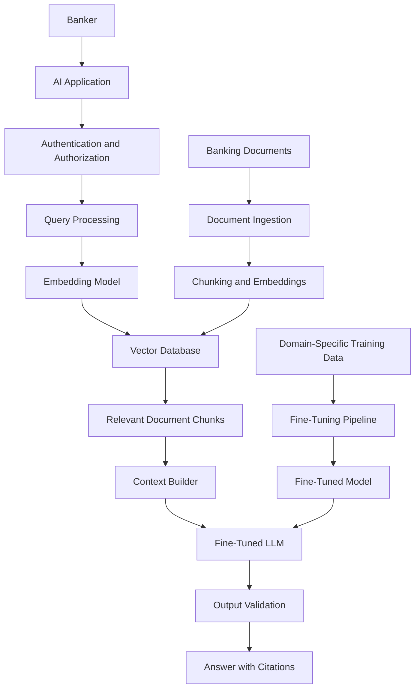
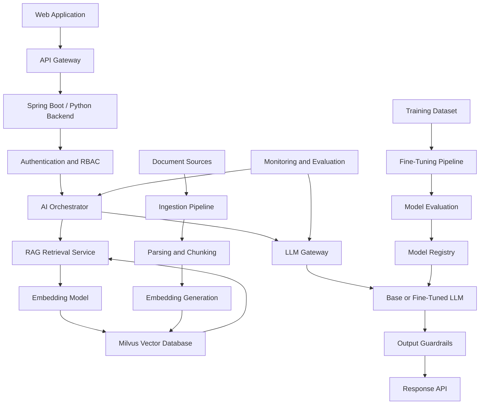

# RAG vs Fine-Tuning – Generative AI Fundamentals

## 1. Introduction

RAG (Retrieval-Augmented Generation) and Fine-Tuning are two approaches used to customize and improve Large Language Models (LLMs) for enterprise applications.

Both approaches solve different problems.

- **RAG:** Provides the LLM with relevant external knowledge at inference time.
- **Fine-Tuning:** Further trains a pretrained model using domain-specific examples to change its learned behavior.

### Simple Example

Suppose a bank wants to build an AI assistant for investment bankers.

The assistant should:
- Answer questions about financial products.
- Understand internal banking terminology.
- Summarize financial documents.
- Answer questions using internal policies.
- Follow the bank's preferred response format.

There are two approaches:

**Using RAG:**
Retrieve relevant banking policies, financial reports, and internal documents and provide them as context to the LLM.

**Using Fine-Tuning:**
Train the pretrained model further using banking-specific examples so that it better follows financial terminology, instructions, and response patterns.

---

## 2. What is RAG?

RAG stands for Retrieval-Augmented Generation.

It combines information retrieval with LLM generation.

Instead of relying only on the knowledge learned during model training, RAG retrieves relevant information from external knowledge sources and provides it to the LLM as context.

### RAG Architecture



### RAG Workflow

**Document Ingestion:**

1. Upload documents such as PDFs, Word files, and financial reports.
2. Extract text using document parsers or OCR.
3. Split documents into smaller chunks.
4. Generate embeddings using an embedding model.
5. Store embeddings and metadata in a vector database.
6. Maintain document versions and access-control metadata.

**Query Processing:**

1. User submits a question.
2. Generate an embedding for the question.
3. Retrieve relevant chunks from the vector database.
4. Apply metadata filtering and access control.
5. Rerank the retrieved chunks.
6. Construct a prompt containing the question and retrieved context.
7. Send the prompt to the LLM.
8. Generate a grounded response with citations.

### Banking Example

A banker asks:

"What are the financial covenants in the latest credit agreement?"

RAG retrieves the relevant sections from the credit agreement and supplies them to the LLM.

The LLM generates a response based on the retrieved content.

### Advantages of RAG

- No need to retrain the LLM when documents change.
- Supports frequently updated enterprise knowledge.
- Provides source citations.
- Can enforce document-level access control.
- Reduces reliance on the model's internal knowledge.
- Can use existing enterprise document repositories.

### Limitations of RAG

- Retrieval quality directly affects answer quality.
- Requires document ingestion and indexing pipelines.
- Vector database operations introduce latency.
- Poor chunking can result in missing context.
- The LLM can still hallucinate despite receiving retrieved context.
- Requires careful access-control enforcement.

---

## 3. What is Fine-Tuning?

Fine-tuning is the process of taking a pretrained model and training it further using a specialized dataset.

The objective is to improve the model's behavior for a particular task or domain.

Fine-tuning can update all model parameters or only selected parameters, depending on the approach.

### Fine-Tuning Architecture



### Fine-Tuning Workflow

1. Select a pretrained model.
2. Prepare domain-specific training data.
3. Clean and validate the dataset.
4. Create instruction-response examples.
5. Split the dataset into training, validation, and test sets.
6. Train the model using a fine-tuning technique.
7. Evaluate model quality.
8. Deploy the fine-tuned model.
9. Monitor performance and periodically retrain when needed.

### Banking Example

A bank wants an AI assistant that consistently summarizes financial documents using a standardized format.

Training examples might look like:

**Input:**

"Summarize the financial risk section of this company report."

**Expected Output:**

```text
Financial Risk Summary:

1. Revenue Risk
2. Liquidity Risk
3. Debt Exposure
4. Market Risk
5. Key Observations
```

After fine-tuning on many high-quality examples, the model may become more consistent in following the bank's preferred summarization format.

### Advantages of Fine-Tuning

- Improves task-specific behavior.
- Helps the model follow domain-specific instructions.
- Can improve output consistency and formatting.
- Can teach specialized language and response patterns.
- May reduce prompt complexity for repeated tasks.

### Limitations of Fine-Tuning

- Requires high-quality training data.
- Requires additional training infrastructure and cost.
- Needs evaluation and model version management.
- New facts are not automatically learned.
- Fine-tuning does not guarantee factual accuracy.
- Training data can introduce bias or undesirable behavior.

---

## 4. RAG vs Fine-Tuning – Key Differences

| Feature | RAG | Fine-Tuning |
|---|---|---|
| Primary purpose | Add external knowledge | Adapt model behavior |
| How it works | Retrieves information at inference time | Further trains a pretrained model |
| Model weights | Normally unchanged | Updated during training |
| Knowledge updates | Update documents and indexes | Requires additional training to learn new information |
| Training dataset | Not required for basic RAG | Required |
| Infrastructure | Retrieval system and vector database | Training and model-serving infrastructure |
| Citations | Can provide document citations | Does not inherently provide citations |
| Best for | Frequently changing knowledge | Specialized behavior and task patterns |
| Cost | Retrieval and inference costs | Training plus inference costs |
| Example | Retrieve latest credit agreement | Learn a consistent credit agreement summary format |

### Important Interview Point

RAG and Fine-Tuning are not competing technologies.

They solve different problems and can be combined.

- Use RAG when the model needs access to current, private, or frequently changing information.
- Use Fine-Tuning when the model needs to learn a specialized task, style, or response pattern.

---

## 5. When Should We Use RAG?

Use RAG when:

1. Enterprise documents change frequently.
2. The LLM needs access to internal knowledge.
3. Responses need document citations.
4. Data must remain in enterprise-controlled repositories.
5. Different users have different document permissions.
6. The organization needs grounded answers from approved sources.

### Financial Services Use Cases

| Use Case | RAG Application |
|---|---|
| Investment Banking | Retrieve M&A transaction documents |
| Credit Analysis | Retrieve loan agreements and financial statements |
| Compliance | Retrieve regulatory policies |
| Hedge Funds | Retrieve research reports and investment documents |
| Wealth Management | Retrieve approved investment product information |
| Risk Management | Retrieve risk policies and procedures |

---

## 6. When Should We Use Fine-Tuning?

Use Fine-Tuning when:

1. The model needs to follow a specialized output format.
2. The application performs a repeated domain-specific task.
3. The model needs better instruction following for a particular workflow.
4. You have enough high-quality training examples.
5. Prompt engineering alone does not achieve the required behavior.

### Financial Services Use Cases

| Use Case | Fine-Tuning Application |
|---|---|
| Financial Document Summarization | Consistent summary format |
| Transaction Classification | Learn specialized classification patterns |
| Compliance Assistance | Improve task-specific response behavior |
| Financial Report Analysis | Standardized extraction and response structure |
| Customer Support | Follow approved communication patterns |

**Important:** Fine-tuning a language model is not a replacement for a validated financial risk model or an approved decision engine.

---

## 7. Can We Combine RAG and Fine-Tuning?

Yes. In enterprise AI applications, combining both approaches can be useful.

### Example: Investment Banking AI Assistant

Business requirement:

Build an AI assistant that helps investment bankers analyze acquisition documents.

The assistant should:
- Retrieve acquisition agreements.
- Summarize financial information.
- Identify important clauses.
- Follow a standard investment banking summary format.
- Cite the source documents.

### Combined Architecture



### How It Works

**RAG component:**

Retrieves the latest acquisition agreements, financial statements, and internal policies.

**Fine-Tuned LLM component:**

Produces summaries using the organization's preferred investment banking format.

**Result:**

The model uses RAG for current, grounded information and fine-tuning for specialized behavior.

---

## 8. Fine-Tuning Techniques

### 8.1 Full Fine-Tuning

Updates all or most of the pretrained model's parameters.

Characteristics:
- Requires substantial GPU resources.
- Can provide broad adaptation.
- Requires careful training and evaluation.

### 8.2 Parameter-Efficient Fine-Tuning (PEFT)

Updates only a small subset of model parameters or introduces trainable components while keeping most pretrained weights frozen.

Advantages:
- Lower memory requirements.
- Less training cost.
- Easier to maintain multiple task-specific adaptations.

### 8.3 LoRA (Low-Rank Adaptation)

LoRA is a popular parameter-efficient fine-tuning technique.

It adds small trainable low-rank matrices to selected model layers while keeping the original model weights frozen.

Benefits:
- Reduces trainable parameters.
- Reduces training resource requirements.
- Allows task-specific adapters.

### 8.4 QLoRA

QLoRA combines quantization with LoRA.

It loads the pretrained model in a quantized representation and trains LoRA adapters.

Benefits:
- Reduces GPU memory requirements.
- Makes fine-tuning larger models more accessible.
- Supports parameter-efficient adaptation.

---

## 9. RAG vs Fine-Tuning vs Prompt Engineering

These three approaches are often discussed together.

| Approach | What it changes | Example |
|---|---|---|
| Prompt Engineering | Instructions sent to the model | Ask the LLM to summarize in five sections |
| RAG | Information provided to the model | Retrieve the latest financial report |
| Fine-Tuning | Model parameters or adapters | Train the model on financial summary examples |

### Practical Example

Requirement: Build an AI assistant for a hedge fund.

**Prompt Engineering:**

Tell the LLM to act as a financial research assistant and use a specific response structure.

**RAG:**

Retrieve the latest company filings, earnings reports, and research documents.

**Fine-Tuning:**

Adapt the model to consistently perform a specialized financial research summarization task.

---

## 10. How Do We Evaluate RAG and Fine-Tuning?

### RAG Evaluation

Important metrics:

- Recall@K: Whether relevant documents appear in the top K retrieved results.
- Precision@K: How many retrieved results are relevant.
- MRR: How highly the first relevant result is ranked.
- NDCG: Measures ranking quality with relevance grades.
- Faithfulness: Whether generated claims are supported by retrieved context.
- Answer Relevance: Whether the response addresses the user's question.

### Fine-Tuning Evaluation

Important metrics depend on the task:

- Accuracy: Percentage of correct predictions.
- Precision: How many predicted positives are correct.
- Recall: How many actual positives are identified.
- F1 Score: Harmonic mean of precision and recall.
- Exact Match: Whether generated output exactly matches the expected answer.
- Human Evaluation: Whether domain experts consider responses useful and correct.

For generative tasks, also evaluate:
- Instruction following.
- Output consistency.
- Domain-specific correctness.
- Safety and policy compliance.
- Regression against a held-out test set.

---

## 11. How Do We Prevent Hallucinations?

Neither RAG nor Fine-Tuning completely eliminates hallucinations.

For enterprise applications, I would implement multiple controls:

1. Retrieve information from approved and trusted sources.
2. Apply document-level authorization before exposing retrieved content.
3. Include retrieved evidence in the prompt.
4. Instruct the LLM to state when evidence is insufficient.
5. Validate generated answers against retrieved sources.
6. Implement input and output guardrails.
7. Provide citations for traceability.
8. Use human review for high-risk decisions.

For financial applications, the LLM should not independently make regulated investment or credit decisions.

Use validated ML models, deterministic calculations, and approved policy engines for those decisions.

---

## 12. Production Architecture – Enterprise AI Platform



### Key Production Components

| Component | Responsibility |
|---|---|
| API Gateway | Authentication, authorization, rate limiting |
| Spring Boot / Python | Application business logic |
| AI Orchestrator | Coordinates RAG and LLM calls |
| Embedding Model | Converts text into vectors |
| Milvus | Stores and retrieves embeddings |
| LLM Gateway | Model routing and access control |
| Fine-Tuning Pipeline | Trains domain-specific model adaptations |
| Model Registry | Stores model versions and metadata |
| Guardrails | Input/output validation |
| Monitoring | Latency, quality, cost, and error tracking |

---

## 13. Interview Questions and Answers

### Q1. What is the main difference between RAG and Fine-Tuning?

**Answer:**

RAG retrieves external information and provides it as context to the LLM during inference. Fine-Tuning further trains a pretrained model using domain-specific examples to adapt its behavior.

I would use RAG when the application needs current enterprise knowledge and Fine-Tuning when it needs specialized behavior or output patterns.

### Q2. Can RAG replace Fine-Tuning?

**Answer:**

Not completely. RAG provides external knowledge, while Fine-Tuning adapts model behavior.

For example, if a bank needs an assistant to answer questions using the latest credit agreements, I would use RAG. If the assistant needs to consistently generate summaries in a specialized banking format, fine-tuning may help.

### Q3. Can Fine-Tuning eliminate hallucinations?

**Answer:**

No. Fine-Tuning can improve task-specific behavior, but it does not guarantee factual accuracy.

For enterprise applications, I would combine RAG, trusted data sources, input/output guardrails, source citations, and human review for high-risk use cases.

### Q4. When would you choose RAG over Fine-Tuning?

**Answer:**

I would choose RAG when information changes frequently, when the model needs access to private enterprise documents, and when answers must be traceable to source documents.

For example, banking policies and acquisition documents change regularly. Rather than retraining the model every time a document changes, I would update the document index and retrieve the latest information.

### Q5. What is LoRA?

**Answer:**

LoRA stands for Low-Rank Adaptation. It is a parameter-efficient fine-tuning technique that adds trainable low-rank matrices to selected model layers while keeping the original pretrained weights frozen.

It reduces the amount of trainable parameters and memory required compared with full fine-tuning.

### Q6. Can we use RAG with a fine-tuned model?

**Answer:**

Yes. We can retrieve enterprise knowledge using RAG and pass that context to a fine-tuned LLM.

For example, an investment banking assistant can retrieve the latest acquisition documents and use a fine-tuned model to generate summaries in the bank's preferred format.

### Q7. What happens when a document changes in a RAG application?

**Answer:**

I would implement document versioning and incremental indexing.

1. Detect the document update.
2. Identify the changed pages or sections.
3. Reprocess the changed content.
4. Generate new chunks and embeddings.
5. Update the vector database.
6. Retire obsolete chunks.
7. Switch the active document version after successful processing.

This avoids retraining the LLM whenever source documents change.

### Q8. Does RAG require model training?

**Answer:**

No. Basic RAG does not require training or updating the LLM's parameters.

However, it does require document processing, embedding generation, indexing, and retrieval. The embedding model itself is already pretrained unless we choose to train or adapt it.

### Q9. How do you decide whether to fine-tune or use prompt engineering?

**Answer:**

I would first try prompt engineering and evaluate the results.

If the model can perform the task reliably with clear instructions and examples, fine-tuning may not be necessary.

If repeated domain-specific behavior remains inconsistent and we have sufficient high-quality training examples, I would evaluate fine-tuning using a controlled test dataset.

### Q10. How would you design a banking AI assistant using RAG and Fine-Tuning?

**Answer:**

I would use RAG to retrieve approved banking documents, financial statements, and policies. The retrieved content would be passed to the LLM as context.

If the business requires a specialized response format or repeated domain-specific task behavior, I would evaluate fine-tuning using approved training examples.

I would also implement RBAC, document-level access control, input/output guardrails, citations, monitoring, and human approval for high-risk decisions.

---

## 14. 30-Second Interview Answer

"RAG and Fine-Tuning solve different problems in Generative AI.

RAG provides the LLM with external knowledge at inference time by retrieving relevant information from sources such as enterprise documents and vector databases. It is useful when information changes frequently and responses need to be grounded in approved sources.

Fine-Tuning further trains a pretrained model using domain-specific examples to improve task-specific behavior, instruction following, or output consistency.

In financial services, I would typically use RAG for retrieving the latest credit agreements, compliance policies, and financial reports. If we need a consistent banking-specific summary format, I would evaluate fine-tuning.

We can also combine both approaches to build production-grade enterprise AI applications."

---

## 15. Key Takeaways

- RAG = Retrieve external knowledge and provide it to the LLM.
- Fine-Tuning = Adapt the model using additional training.
- Prompt Engineering = Improve instructions without changing model weights.
- LoRA = Parameter-efficient fine-tuning.
- QLoRA = Quantized model fine-tuning using LoRA adapters.
- RAG is useful for frequently changing enterprise knowledge.
- Fine-Tuning is useful for specialized tasks and response behavior.
- RAG and Fine-Tuning can work together.
- Neither approach guarantees hallucination-free responses.
- Enterprise AI requires security, evaluation, governance, and monitoring.

**Interview rule to remember:**

Use RAG to teach the model what information to refer to. Use Fine-Tuning to teach the model how to perform a specialized task.
